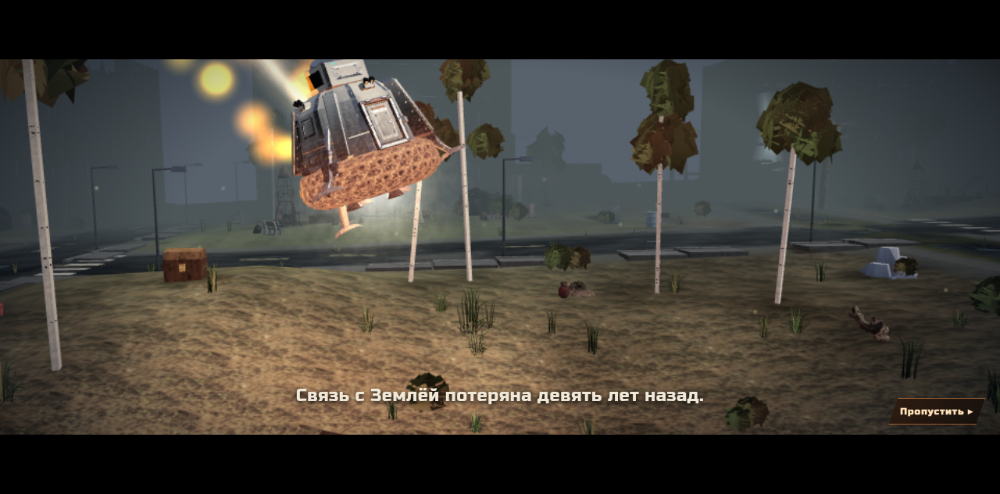

<div align="center">

# ТЕРРА — Россия, 2136

**Вернись. Выживи. Собери своих.**

[](https://ckupkakhv-droid.github.io/terra-2136/play/)
[](https://github.com/ckupkakhv-droid/terra-2136/releases/latest)




[**Играть в браузере**](https://ckupkakhv-droid.github.io/terra-2136/play/) · [Сайт игры](https://ckupkakhv-droid.github.io/terra-2136/) · [Офлайн-версия](https://github.com/ckupkakhv-droid/terra-2136/releases/latest)

</div>

## Об игре

Земля молчит девять лет. Экспедиция «Арес-7» возвращается с Марса, а капсула «ТЕРРА-1» падает среди заросших руин. Города опустели, лес забрал улицы, в метро кто-то до сих пор ждёт поезд. Найди припасы, встреть выживших и построй место, куда можно вернуться, а заодно выясни, почему на Земле тебя ждали совсем не так, как ты думал.

**ТЕРРА** — 3D-сурвайвал с видом сверху, который запускается прямо в браузере на ПК и смартфоне. Без установки, без регистрации, бесплатно.

## Что есть в игре

- **Открытый мир.** Пять поясов опасности (☠ → ☠☠☠☠☠): чем дальше от капсулы, тем жёстче. Радиация, споры, огонь, тьма, затопленные тоннели.
- **Подземелья и метро.** Станции, тайники, запертые комнаты. Метро, вышки и лагеря открывают быстрые перемещения.
- **Бой и снаряжение.** Ближний бой, огнестрел, метательное оружие. Шесть уровней редкости, свитки заточки, крафт.
- **Развитие.** Навыки (стрельба, сбор, стройка, крафт, переноска, разведка, медицина), таланты и ранги от «Новичка» до «Мастера вылазок».
- **Поселение.** Выжившие с профессиями и характерами, мораль, ферма, лаборатория, кухня. Отправляй людей на задания: сопровождение, охоту за головами, спасение.
- **Набеги и торговля.** Контракты на блокпосты, караваны торговцев, задание дня.
- **Боссы открытого мира.** Чернобор (Грибной Колосс), Кукловод, Объект-7 «Молох», Костяная Царица, Бледный Скиталец, Машинист Кольцевой.
- **Сюжет в деталях.** Десятки записок, журналов и пропусков, из которых складывается история «Арес-7».
- **Кооператив (прототип).** Пригласи друга через меню «Связь». В коопе подземелья и метро пока закрыты.
- **Надёжные сохранения.** Резервные копии, экспорт и импорт сейва в JSON, защита от записи из двух вкладок.

## Новое в этой сборке (v0.3)

- **Класс «Полевой техник».** Бесплатный выбор без сброса навыков: дрон поддержки, второй дрон и турель, питаются энергоячейками.
- **Новые боссы:** Бледный Скиталец и Машинист Кольцевой.
- **Профиль сохранения v3.** ⚠️ После выбора класса сейв переходит на формат v3, и **старые сборки его больше не откроют**. Перед переходом игра сама делает локальную копию; её можно экспортировать из главного меню.

Полный список изменений смотри в [CHANGELOG.md](CHANGELOG.md).

## Управление

**ПК:** `WASD` движение · мышь прицел · `ЛКМ` атака · `Shift` бег · `E` действие · `R` перезарядка · `G` бросок · `T` выбор броска · `Q` / `1–4` оружие · `Tab` / `I` рюкзак · `K` навыки · `M` карта · `Esc` пауза

**Смартфон (портрет и ландшафт):** левый стик — движение; правый стик — прицел и атака с автодоводкой; отдельные кнопки для действия, перезарядки, броска, оружия, бега, рюкзака и карты.

## Как запустить

**В браузере:** открой [игру](https://ckupkakhv-droid.github.io/terra-2136/play/). Лучше всего работает в свежем Chrome или Edge. Игра весит около 47 МБ, первая загрузка на мобильном интернете может занять время.

**Офлайн:** скачай `terra.html` из [последнего релиза](https://github.com/ckupkakhv-droid/terra-2136/releases/latest) и открой в Chrome. Для кооператива нужно подключение.

**Локально из репозитория:**

```sh
git clone https://github.com/ckupkakhv-droid/terra-2136.git
cd terra-2136
python3 -m http.server 8080
# открой http://localhost:8080/ (сайт) или http://localhost:8080/play/ (игра)
```

Сборка не нужна: основной игровой бандл и ассеты встроены в HTML. Дополнения интерфейса загружаются из `play/ui/`; для текущей версии из репозитория сохраняйте эту папку рядом с HTML и запускайте локальный сервер. Один скачанный `play/index.html` не включает эти дополнения. Отдельный офлайн-файл из ранее опубликованного релиза остаётся самостоятельной сборкой.

## Технологии

- **Three.js r160** (WebGL) — рендер, встроен в сборку
- **fflate** — распаковка встроенных моделей и текстур
- **PeerJS** (WebRTC) — кооператив
- Ванильный JavaScript, сборка в один HTML-файл, сохранения в хранилище браузера
- Устанавливается как веб-приложение (PWA-манифест), полноэкранный режим на мобильных

## Структура репозитория

```
index.html          — сайт игры (лёгкая витрина)
play/index.html     — игровой бандл со встроенными ассетами
play/ui/            — стили и поведение интерфейса лагеря
assets/             — кадры для сайта и README
CHANGELOG.md        — история изменений
.github/ISSUE_TEMPLATE — шаблоны для ошибок и идей
```

## Планы

Это ориентиры, а не обещания. Сроки и состав могут меняться.

- [ ] Стабильный кооператив, включая подземелья и метро
- [ ] Новые классы персонажа
- [ ] Новые районы и продолжение сюжета «Арес-7»
- [ ] Уменьшение размера сборки и ускорение первой загрузки
- [ ] Оптимизация для слабых смартфонов
- [ ] Баланс экономики лагеря и снаряжения

## Команда

ТЕРРУ делает небольшая независимая команда «Терры»:

- **Геймдизайн и сценарий** — мир, сюжет, баланс, записки
- **Программирование** — движок на Three.js, ИИ, сохранения, сеть
- **Арт и 3D** — персонажи, окружение, интерфейс
- **Звук** — эмбиент, шаги, эффекты
- **Тестирование и сообщество** — сборки, отзывы игроков

## Обратная связь

- 🐞 [Сообщить об ошибке](https://github.com/ckupkakhv-droid/terra-2136/issues/new?template=bug.yml) — что делал, что ожидал, устройство и браузер
- 💡 [Предложить идею](https://github.com/ckupkakhv-droid/terra-2136/issues/new?template=idea.yml) — механика, лагерь, район, противник, управление

## Авторы и лицензии

Персонажи и игра — команда «Терры». В игре используются материалы сторонних авторов; права на них принадлежат авторам, условия — по их лицензиям:

- [Kenney](https://kenney.nl) — CC0
  - Оборона лагеря: ящик подносчика `box` из [Survival Kit 2.0](https://kenney.nl/assets/survival-kit) — Kenney, CC0 1.0, `play/assets/defense/ammo-crate.glb`.
- [OpenGameArt](https://opengameart.org) — CC0
- [game-icons.net](https://game-icons.net) — CC BY 3.0
- [Quaternius](https://quaternius.com) ([itch.io](https://quaternius.itch.io))
  - Оборона лагеря: модели турелей из [Turret Pack (March 2020)](https://opengameart.org/content/lowpoly-steampunk-turrets) — Quaternius, CC0 1.0. Gun_8 → «Спарка ПКМ», Gun_3 → «Гвоздомёт», Long_1 → «Огнемёт «Пропан»»; перекрашены и сжаты, `play/assets/defense/`.
- [Mixamo](https://www.mixamo.com) — анимации
- [Poly Haven](https://polyhaven.com), [ambientCG](https://ambientcg.com) — текстуры (CC0)
- [Sketchfab](https://sketchfab.com), [Fab](https://www.fab.com), [Meshy](https://www.meshy.ai)
- Авторы на itch.io: [atomicrealm](https://atomicrealm.itch.io), [cebisathecreator](https://cebisathecreator.itch.io), [gbstwo](https://gbstwo.itch.io), [grigory-petrov](https://grigory-petrov.itch.io), [retrostylegames](https://retrostylegames.itch.io), [tako4short](https://tako4short.itch.io)
- Модели ориентиров (`play/assets/art/landmarks.glb`) — собственная процедурная геометрия команды (`tools/art/`), текстуры — уже встроенные ambientCG (CC0)
- Шрифт [DejaVu](https://dejavu-fonts.github.io)
- Библиотеки: [three.js](https://threejs.org) (MIT), [fflate](https://github.com/101arrowz/fflate) (MIT), [PeerJS](https://peerjs.com) (MIT)

Полный список с указанием конкретных материалов доступен в игре: главное меню → «авторы».

Код и оригинальные материалы игры: **© 2026 Команда «Терры». Все права защищены.** См. [LICENSE](LICENSE).

---

> **Ранний доступ.** ТЕРРА в активной разработке. Наличие функции не значит, что её баланс, графика и стабильность окончательные. Спасибо, что играете и пишете нам!

## Проверка обороны лагеря

При запущенном сервере: `python3 tests/defense-turrets.py`. Тест делает «старое» сохранение с турелью без новых полей (на сборке из `TERRA_BASELINE_URL`, если она на том же адресе, иначе на текущей), загружает его, ставит Гвоздомёт и Огнемёт, назначает двух подносчиков (одного кнопкой во вкладке «Оборона»), ждёт доставку со склада, проверяет стрельбу, подписи видов в полосках прочности, возврат при сносе (своя цена вида и улучшений), блок `camp.defense` из более новой версии, сохранение/загрузку и нагрузку 18 турелей + 30 врагов. Скриншоты — в `TERRA_QA_OUTPUT` (по умолчанию `/tmp/terra-defense-qa`). Код — `play/ui/defense.js`, обвязка бандла — одноразовый `scripts/apply-defense-hook.py` (уже применён; правки ищет по якорям, повторный запуск ничего не меняет), модели — `play/assets/defense/`.

## Проверка интерфейса лагеря

При запущенном локальном сервере на порту 8080: `python3 tests/camp-navigation.py`. Проверке нужны Python Playwright и Chromium/Chrome (они уже есть в подготовленной облачной среде). Путь к браузеру можно задать через `TERRA_CHROMIUM`; иначе тест ищет `chromium` или `google-chrome` в PATH. Для другого адреса игры задайте `TERRA_TEST_URL`. Она создаёт чистый профиль и двух тестовых жителей через игровой API, проверяет поиск, переходы, клавиатуру и три размера экрана. Скриншоты сохраняются в `/tmp/terra-camp-navigation-qa`. Это не проверка на физическом телефоне.

`python3 tests/camp-mobile.py` проверяет мобильный каркас лагеря (`play/ui/camp-mobile.*`, подключается из `camp-navigation.js`) в 390×844, 844×390, 360×740, 667×375 и 1280×800: цели касания не меньше 48 px, вкладки без обрезки и наложений, нижняя панель в портрете и рельс в альбоме, отступы safe-area, вкладка «Оборона» и точки встраивания `window.terraCampUI` для разделов-дополнений. Скриншоты — в `/tmp/terra-camp-mobile-qa`.

`play/ui/` редактируется напрямую, сборщик не требуется. `scripts/apply-camp-navigation.py` документирует замену текста и подключение файлов к точной исходной версии HTML; повторное применение или другая исходная версия отклоняются. При переносе новой версии в архив нужно включать весь каталог `play/`.

`python3 tests/camp-jobs.py` проверяет карточку жителя в сенсорной эмуляции: видимые причины недоступности работ, закреплённый возврат к списку, переходы к очереди работ/складам/энергоснабжению, отсутствие изменения состояния при навигации и штатные приказы отдыха/возврата к автоматической работе. Физический телефон и полный экспорт/импорт сохранения этим тестом не проверяются.

`python3 tests/field-hud.py` проверяет HUD в чистых профилях: настольный браузер и сенсорная эмуляция, отсутствие наложения цели на здоровье/кнопки/миникарту/сенсорное управление (в том числе 667×375 и 568×320), раскрытие подсказки без включения джойстика или атаки, управление картой/паузой/навыками с клавиатуры. Используются те же `TERRA_CHROMIUM`, `TERRA_TEST_URL` и `TERRA_QA_OUTPUT`. Скриншоты по умолчанию сохраняются в `/tmp/terra-field-hud-qa`.
