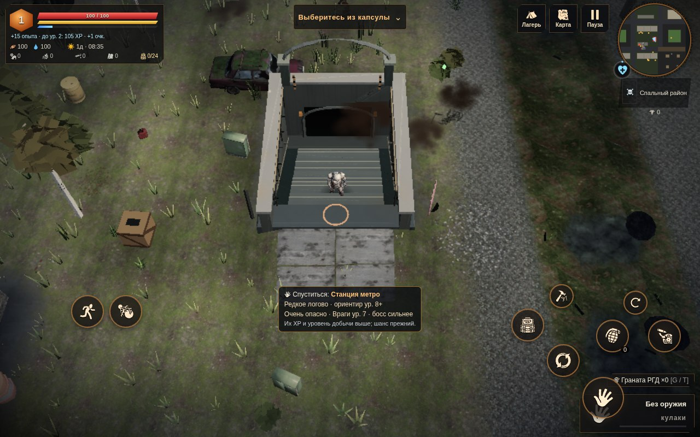
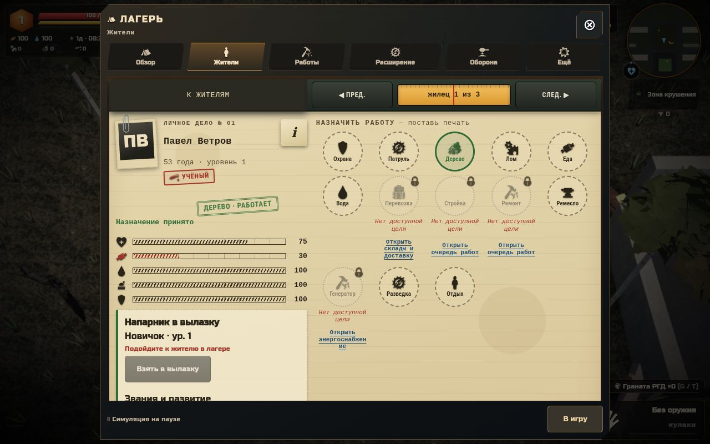
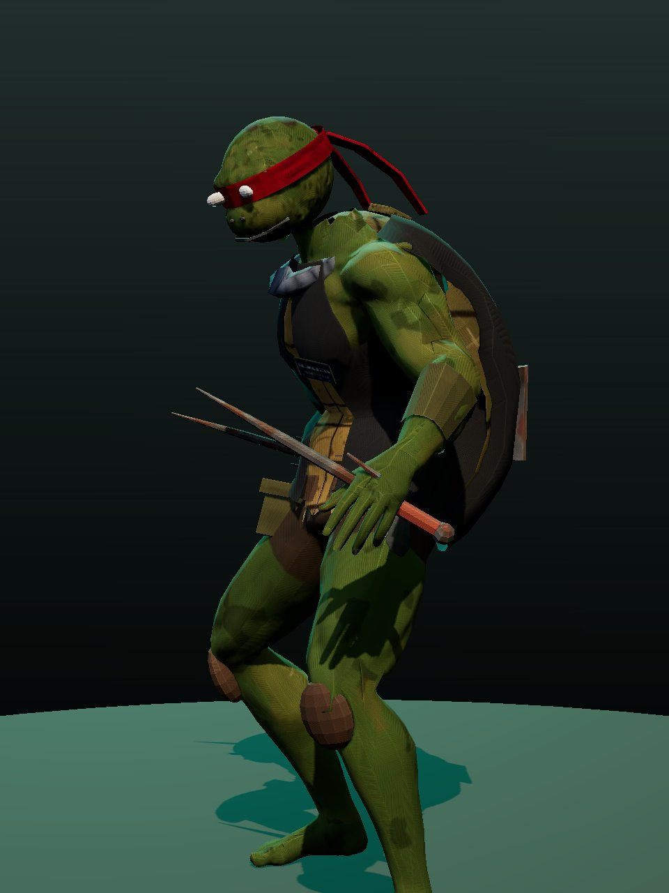

<div align="center">

# ТЕРРА · Россия, 2136

### Вернись. Выживи. Собери своих.

**3D-сурвайвал · RPG · стратегия поселения**

[**▶ ИГРАТЬ В БРАУЗЕРЕ**](https://ckupkakhv-droid.github.io/terra-2136/play/) · [**↓ ОФЛАЙН-ВЕРСИЯ**](https://github.com/ckupkakhv-droid/terra-2136/releases/latest) · [**САЙТ ИГРЫ**](https://ckupkakhv-droid.github.io/terra-2136/)


**ПК и смартфон · Без установки и регистрации · Ранний доступ**

</div>

---

Земля молчит девять лет. Экспедиция «Арес-7» возвращается с Марса, а капсула «ТЕРРА-1» падает среди заросших руин России. Лес забрал улицы, под землёй остались чужие следы, а люди всё ещё ищут место, куда можно вернуться.

**ТЕРРА** соединяет вылазки за припасами, развитие персонажа и управление поселением. Исследуй мир с видом сверху, выбирай снаряжение, назначай выжившим работу и готовь периметр к следующей атаке.

[Сюжетный трейлер](assets/media/terra_trailer1.mp4) · [Трейлер игры](assets/media/terra_trailer2.mp4) · [Что изменилось](CHANGELOG.md) · [Выпуск 0.4.32](https://github.com/ckupkakhv-droid/terra-2136/releases/tag/v0.4.32) · [Сообщить об ошибке](https://github.com/ckupkakhv-droid/terra-2136/issues/new?template=bug.yml)

## Три стороны одной экспедиции

| Исследуй | Собери своих | Вернись с добычей |
| --- | --- | --- |
| Заросшие районы России, пять поясов опасности, метро и подземелья. Радиация, споры, огонь и затопленные проходы. | Жители с профессиями, навыками и состоянием. Работы, хозяйство, строительство и снабжение обороны. | Ближний бой, огнестрел, метательное оружие. Редкое снаряжение, крафт, заточка, навыки, таланты и ранги. |

## Обновления линии 0.4

**Полевой скафандр.** Герой остаётся видимым, даже если основная модель не загрузилась. Временный блочный силуэт заменён округлым скафандром с визором, перчатками и ботинками. [Кадры и проверка](docs/art/hero-fallback-0432/README.md).

**Тень за границей.** Контактная тень дома продолжается на соседнем участке земли: светлая полоса на проверенных стыках исчезла. Загрузка и выгрузка районов сохраняют согласованное затемнение. [Кадры и проверка](docs/art/shared-contact-0431/README.md).

**Плавный свет.** Освещение у площадок зданий и водоёмов плавно согласуется на границах районов. На проверенных стыках исчезли случайные полосы другого покрытия; форма земли и построек прежняя. [Кадры и проверка](docs/art/terrain-light-0430/README.md).

**След на обочине.** Местные тропы плавно растворяются в грунте у дороги, без прямого обрыва рисунка по границе района. Вместе со следом затухает его влажный блеск. [Кадры и проверка](docs/art/paths-0429/README.md).

**Тень у основания.** Исправлены светлые пропуски в контактном затемнении у стен и предметов. Окружение выглядит плотнее связанным с землёй, физика и сила тени прежние. [Кадры и проверка](docs/art/contact-0428/README.md).

**Каменная поверхность.** Фактура плавно обтекает валуны, переходы рисунка и освещения между гранями стали мягче. Контуры и коллизии сохранены, новых текстур не добавлено. [Кадры и контрольный тест](docs/art/stone-surface-0427/README.md).

**Цельный камень.** Два повреждённых валуна получили цельную поверхность без треугольных щелей. Формы смягчены, число треугольников уменьшено; расстановка, коллизии и каменная фактура прежние. [Кадры до и после](docs/art/rocks-0426/README.md).

**Припасы на полках.** Вместо цветных кубов — банки, бутылки и упаковки с выцветшими этикетками. Металлический каркас и расположение припасов прежние, поиск добычи работает как раньше. [Кадры до и после](docs/art/shelves-0425/README.md).

**Герой в кадре.** Готовая модель героя подключается перед игровым кадром, пока остальные персонажи ещё загружаются. При быстром пропуске вступления больше не нужно ждать всего набора, чтобы увидеть героя.

**Цельный лес.** Восемнадцать вариантов лиственных деревьев, сосен и сухостоя получили цельные стволы и ветви со скошенными рёбрами. Основания совпадают с центром прежних коллизий, кроны учитывают радиус скрытия при рубке. Число треугольников не выросло, архив окружения стал меньше.

**Лесная крона.** Крупные пластины листвы получили отдельные силуэты листьев и хвойных побегов. Листья видны с обеих сторон, в том числе при падении дерева; маска действует и в тенях.

**Камень и дерево.** Исправлено смещение фактур после добавления моделей окружения. Старые белёсые камни получили приглушённый гранитный оттенок, следы мха и существующую каменную фактуру.

**Обжитые руины.** Диваны получили мягкие подушки, подлокотники, каркас и заплаты; шкафы — отдельные панели дверей, ручки и петли. Исправлены щели в боковых гранях процедурных предметов.

**Детали мира.** Разрушаемые ящики, сундуки и инструментальные коробки получили доски, крепления, петли и замки. Базовые покрытия соседних районов плавно смешиваются у границ, убирая прямые цветовые швы.

**Настоящий спуск в метро.** Открытая шахта, шестнадцать ступеней на 2,4 метра вниз, перила и тусклый свет нижнего портала. Персонаж спускается по лестнице; вход в подземелье доступен и на нижней площадке.



**Южный коллектор.** Дополнительный подземный слой: семь соединённых секторов, два насоса, затопление, сухие обходы и обратная лестница. Собственная схема показывает исследованные камеры и местные цели.

**Рафаэль — последний из клана.** Отдельная модель с панцирем, красной повязкой, ватником и саями; постановочная встреча, предупреждения перед атаками и уникальная награда. Рядом обитают крысы. Окружение лаборатории «Объект 7 · НИИ „Полынь“» продолжает след Ambrala.

**Штабной стол.** Личные дела жителей, назначения и чертежи построек. Мобильный интерфейс поддерживает обе ориентации; поиск и фильтры помогают найти нужного человека.

**Оборона лагеря.** Спарка ПКМ, гвоздомёт и огнемёт «Пропан», магазины, приоритеты и подносчики боеприпасов. Приказы учитывают результат записи сохранения.

**Московский перехват.** После коллектора и «Тихого перехода» на Радиопосте Ноль открывается новый след и локальная встреча с роботом-разведчиком. Полноценный московский регион и нарастание роботизации по маршруту ещё в разработке.

<table>
<tr>
<td width="50%"><br><b>Штабной стол.</b> Кадр интерфейса лагеря.</td>
<td width="50%"><br><b>Последний из клана.</b> Превью модели Рафаэля.</td>
</tr>
</table>

Полные правила подземного участка и границы реализации — в [досье канализации](docs/SEWERS_RU.md). История всех выпусков — в [CHANGELOG](CHANGELOG.md).

## Что ещё есть в игре

- Класс **«Полевой техник»**: дроны поддержки и турель на энергоячейках.
- Боссы открытого мира: Чернобор, Кукловод, Объект-7 «Молох», Костяная Царица, Бледный Скиталец и Машинист Кольцевой.
- Контракты, блокпосты, торговые караваны, спасение и сопровождение выживших.
- Сюжетные записки и журналы о возвращении «Арес-7».
- Прототип кооператива через меню **«Связь»**. Подземелья и метро пока доступны только в одиночной игре.
- Сохранения в браузере, резервные копии, экспорт и импорт JSON, защита от записи из двух вкладок.

## Начать играть

| Способ | Что делать |
| --- | --- |
| **В браузере** | Открыть [игру](https://ckupkakhv-droid.github.io/terra-2136/play/) в свежем Chrome или Edge с WebGL. Первая загрузка — десятки мегабайт. На слабом устройстве выбрать низкое качество. |
| **Без интернета** | Скачать `terra.html` из [последнего релиза](https://github.com/ckupkakhv-droid/terra-2136/releases/latest) и открыть в Chrome. Для кооператива нужен интернет. |
| **Из репозитория** | Запустить локальный HTTP-сервер, как показано ниже. Сохранять весь каталог `play/`, включая внешние модули и ассеты. |

```sh
git clone https://github.com/ckupkakhv-droid/terra-2136.git
cd terra-2136
python3 -m http.server 8080
```

[http://localhost:8080/](http://localhost:8080/) — витрина · [http://localhost:8080/play/](http://localhost:8080/play/) — игра.

Для запуска готовой игры сборщик не нужен. `play/index.html` содержит основной бандл, но дополнения из `play/ui/`, `play/art/` и модели из `play/assets/` загружаются отдельно. **Один скачанный `play/index.html` не заменяет офлайн-релиз.**

### Управление

**ПК:** `WASD` — движение · мышь — прицел · `ЛКМ` — атака · `Shift` — бег · `E` — действие · `R` — перезарядка · `G` — бросок · `T` — выбор броска · `Q` / `1–4` — оружие · `Tab` / `I` — рюкзак · `K` — навыки · `M` — карта · `Esc` — пауза.

**Смартфон:** левый стик — движение; правый — прицел и атака с автодоводкой. Отдельные кнопки действия, перезарядки, броска, оружия, бега, рюкзака и карты. Портретная и альбомная ориентации.

### Сохранения

Прогресс хранится локально в браузере. **Перед обновлением, сменой браузера или устройства экспортируй JSON через меню игры.** Офлайн-файл и сайт могут использовать разные хранилища: для переноса нужен экспорт/импорт.

Текущий формат — **profile v3**. Парные саи записываются как катана с необязательной меткой `hold`: старая сборка открывает такой профиль и оставляет предмет в инвентаре, но считает его катаной. Файл, где тип так и остался `sewer_sai`, старая сборка не открывает и не перезаписывает. Подробности — в `docs/SEWERS_RU.md`.

## Разработка и выпуск

```
index.html                 — лёгкая витрина; игровой бандл не загружается
play/index.html            — основной игровой бандл
play/assets/boot.js        — асинхронная загрузка и проверка архива до старта
play/assets/pack/          — модели, текстуры и звук отдельными пакетами
scripts/assets_boot.py    — обновление версий загрузчика и описи в HTML
play/ui/                   — лагерь, оборона, канализация и HUD
play/art/                  — загрузчики и подключение арт-слоёв
play/assets/               — внешние модели и их лицензии
scripts/build-offline.py   — сборка самостоятельного terra.html
tests/                     — целевые браузерные и компонентные проверки
docs/                      — досье систем, арт-контракты и снимки
CHANGELOG.md               — история изменений
```

**Стек:** Three.js r160 / WebGL, ванильный JavaScript, fflate, PeerJS / WebRTC. Основные библиотеки встроены в игровую сборку. Дополнения редактируются напрямую; полная пересборка исходного бандла для них не нужна.

HTML закрепляет SHA256 описи архива; URL загрузчика и групп содержат хеш содержимого. После изменения `assets/boot.js` или описи выполните `python3 scripts/assets_boot.py`. Игра запускается после проверки всех групп и регистрации снаряжения, поэтому неполный или смешанный кэш не открывает сохранение с пустыми ассетами. В одиночном `terra.html` проверяются встроенные байты; сеть для архива не нужна.

### Собрать офлайн-файл

```sh
python3 scripts/build-offline.py
```

Результат — `terra.html` в корне репозитория со встроенными дополнениями и ресурсами. Проверить размер и запуск самостоятельного файла; **не коммитить его**, прикреплять к GitHub Release. Для сайта GitHub Pages публикуется содержимое `main` с полным каталогом `play/`.

Изменения идут через PR. Краткие правила — [AGENTS.md](AGENTS.md), координация — [Issue #2](https://github.com/ckupkakhv-droid/terra-2136/issues/2). Ведущую интеграцию и публикацию по поручению владельца теперь ведёт Codex / dot; история вклада Grok, art, UI и defense сохраняется в PR.

## Дальше по маршруту

Это направления работы, а не обещания сроков:

- [ ] Продолжение московского маршрута и новые районы.
- [ ] Дальнейшая постановка встреч и развитие подземных локаций.
- [ ] Стабильный кооператив с подземельями.
- [ ] «Живой лагерь»: взаимодействие с постройками прямо в 3D-сцене.
- [ ] Уменьшение размера сборки и оптимизация для слабых смартфонов.
- [ ] Баланс экономики, снаряжения и обороны.

## Сделаем ТЕРРУ лучше

[Сообщить об ошибке](https://github.com/ckupkakhv-droid/terra-2136/issues/new?template=bug.yml) · [Предложить идею](https://github.com/ckupkakhv-droid/terra-2136/issues/new?template=idea.yml)

Для ошибки укажи устройство, браузер, версию игры и действия перед проблемой. Команда «Терры» работает над миром, кодом, графикой и звуком вместе с владельцем проекта и сообществом.

## Авторы и лицензии

Персонажи и игра — команда «Терры». В игре используются материалы сторонних авторов; права на них принадлежат авторам, условия — по их лицензиям:

- [Kenney](https://kenney.nl) — CC0
  - Оборона лагеря: ящик подносчика `box` из [Survival Kit 2.0](https://kenney.nl/assets/survival-kit) — Kenney, CC0 1.0, `play/assets/defense/ammo-crate.glb`.
- [OpenGameArt](https://opengameart.org) — CC0
- [game-icons.net](https://game-icons.net) — CC BY 3.0
- [Quaternius](https://quaternius.com) ([itch.io](https://quaternius.itch.io)) — модели и анимации CC0 (мутант коллекторов, см. ниже). Цельные деревья линии 0.4.23: LowPoly Nature Pack, CC0 1.0; [источники, лицензия и обработка](tools/art/nature/README.md). Два валуна линии 0.4.26 — из того же набора; [полные исходники, лицензия и обработка](tools/art/rocks/README.md). Применены упрощение с сохранением замкнутой поверхности, фаски и подгонка к игровым габаритам.
- [Mixamo](https://www.mixamo.com) — анимации
- [Poly Haven](https://polyhaven.com), [ambientCG](https://ambientcg.com) — текстуры (CC0)
- [Sketchfab](https://sketchfab.com), [Fab](https://www.fab.com), [Meshy](https://www.meshy.ai)
- Авторы на itch.io: [atomicrealm](https://atomicrealm.itch.io), [cebisathecreator](https://cebisathecreator.itch.io), [gbstwo](https://gbstwo.itch.io), [grigory-petrov](https://grigory-petrov.itch.io), [retrostylegames](https://retrostylegames.itch.io), [tako4short](https://tako4short.itch.io)
- Модели турелей обороны (`play/assets/defense/turrets.glb`) — собственная процедурная геометрия и атлас команды (`tools/art/turret_gen.py`): бочка, тренога, мешки, покрышки, трубы, баллоны, заплатки и трафареты. Надписи — шрифт DejaVu. Ящик подносчика по-прежнему Kenney, CC0.
- Модели оружия и инструментов в руках героя (`play/assets/art/held.glb`) — собственная процедурная геометрия команды (`tools/art/weapons_gen.py`)
- Мелкие контейнеры и мебель (`play/art/salvage-props.js`) — собственная процедурная геометрия команды; используются существующие материалы и пакеты отрисовки.
- Модели ориентиров (`play/assets/art/landmarks.glb`) — собственная процедурная геометрия команды (`tools/art/`), текстуры — уже встроенные ambientCG (CC0)
- Мутант коллекторов «Рафаэль» (`play/assets/sewer/mutant.glb`): тело, риг и анимации — [Quaternius](https://quaternius.com) Universal Base Characters и Universal Animation Library 1 (CC0 1.0); голова, панцирь, одежда, саи, текстуры, клипы scream/emerge — собственные (`tools/art/sewer_mutant/`). Подробно: `play/assets/sewer/CREDITS.md`
- Набор лаборатории «Объект 7 · НИИ „Полынь“» (`play/assets/sewer/lab/lab_kit.glb`): собственная процедурная геометрия, текстуры и логотип Ambrala (`tools/art/sewer_lab/`); надписи RU/CN набраны шрифтом [Noto Sans CJK SC](https://github.com/notofonts/noto-cjk) (SIL OFL 1.1). Подробно: `play/assets/sewer/CREDITS.md`
- Шрифт [DejaVu](https://dejavu-fonts.github.io)
- Библиотеки: [three.js](https://threejs.org) (MIT), [fflate](https://github.com/101arrowz/fflate) (MIT), [PeerJS](https://peerjs.com) (MIT)

Полный список с указанием конкретных материалов доступен в игре: главное меню → «авторы».

Код и оригинальные материалы игры: **© 2026 Команда «Терры». Все права защищены.** См. [LICENSE](LICENSE).


---

> **Ранний доступ.** Наличие механики не означает, что её баланс, графика и стабильность окончательные. Спасибо за вылазки и обратную связь.

<details>
<summary><strong>Технические проверки и сценарии QA</strong></summary>

## Проверка обороны лагеря

При запущенном сервере: `python3 tests/defense-turrets.py`. Тест делает «старое» сохранение с турелью без новых полей (на сборке из `TERRA_BASELINE_URL`, если она на том же адресе, иначе на текущей), загружает его, ставит Гвоздомёт и Огнемёт, назначает двух подносчиков (одного кнопкой во вкладке «Оборона»), ждёт доставку со склада, проверяет стрельбу, подписи видов в полосках прочности, возврат при сносе (своя цена вида и улучшений), блок `camp.defense` из более новой версии, сохранение/загрузку и нагрузку 18 турелей + 30 врагов. Скриншоты — в `TERRA_QA_OUTPUT` (по умолчанию `/tmp/terra-defense-qa`). Код — `play/ui/defense.js`, обвязка бандла — одноразовый `scripts/apply-defense-hook.py` (уже применён; правки ищет по якорям, повторный запуск ничего не меняет), модели — `play/assets/defense/turrets.glb` (генератор `tools/art/turret_gen.py`).

`python3 tests/defense-cache.py` подменяет постройку в том же массиве `base` (длина не меняется): другой вид турели, перенос, вышка вместо стены и обратно. Кеш стволов и бонус башни должны догнать состав без `baseDirty`.

`python3 tests/turret-perf.py` гоняет ночной рейд на 60 врагов при 0, 6 и 18 турелях: окно 390×844, сенсорный ввод, SwiftShader и обычный ANGLE, замедление CPU 4× и 6×. Считает время кадра, время `loop` и `moduleUpdate`, вызовы отрисовки и треугольники. Качество зафиксировано на «Среднем». Игра сама режет pixel ratio телефона примерно до 1.1 — это строка `natural`; строки `forced` ставят 2 и 3, как у экрана. Цифры с этой машины и как снять замер с телефона через удалённую отладку — в [tests/turret-perf-results.md](tests/turret-perf-results.md). Это не замер настоящего телефона.

`python3 tests/defense-save.py` проверяет защищённую запись приказов `window.terraDefense`: для каждого приказа (`upgrade`, `repair`, `reload`, `assign`, `setPriority`, `deposit`) подменяет `localStorage.setItem` на QuotaExceededError и ждёт `{ok:false, reason:'save-failed'}` без изменения рюкзака, склада, турелей и сейва, затем повтор и холодную загрузку новой страницы с тем же localStorage; отдельно — отказ всех записей, доставку подносчиком при отказе записи (ни потери, ни дубля) и сообщение во вкладке «Оборона». Скриншоты — в `TERRA_QA_OUTPUT` (по умолчанию `/tmp/terra-defense-save-qa`).

## Проверка интерфейса лагеря

При запущенном локальном сервере на порту 8080: `python3 tests/camp-navigation.py`. Проверке нужны Python Playwright и Chromium/Chrome (они уже есть в подготовленной облачной среде). Путь к браузеру можно задать через `TERRA_CHROMIUM`; иначе тест ищет `chromium` или `google-chrome` в PATH. Для другого адреса игры задайте `TERRA_TEST_URL`. Она создаёт чистый профиль и двух тестовых жителей через игровой API, проверяет поиск, переходы, клавиатуру и три размера экрана. Скриншоты сохраняются в `/tmp/terra-camp-navigation-qa`. Это не проверка на физическом телефоне.

`python3 tests/camp-mobile.py` проверяет мобильный каркас лагеря (`play/ui/camp-mobile.*`, подключается из `camp-navigation.js`) в 390×844, 844×390, 360×740, 667×375 и 1280×800: цели касания не меньше 48 px, вкладки без обрезки и наложений, нижняя панель в портрете и рельс в альбоме, отступы safe-area, вкладка «Оборона» и точки встраивания `window.terraCampUI` для разделов-дополнений. Скриншоты — в `/tmp/terra-camp-mobile-qa`.

`python3 tests/camp-dossier.py` проверяет «Штабной стол» (`play/ui/camp-dossier.*`) в тех же пяти размерах: печать в личном деле меняет работу жителя штатным обработчиком, «i», листание дел, чертежи построек, вкладку «Оборона», цели ≥ 48 px и загрузку сохранения через «Продолжить». Скриншоты — в `/tmp/terra-camp-dossier-qa`.

`python3 tests/camp-live.py` проверяет «Живой лагерь» (`play/ui/camp-live.*`) в 390×844, 844×390 и 1280×800: метки над постройками и жителем, контекстное меню со штатным приказом, чертёж постройки с кнопками «Поставить» и «Отмена», цели ≥ 48 px и то, что просмотр меток не меняет сохранение. `?livecamp=0` выключает модуль для сравнения кадра. Скриншоты — в `/tmp/terra-camp-live-qa`.

`play/ui/` редактируется напрямую, сборщик не требуется. `scripts/apply-camp-navigation.py` документирует замену текста и подключение файлов к точной исходной версии HTML; повторное применение или другая исходная версия отклоняются. При переносе новой версии в архив нужно включать весь каталог `play/`.

`python3 tests/camp-jobs.py` проверяет карточку жителя в сенсорной эмуляции: видимые причины недоступности работ, закреплённый возврат к списку, переходы к очереди работ/складам/энергоснабжению, отсутствие изменения состояния при навигации и штатные приказы отдыха/возврата к автоматической работе. Физический телефон и полный экспорт/импорт сохранения этим тестом не проверяются.

`python3 tests/field-hud.py` проверяет HUD в чистых профилях: настольный браузер и сенсорная эмуляция, отсутствие наложения цели на здоровье/кнопки/миникарту/сенсорное управление (в том числе 667×375 и 568×320), раскрытие подсказки без включения джойстика или атаки, управление картой/паузой/навыками с клавиатуры. Используются те же `TERRA_CHROMIUM`, `TERRA_TEST_URL` и `TERRA_QA_OUTPUT`. Скриншоты по умолчанию сохраняются в `/tmp/terra-field-hud-qa`.

Первый участок канализации и его проверка описаны в [docs/SEWERS_RU.md](docs/SEWERS_RU.md).

Награда и повторная загрузка канализации проверяются `python3 tests/sewer-boss.py` и `node --test tests/sewer-reward.mjs`. Саи — новый тип контента: для открытия сейва с ними нужна поддерживающая сборка; подробности совместимости — в `docs/SEWERS_RU.md`.

</details>

Шрифт витрины Fira Sans Extra Condensed — Mozilla / Carrois, [SIL OFL 1.1](assets/FIRA-OFL.txt). Трейлеры и их кадры сохранены из [прежней витрины команды «Терры»](https://github.com/89244114832maxim-ai/terra-play).
