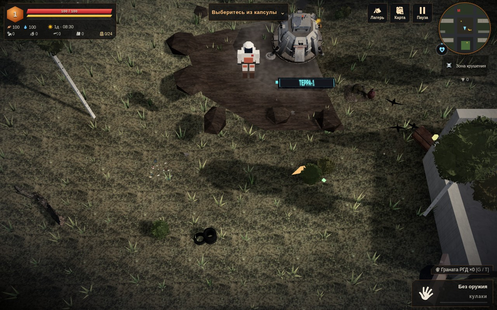
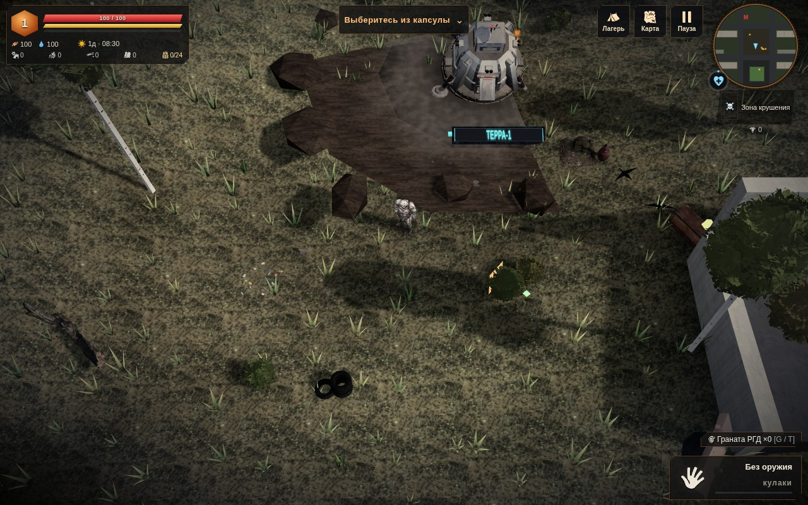

# Герой в кадре · 0.4.24

Собственная модель героя декодировалась первой, но подключалась к сцене только после окончания загрузки всего набора персонажей. При быстром пропуске вступления игрок мог видеть пустое место или резервную фигуру, хотя полноценный герой уже был готов.

| Готовый герой ожидает остальные модели | Готовый герой подключён перед игровым кадром |
| --- | --- |
|  |  |

На обоих кадрах загрузка реального GLB торговца намеренно удерживается тестом. Собственная модель героя готова. В исходном режиме нет экземпляра GLB героя и видны шесть частей резервной сборки; после исправления видна полноценная модель, резервная сборка скрыта. Без вызова ранней позы вступления в отдельной проверке наблюдалось пустое место вместо героя.

## Изменение

`play/art/actor-readiness.js` проверяет готовность героя перед нативным обновлением позы. В активной игре, при готовом собственном ресурсе и отсутствии экземпляра, он вызывает нативное подключение в режиме `heroOnly`. Этот путь не обходит экземпляры других персонажей. Обычное завершение загрузчика сохраняет прежний полный проход.

Ранний путь не работает во время вступления и перехода между уровнями. Если экземпляр уже существует, его видимость и принадлежность сцене сохраняются. В частности, скрытая модель не включается повторно. Новых моделей, текстур, загрузчиков или полей сохранения нет.

`scripts/apply-actor-readiness.py` добавляет необязательный вызов в начале `heroPose`, флаг `heroOnly` в `refreshModelMode` и ссылку на читаемый скрипт. По умолчанию `refreshModelMode` выполняет прежнее действие; короткий путь включается только явным `true`. Адаптер проверен на точное воспроизведение из 0.4.23 и повторное применение.

## Проверка

`tests/actor-readiness.py` запускает три управляемых сценария: прежнее поведение, раннее подключение с успешной поздней загрузкой и раннее подключение с ошибкой поздней загрузки. Исходный режим воспроизводится отключением только необязательного помощника; остальной код и данные совпадают.

Проверены:

- Полноценная модель видна после первого игрового обновления позы, пока торговец ещё не загружен. В исходном режиме полноценного экземпляра ещё нет.
- Вступление сохраняет свой режим. Уже скрытый экземпляр не показывается помощником. Проверочный экземпляр инженера из нативного пула сохраняется даже при отсутствии его базового ключа: короткий путь не вызывает чужую очистку.
- Движение, обновление позы и конечная матрица оружия; катана сохраняется и восстанавливается через нативные `save` / `continueGame`. После продолжения герой следует за новым объектом игрока.
- Позднее завершение или ошибка загрузки торговца не создают второго героя. Сохраняются UUID экземпляра и единственный корень в игровой сцене; анимационный микшер продолжает работать.

Сетевая и самостоятельная HTTP-версии прошли Chromium/SwiftShader без неожиданных ошибок JavaScript. Ожидаемая ошибка сети относится только к намеренно прерванному запросу торговца в третьем сценарии. [Исходный режим](before.json) · [Подключение](after.json) · [Ошибка поздней модели](failed-late-model.json). JS/Python parse и diff check пройдены.

Самостоятельный HTML: **38301407 байт**, SHA256 `9f900a11cdfd65dd4ec664582b0aad0b240879bf4c8b5fbb5c38a00b0398134c`. Формат profile v3 прежний. Собственный ресурс героя всё ещё должен завершить загрузку; это изменение убирает ожидание посторонних моделей. Физический телефон и прямое открытие `file://` не проверялись.
