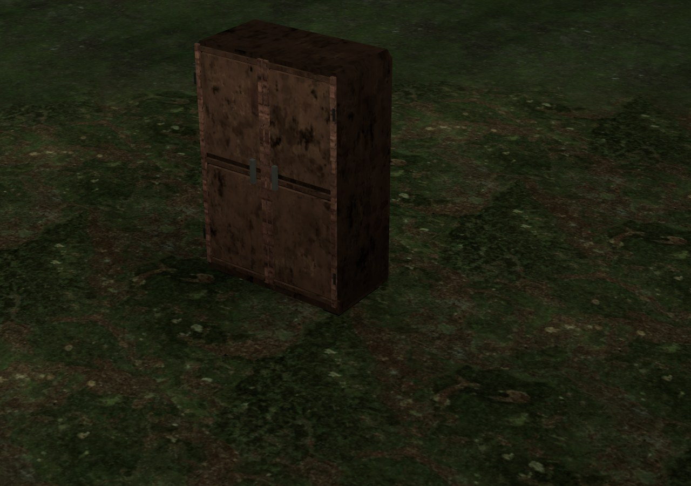
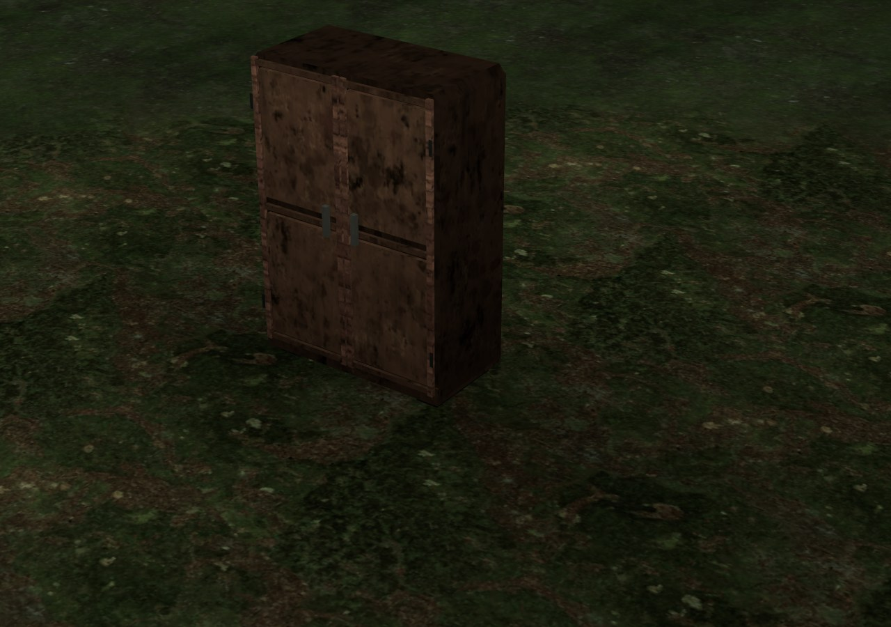

# Тень у основания · 0.4.28

Контактное затемнение грунта рассчитывалось в радиусе 1,6 м от объекта, но временный поисковый индекс учитывал только его габариты. Если край затемнения попадал в соседнюю ячейку, объект там не находился. Часть тени отсутствовала, создавая светлый пропуск у основания.

| Пропуск затемнения | Полный штатный радиус |
| --- | --- |
|  |  |

В кадре — штатная модель шкафа в контрольной сцене. Направленные тени отключены, чтобы показать только контакт с грунтом. Существующие модели и материалы не заменялись.

## Исправление

Четыре границы временного индекса расширены на штатные 1,6 м. Формула, сила и радиус затемнения прежние. Проверка расстояния по-прежнему исключает далёкие объекты; невысокие объекты сохраняют прежнее исключение. Физические коллизии не расширяются.

`scripts/apply-terrain-occlusion.py` воспроизводит правку из опубликованной 0.4.27, проверяет точные якоря индекса и формулы радиуса, допускает повторное применение. Исходники игрового бандла по модулям недоступны; изменение ограничено четырьмя арифметическими выражениями. Новых текстур, материалов, ассетов и полей сохранения нет. Формат profile v3 прежний.

## Проверка

`tests/terrain-occlusion.py` сравнивает опубликованную 0.4.27 с новым кодом. Для самостоятельного режима параметр `TERRA_BASELINE_FILE` указывает на самостоятельный HTML этого выпуска; его SHA256 проверяется перед запуском.

- Восемь контрольных случаев: две позиции мира, включая отрицательные координаты, стена вдоль каждой оси, узкая опора и невысокий объект. Отношение цвета грунта к сцене без объектов сверяется с независимым перебором всех коллизий.
- Максимальная ошибка коэффициента затемнения: **0,4224365 → 7,11×10⁻⁸**. В исходной контрольной вершине был коэффициент **1**, хотя ожидалось **0,5775635**; после исправления получен ожидаемый результат.
- В девяти настоящих районах **2550 выводимых вершин** ранее теряли часть затемнения. Новые цвета совпали с полным эталоном с максимальной ошибкой **1,32×10⁻⁸**. Проверяются исходные образцы треугольников до обрезки проёма метро: эта обработка затем интерполирует дополнительные вершины.
- Итоговые позиции/нормали/смесь покрытий/влажность, сетка высот и геометрия воды совпали. Коллизии, контейнеры, узлы, расстановка и следующие числа генератора прежние. Проверены также геометрия и метаданные контрольных случаев.
- Нативный шкаф и рельеф: **2 вызова / 2010 треугольников** в обоих режимах, без ошибок JavaScript и WebGL. Дождались настоящей готовности PBR-атласа; кадры просмотрены.

Сетевая и самостоятельная HTTP-версии прошли Chromium/SwiftShader. [Исходный отчёт](before.json) · [Новый отчёт](after.json). Точное воспроизведение адаптера, повторное применение, JS/Python parse и diff check пройдены.

Осмотр соседних границ этих районов показал совпадение высот, но локальные различия цвета и смеси покрытий ещё есть. Это отдельный следующий проход; исправление контактного затемнения не объявляется завершением всех швов рельефа. Индекс содержит больше соседних объектов, число вызовов и треугольников прежнее; измерения FPS на физических GPU/телефоне и запуск `file://` отдельно не проводились.

Самостоятельный HTML: **38310040 байт**, SHA256 `d511d43d7aa32310b02da216dfdec6b98868f8ea0622917ff9fd7e6c040ef92f`. Архивы ассетов прежние.
