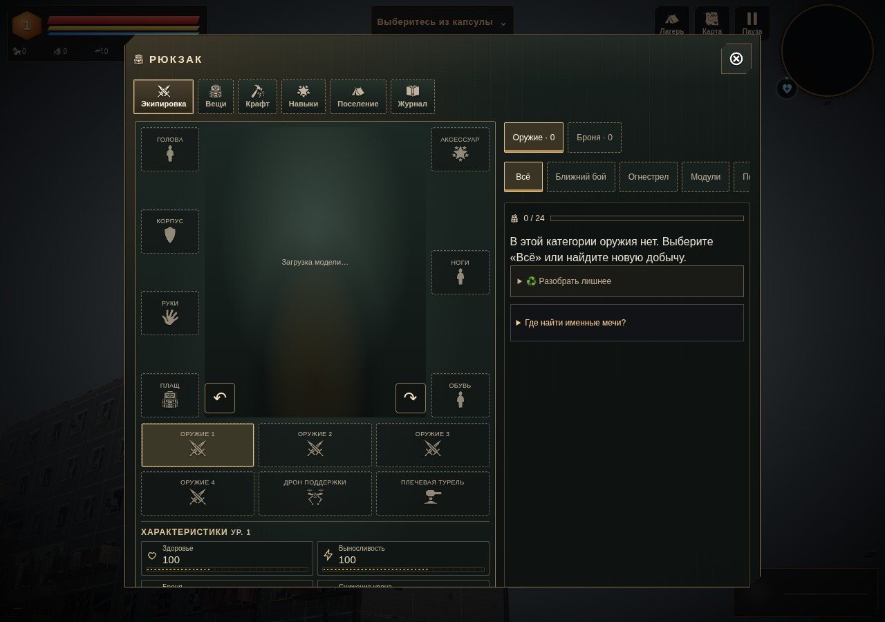
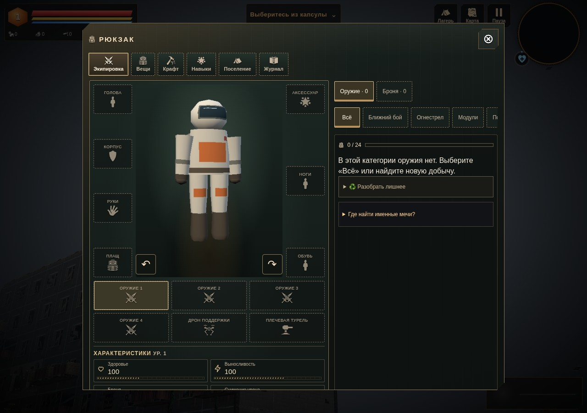
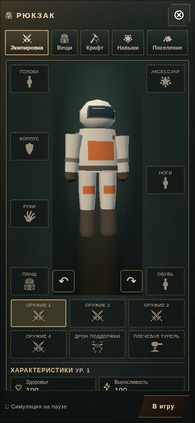
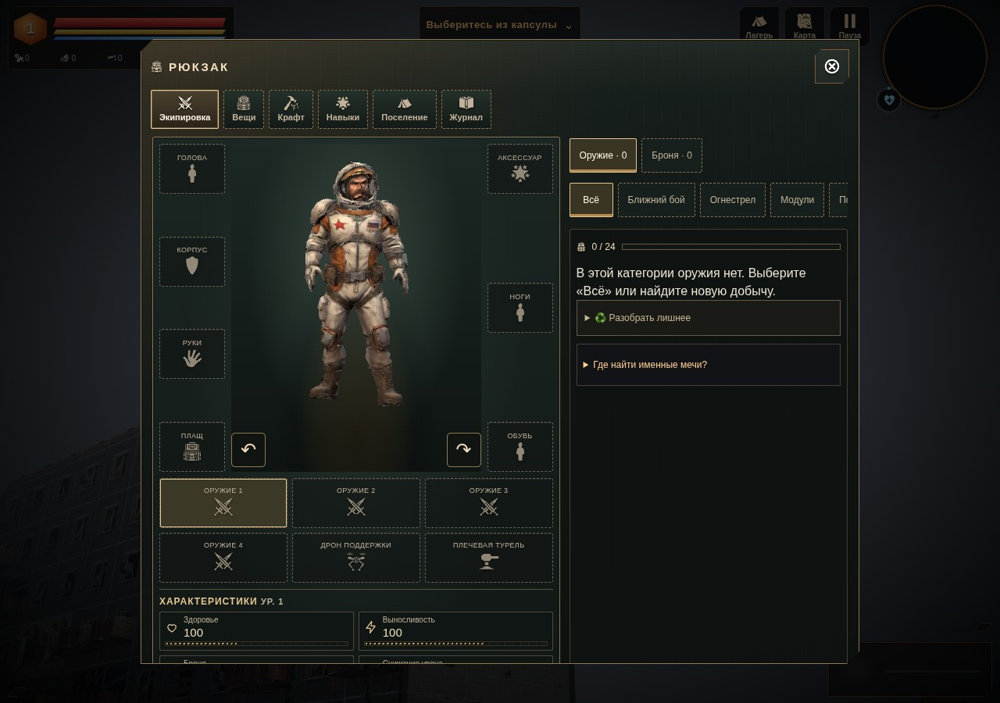

# Предпросмотр экипировки · 0.4.33 «Силуэт в досье»

После отказа собственного файла героя экипировка оставляла пустое окно с надписью «Загрузка модели…». Теперь в нём виден полевой скафандр. Его можно повернуть кнопками или перетаскиванием; поздняя готовая модель появляется без закрытия и повторного открытия меню.

| До: файл героя недоступен | После: тот же отказ |
| --- | --- |
|  |  |





## Владение и работа отрисовки

Предпросмотр получает собственный корень и шесть частей штатного рига, использующих скафандр из 0.4.32. Геометрия и экземпляры мешей принадлежат только окну экипировки. Материал остаётся общим с миром и не удаляется при закрытии окна. Герой в мире не перемещается и не используется вместо фигуры предпросмотра. Кадрирование, целевой буфер и восстановление состояния renderer сохраняют штатный путь.

При готовности **собственного** файла загрузчик уведомляет открытый предпросмотр. Резервная фигура освобождается, затем создаётся обычный экземпляр GLB. Уведомления о чужих моделях не запускают этот переход. Закрытое окно отписано и не создаёт невидимую фигуру при позднем успехе.

У неподвижного скафандра нет периодического опроса или перерисовки. Поворот, изменение размера и готовность модели запрашивают кадр. Готовый GLB сохраняет прежний цикл анимации; уменьшенное движение оставляет неподвижный кадр и поддерживает позднюю загрузку. Подсветка применяется к каждой новой сцене предпросмотра; при закрытии ссылка на неё и таймер анимации сбрасываются.

Читаемые модули: [actor-fallbacks.js](../../../play/art/actor-fallbacks.js), [backpack.js](../../../play/ui/backpack.js). [Строгий адаптер](../../../scripts/apply-equipment-preview-fallback.py) воспроизводит семь подключений из опубликованной 0.4.32, включая версии обоих скриптов для обновления браузерного кэша. Повторный запуск безопасен, неизвестные и частично применённые якоря отклоняются.

## Проверка

`tests/equipment-preview-fallback.py` использует опубликованный коммит 0.4.32 `f56f8bfc16e97088ad0b9fd6e88315c06778e17a` как независимое «до»: HTML и оба затронутых скрипта закреплены Git, самостоятельный HTML — контрольной суммой.

- Отказ собственного GLB воспроизводит пустое окно в прежней версии. В новой версии фигура видна и во время ожидания, и после отказа; поворот меняет изображение, кадр имеет поля со всех сторон.
- Поздний успех при открытом окне автоматически заменяет фигуру готовой моделью. При закрытом окне успех не создаёт предпросмотр; повторное открытие сразу показывает готовую модель. Второй случай проверяется с уменьшенным движением.
- Во всех новых случаях проверены размеры 1280×900, 390×844 и 844×390. Фигура видна и не обрезана. Это проверка размеров окна Chromium, не физических телефонов.
- Целевой буфер, viewport, scissor, clear color/alpha, autoClear и DPR восстанавливаются при DPR 0,75 / 1,1 / 2, в том числе после намеренной ошибки чтения пикселей. Во время синхронного draw матрицы и видимость частей героя в мире не меняются.
- Шесть частей и их атрибуты независимы от мировых. При подмене или закрытии удаляются 6 геометрий и 6 InstancedMesh; общий материал не удаляется. Целевой буфер освобождается при закрытии. После закрытия и трёх повторных циклов «открыть → другая вкладка → закрыть» живых резервных фигур и подписок нет; число созданий равно числу освобождений.
- У резервного скафандра и при уменьшенном движении отсутствуют таймер и повторные кадры после стабилизации. У готового GLB в обычном режиме анимация продолжается. Открытие, поворот и вкладки не изменяют сохранение.

Браузерная и самостоятельная HTML-сборки по HTTP прошли все четыре случая. Отчёты: [до](before.json), [отказ](failed-own-model.json), [поздний успех при открытом окне](late-open.json), [поздний успех при закрытом окне](late-closed.json). Намеренный сетевой отказ учтён; прочих ошибок JavaScript и прямых ошибок GL нет. Существующая `tests/backpack-preview.py` также проверяет готовую модель, её кадр, состояние renderer и возврат в мир на трёх размерах/DPR.

Геометрия скафандра прежняя: 578 треугольников и 6 вызовов отрисовки; общий кэш остаётся ограничен 6 шаблонами / 76 296 байтами типизированных данных. У окна собственные буферы частей; после закрытия они освобождаются. Новых моделей, текстур и материалов нет. Формат сохранений profile v3 прежний.

```bash
python3 -m http.server 8180
TERRA_TEST_URL=http://127.0.0.1:8180/play/ python3 tests/equipment-preview-fallback.py
TERRA_TEST_URL=http://127.0.0.1:8180/play/ python3 tests/backpack-preview.py
python3 scripts/build-offline.py
```

Для самостоятельной сборки задать `TERRA_TEST_URL=http://127.0.0.1:8180/terra.html` и `TERRA_BASELINE_FILE` — путь к опубликованному `terra.html` 0.4.32. Проверки выполнены в Chromium/SwiftShader по HTTP; FPS на физическом GPU и запуск через `file://` здесь не измерялись. Остальные модели и дальние варианты остаются в [графическом аудите](../../GRAPHICS_AUDIT_RU.md).
