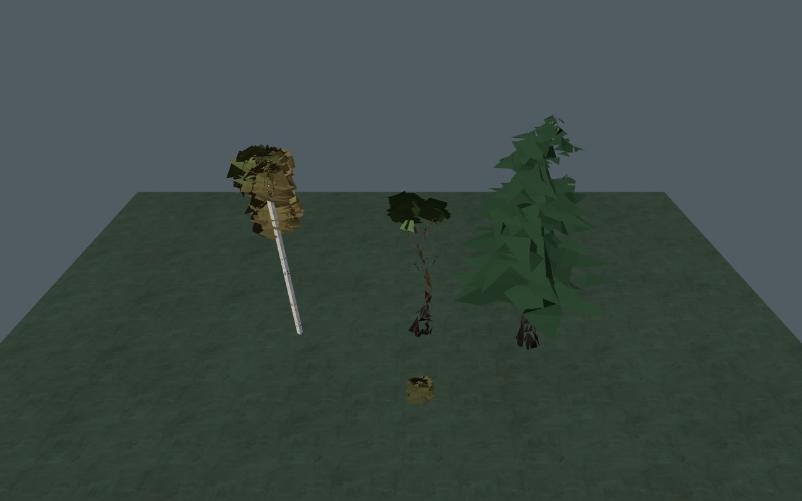
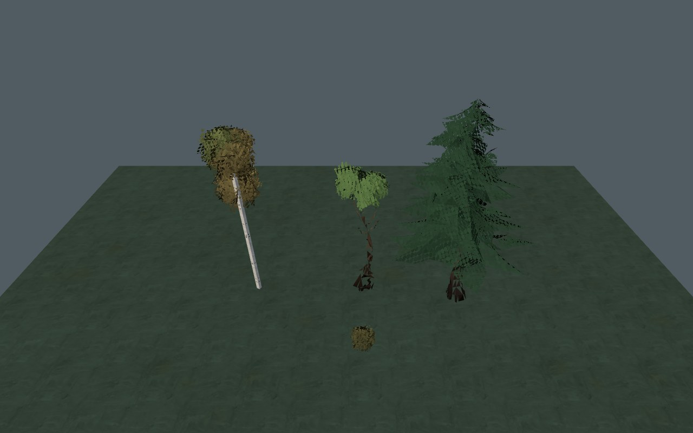
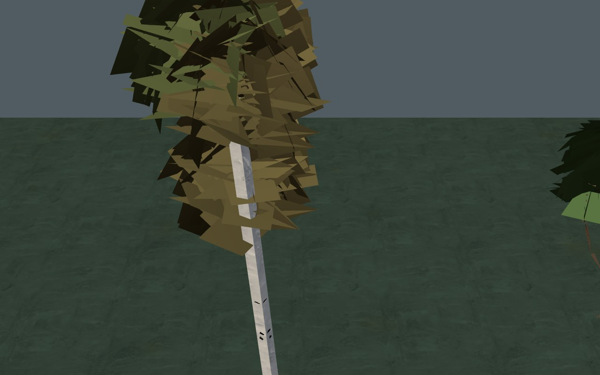
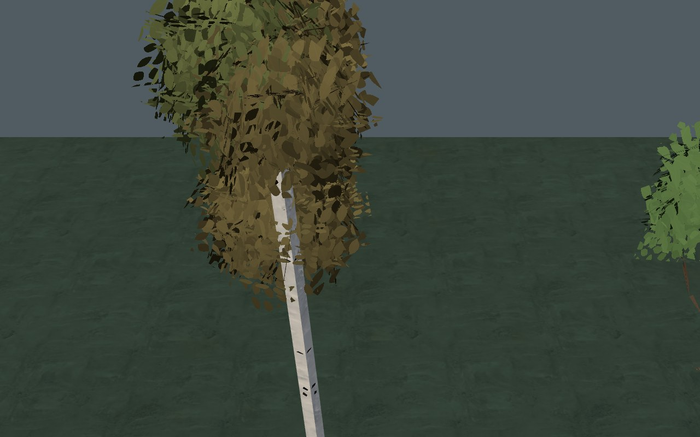
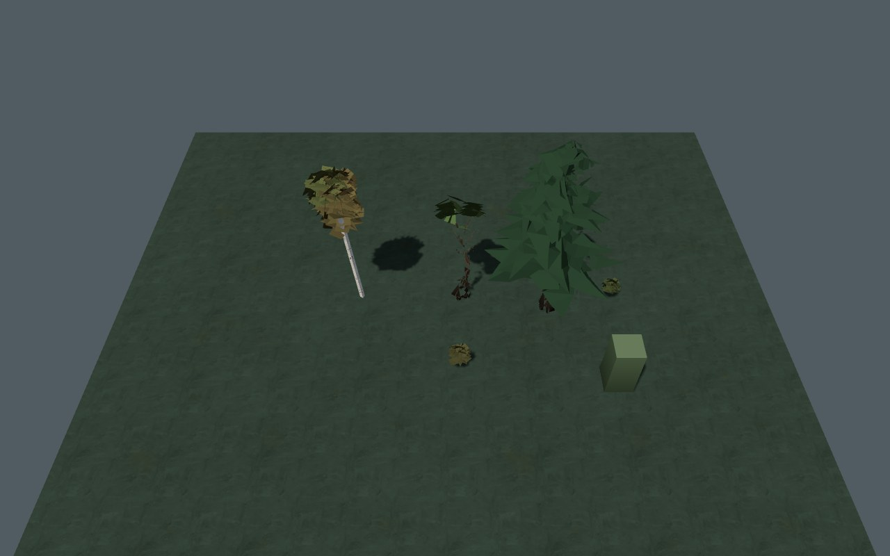
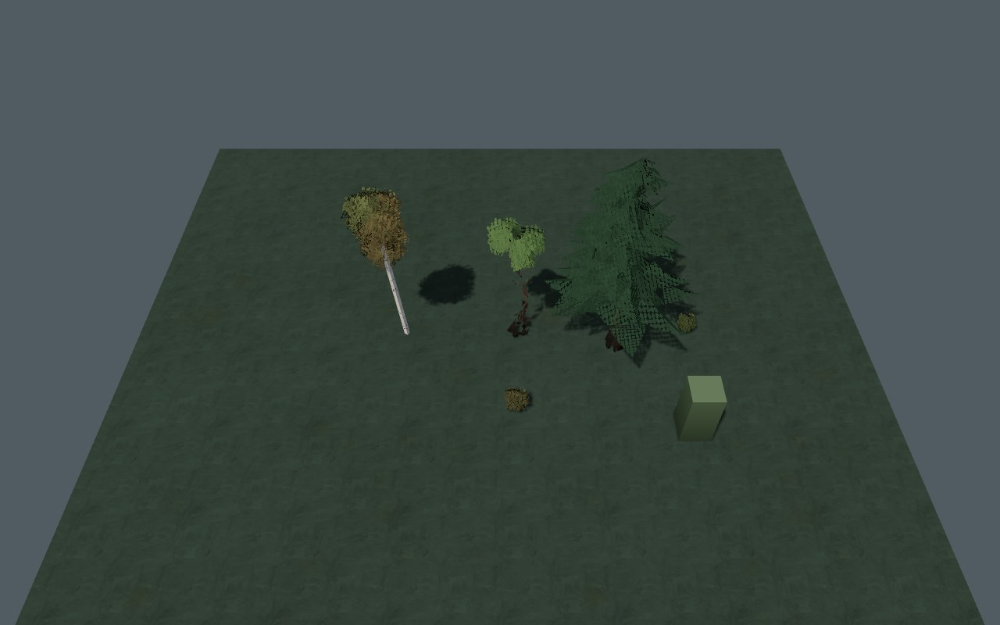
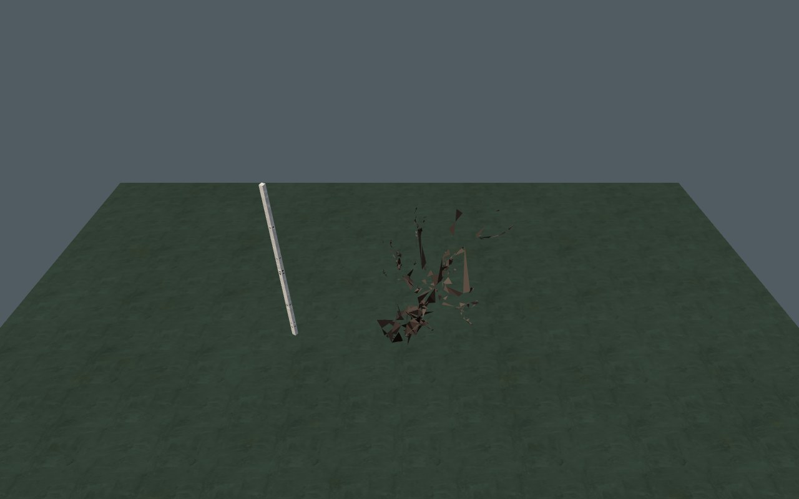
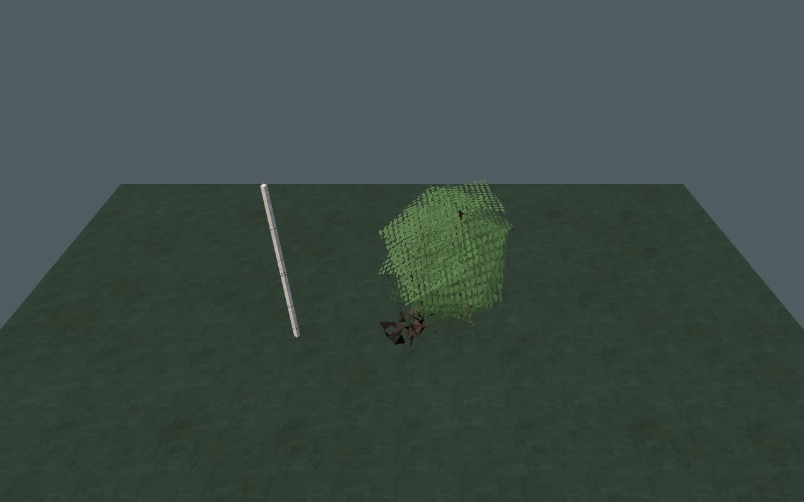

# Кроны · 0.4.22

Крупные плоские участки крон получили просветы в форме листьев и плотных хвойных побегов. Листья видны с обеих сторон; прежде обратная сторона отсекалась, и при наклоне дерева крона могла почти исчезнуть. Силуэт действует также в тенях и на отдельной модели дерева во время рубки.

| До | После |
| --- | --- |
|  |  |
|  |  |
|  |  |
|  |  |

Это контрольная сцена с нативными моделями, материалами и освещением; куб справа — проверка нерастительной геометрии в общем материале. Его обратные грани сохраняют прежнее отсечение.

## Реализация

- `play/art/leaf-canopies.js` добавляет к существующей геометрии байтовый признак: 0 — ствол/прочая поверхность, 1 — листва, 2 — хвойный побег. Геометрия, коллизии, расстановка, добыча и последовательность ГСЧ остаются нативными. Для ивы с голым искривлённым стволом маска не добавляется.
- Классификация ограничена 14 именами моделей. Небольшой общий кэш хранит только признаки вершин; диапазоны временных сборщиков принадлежат `WeakMap`. Признаки не входят в сохранение.
- Процедурный рисунок опирается на положение и нормаль до ветра. При наклоне дерева рисунок движется вместе с ним. Уменьшение деталей по экранному размеру уплотняет дальнюю крону; новых изображений и текстур нет.
- Общий материал сохраняет ветер, срез перед камерой и скрытие срубленных деревьев. Для листьев включена двусторонняя видимость; обратные грани с нулевым признаком отсекаются в шейдере. Материал получает нулевой атрибут по умолчанию для прочих пакетов без листвы.
- Одна пара теневых материалов на видимый материал переиспользуется чанками. Она использует нативные uniform-переменные ветра и рубки. Для отдельной модели падающего дерева сохраняется её штатный режим `fell=0`, чтобы дерево не скрывало само себя.
- `scripts/apply-leaf-canopies.py` воспроизводит две небольшие точки подключения к существующему бандлу: фабрику теневых материалов и обработку модели падающего дерева. Адаптер проверен на точное воспроизведение из 0.4.21 и повторное применение.

## Проверка

`python3 tests/leaf-canopies.py` сравнивает `?leaves=0` и обычный режим. Проверены берёза, тополь, клён, сосна, ива, куст; хеши геометрии/цветов/метаданных/ГСЧ совпадают. Атрибут полный, байтовый; стволы и голая ива не получают листовой рисунок. Реальная нативная модель падающего дерева сохраняет геометрию и матрицу наклона, получает маску и обе тени.

| Контрольная сцена | До | После |
| --- | --- | --- |
| Без теней: вызовы / треугольники | 2 / 3179 | 2 / 3179 |
| С солнцем и контрольными предметами: вызовы / треугольники | 7 / 6822 | 7 / 6822 |
| Байтовый атрибут листвы в основной сцене | — | 9297 байт |

Тени солнца и точечного источника компилируются и отрисовываются без ошибок WebGL и консоли. Проверено переиспользование теневых материалов и нулевой атрибут обычного предмета. Отдельная сцена исключает влияние поздно загружаемых игровых моделей на эти счётчики. [Исходное измерение](baseline.json) · [После изменения](updated.json).

Проверка выполнена Chromium/SwiftShader для сетевой версии и самостоятельного HTML через HTTP. Счётчики не означают ускорение: двусторонняя листва и маска добавляют работу фрагментному шейдеру. На физическом телефоне, аппаратном GPU и через `file://` этот выпуск не измерялся. Для сравнения доступен `?leaves=0`.

Стволы, отдельные ветви, локальные стыки грунта и переходы LOD остаются в [общем аудите](../../GRAPHICS_AUDIT_RU.md). Этот выпуск улучшает кроны и устраняет исчезновение листьев; он не завершает всю графику мира.
