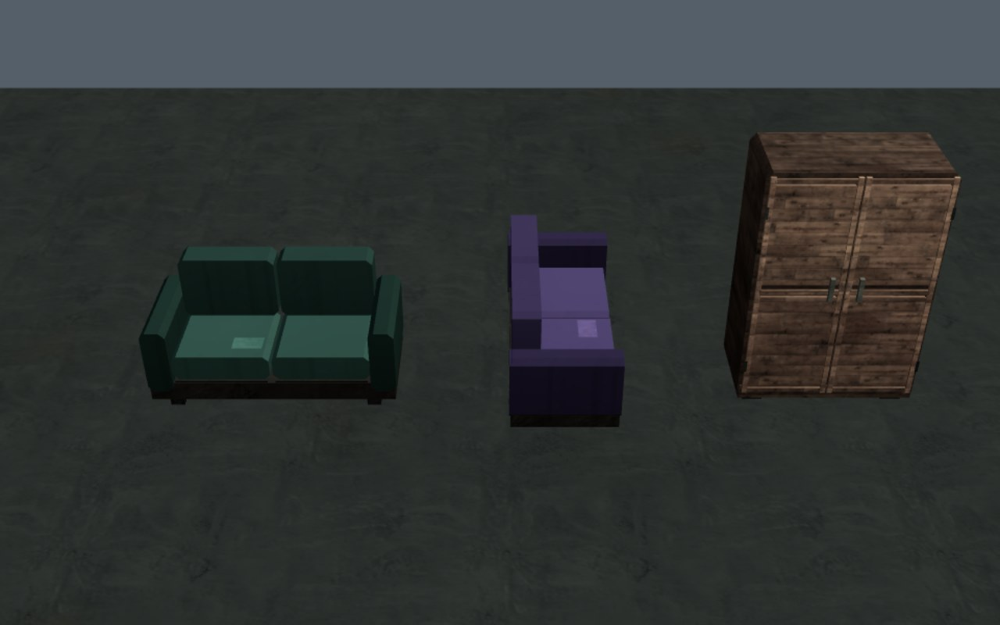

# Мебель · 0.4.20

[До](before.jpg) · [После](after.jpg). Проверочная сцена штатного игрового рендерера и статического материала; в продукт отдельная сцена не добавляется. Кадры показывают низкое качество, два поворота дивана и шкаф.

Диван: шесть отдельных подушек/подлокотников с фасками, каркас, ножки, фронтальные швы и ремонтная заплата. На высоком качестве фаски замыкаются во всех трёх измерениях и добавляются стежки. Прежняя палитра сохраняется; обивка использует нулевой индекс атласа, чтобы не наследовать строительное покрытие. При повороте спинка следует локальной оси дивана.

Шкаф: отдельные утопленные панели дверей, рамки, ручки, петли и цоколь; используется существующая текстура дерева. Прежние коллизии, содержимое и ресурсная точка сохраняются.

Обнаружена и исправлена ошибка общего extruded prism: боковые треугольники были направлены внутрь. При отсечении задних граней это оставляло видимые щели. Исправление относится и к ранее добавленным процедурным контейнерам.

| Модель | Низкое качество | Высокое качество |
| --- | ---: | ---: |
| Диван | 234 треугольника | 336 |
| Шкаф | 328 | 328 |

`tests/salvage-props.py` сравнивает нативную и новую геометрию, низкое/высокое качество, повороты 0°/90°, метаданные и ГСЧ трёх чанков. Лучи сверху проверяют замкнутые наружные поверхности: подлокотник на 0,735 м, крыша шкафа на 2,07 м. Также проверяются атлас обивки, реальное разрушение ящика, освобождение коллизии, сохранение и перезагрузка. Проверено онлайн и в standalone HTML через HTTP, ошибок JS 0. Новых материалов, текстур, моделей GLB и пакетов отрисовки нет; геометрии стало больше исходных двух объёмов. Формат сохранений profile v3 прежний.

Физический телефон/file:// не проверены. Оставшиеся художественные задачи — в [аудите графики](../../GRAPHICS_AUDIT_RU.md).
