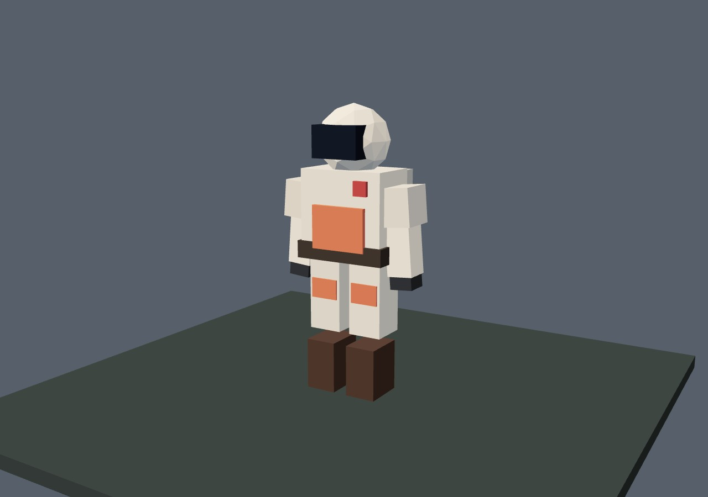
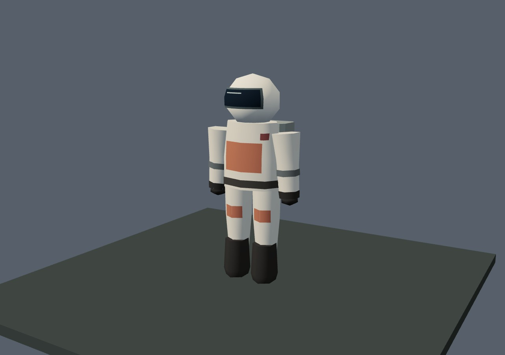
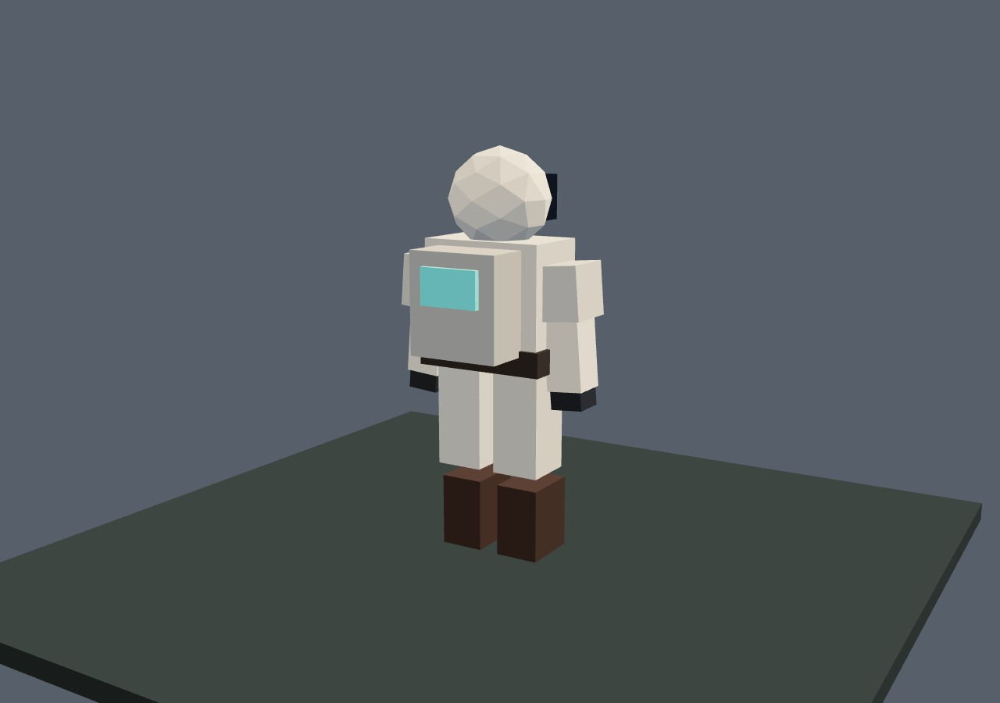
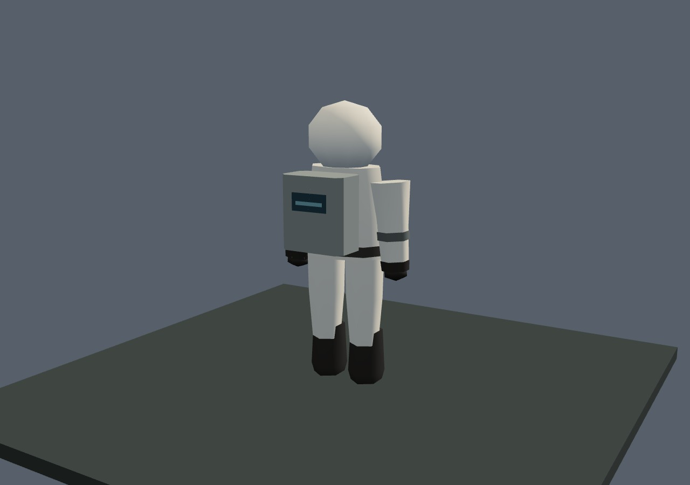

# Резервный герой · 0.4.32 «Полевой скафандр»

При ошибке загрузки собственного GLB героя игра скрывала резервную фигуру и оставляла игрока невидимым. Теперь она остаётся в кадре до готовности модели. Блочный силуэт заменён округлым полевым скафандром: шлем с визором, рукава и перчатки, брюки и ботинки, рюкзак со скошенными рёбрами. Нашивки прилегают к поверхности, пояс и запястья закрыты.

| До: нативный резервный силуэт | После: скафандр |
| --- | --- |
|  |  |
|  |  |

Кадры сняты в одинаковой контрольной сцене. «До» показывает сам резервный меш: после завершения неудачной загрузки в опубликованной 0.4.31 он исчезал. Основной готовый GLB этим выпуском не изменён.

## Что проверено

`tests/hero-fallback.py` сравнивает с опубликованным коммитом 0.4.31 `a52081ccb5c6db1dc540bafa261342f5a0ca5c07`. Проверены три случая: прежний отказ, новый отказ и поздняя успешная загрузка **собственного** файла героя. Последовательный загрузчик удерживается на этом файле, затем запрос намеренно завершается ошибкой либо получает настоящие байты GLB.

- В интро персонаж скрыт. После старта ожидающая модель представлена шестью частями резервной фигуры. После отказа раньше оставалось 0 видимых частей, теперь — 6. Поздний успех создаёт один штатный экземпляр GLB и скрывает резервную фигуру.
- Движение, матрица катаны, сохранение и «Продолжить» в той же странице работают в обоих новых случаях; восстанавливаются новый объект игрока, позиция и оружие. Формат profile v3 прежний. Холодная перезагрузка в этой проверке не выполнялась.
- Матрицы шести частей, корня и крепления оружия совпали с нативными для четырёх контрольных поз: стояние, шаг, поворот при прицеливании и наклон/масштаб при смерти. Цвет и вспышка также совпали.
- Координаты и нормали конечны, нормали единичные, вырожденных треугольников и неверного направления граней нет. Границы частей сохранены, кроме подола торса: он опущен на 25 мм для перекрытия старой щели, внутри прежних общих габаритов стоящего героя. Шарниры и коллизии не менялись.
- Четыре других типа процедурного рига сохранили все атрибуты. Отключение новой геометрии возвращает исходный меш героя. Число обращений к штатному генератору случайных чисел прежнее.
- Две новые фигуры получают независимые, равные по содержимому атрибуты; удаление геометрии одной не повреждает другую. Дополнительный отчёт: [ownership.json](ownership.json).

Браузерная и самостоятельная HTML-сборки по HTTP прошли все три случая. Их отчёты геометрии и итогового состояния совпали точно: [до](before.json), [отказ после исправления](failed-own-model.json), [поздний успех](late-own-model.json). Преднамеренный сетевой отказ и штатное предупреждение `GLB hero` сохранены в отчёте; других ошибок JavaScript и прямых ошибок GL не было. Существующая проверка `tests/actor-readiness.py` также прошла: поздняя готовность или отказ чужой модели не задерживает готового героя и не изменяет чужие экземпляры.

## Стоимость и воспроизведение

Герой: **578 треугольников вместо 320**, те же 6 вызовов отрисовки. Контрольная сцена с полом: **590 вместо 332 треугольников**, те же **7 вызовов**. Общий ограниченный кэш — 6 шаблонов, **76 296 байт типизированных данных**; у экземпляров собственные GPU-буферы. Новых материалов, текстур, шейдеров, GLB и построения геометрии на каждом кадре нет. Добавлен только небольшой скрипт геометрии; все формы созданы кодом проекта.

Читаемый модуль: [actor-fallbacks.js](../../../play/art/actor-fallbacks.js). Строгий адаптер [apply-hero-fallback.py](../../../scripts/apply-hero-fallback.py) соединяет три нативных места: загрузку модуля, создание геометрии и условие видимости. Повторный запуск безопасен; неизвестные или частично применённые якоря останавливают адаптер.

```bash
python3 -m http.server 8180
TERRA_TEST_URL=http://127.0.0.1:8180/play/ python3 tests/hero-fallback.py
TERRA_TEST_URL=http://127.0.0.1:8180/play/ python3 tests/actor-readiness.py
python3 scripts/build-offline.py
```

Для самостоятельной сборки задать `TERRA_TEST_URL=http://127.0.0.1:8180/terra.html` и `TERRA_BASELINE_FILE` — путь к опубликованному `terra.html` версии 0.4.31. Проверка сверяет его SHA256 перед использованием.

Проверки выполнены в Chromium со SwiftShader; это не измерение FPS на физическом GPU. Самостоятельный HTML проверен по HTTP, не через `file://`. Другие персонажи, дальние модели и предпросмотр снаряжения при отказе GLB остаются следующими пунктами [графического аудита](../../GRAPHICS_AUDIT_RU.md).
