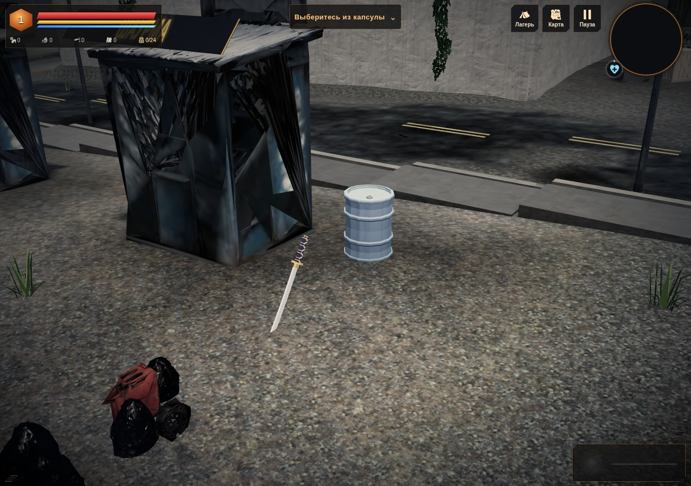
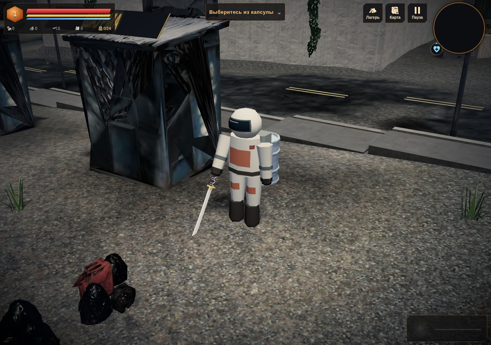

# Герой на рельефе · 0.4.34 «Земля под ногами»

Резервный скафандр оставался на высоте y=0, пока грунт под ним поднимался или опускался. На возвышенности герой полностью уходил под поверхность, а оружие оставалось в кадре. Теперь шесть частей фигуры следуют штатной высоте земли и лестниц метро.

| До: герой под поверхностью | После: скафандр стоит на грунте |
| --- | --- |
|  |  |

На контрольной площадке `(140,14)` земля имеет y=4,30045. Подошва раньше оставалась на y≈−0,01; теперь она на y≈4,29045. Незначительное погружение подошвы на 1 см сохраняет прежнюю форму ботинок. Геометрия и высота самой фигуры не менялись.

## Причина и изменение

Штатный `renderT` на время отрисовки поднимает обычные корни GLB на высоту поверхности. Инстансированные меши он пропускает: у VAT-врагов высота уже включена в их матрицы. Резервный герой тоже состоит из InstancedMesh, но такой поправки у него не было.

[actor-grounding.js](../../../play/art/actor-grounding.js) добавляет высоту только в компоненту y матриц отображаемых частей **живого мирового рига героя**. Предпросмотры и отдельные контрольные риги остаются в локальных координатах. Локальные `_root` и `_armR` не меняются: оружие уже получает подъём в штатном проходе отрисовки. Основной GLB продолжает работать тем же способом, без двойного подъёма.

Один вызов штатного обновления рига делает один дополнительный запрос высоты для его единственной фигуры. Новых матриц, геометрии, материалов и кэшей нет; используются существующие типизированные буферы и уже поставленная нативным кодом пометка обновления. Повторное обновление заново записывает локальные матрицы, поэтому смещение не накапливается. Геометрия скафандра прежняя: 578 треугольников и 6 вызовов отрисовки.

[Строгий адаптер](../../../scripts/apply-hero-terrain-grounding.py) воспроизводит два подключения из опубликованной 0.4.33: скрипт и один вызов в конце обновления рига. Повторный запуск безопасен; неоднозначные и частичные якоря отклоняются. `TERRA_ART.actorGroundingEnabled=false` возвращает прежнее отображение для сравнения.

## Проверка

`tests/hero-terrain-grounding.py` сравнивает с опубликованным коммитом 0.4.33 `4a4a181bd7ecca8daa2c237912c0e3e6300ed092`. Для самостоятельной сборки старый HTML проверяется по SHA256. Собственный файл героя удерживается на настоящем URL, затем получает байты настоящего GLB.

| Контроль | Нативная высота |
| --- | ---: |
| Низина `(22,36)` | −5,88203 |
| Возвышенность `(140,14)` | 4,30045 |
| Нижняя часть лестницы метро `(90,79)` | −1,56270 |
| Пол обычного подземного метро, 16 комнат | 0 |

Для каждой точки проверены стояние, шаг, поворот при прицеливании и падение с масштабом: **16 случаев для каждого состояния**. Все коэффициенты матриц, кроме нужного переноса y, совпали с нативным локальным контролем; ошибка относительно Float32-переноса — 0. `_root` и `_armR` точны, повторные обновления не дают дрейфа, версия каждого атрибута увеличивается штатно один раз. Высота запрашивается один раз, локальный контроль её не запрашивает.

Перед, внутри и после настоящего `renderT` высота фигуры стабильна. Оружие получает ровно прежнее смещение и восстанавливает локальную матрицу. Его высота берётся в точке крепления оружия, как в нативном коде. Отдельная фигура в настоящем окне экипировки сохраняет локальные матрицы даже при высоте мирового грунта 4,3 м; закрытие оставляет ноль живых фигур и подписок. При позднем успехе GLB создаётся один мировой экземпляр, резервная фигура скрывается, корень основной модели поднимается один раз и возвращается в исходные координаты после кадра.

Петля мира приостановлена на время измерений; позы и `renderT` вызываются вручную с настоящими загруженными районами, профилем лестницы и нативным подземным полом. Браузерная и самостоятельная HTML-сборки по HTTP прошли проверку; полные числовые отчёты совпали точно: [до](before.json), [после](grounded.json). Хеш всех атрибутов геометрии совпал с прежней версией. Ошибок JavaScript и прямых ошибок GL нет.

Существующая `tests/hero-fallback.py` также прошла: отказ/поздний успех собственного файла, интро, настоящее движение, катана, сохранение и «Продолжить», геометрия и четыре локальные позы, другие риги, RNG и ограниченный кэш. [Результат](hero-regression.txt). Profile v3 прежний; физические параметры и высоты земли не менялись.

```bash
python3 -m http.server 8180
TERRA_TEST_URL=http://127.0.0.1:8180/play/ python3 tests/hero-terrain-grounding.py
python3 scripts/build-offline.py
```

Для самостоятельного HTML задать `TERRA_TEST_URL=http://127.0.0.1:8180/terra.html` и `TERRA_BASELINE_FILE` — путь к опубликованному `terra.html` 0.4.33. Проверка выполнена в Chromium/SwiftShader по HTTP; физические GPU, телефон, `file://` и FPS здесь не проверялись. Остальные модели и дальние варианты остаются в [графическом аудите](../../GRAPHICS_AUDIT_RU.md).
