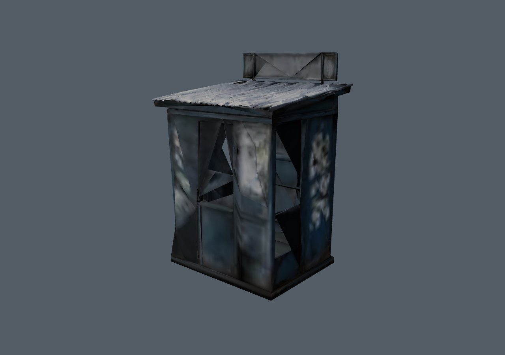
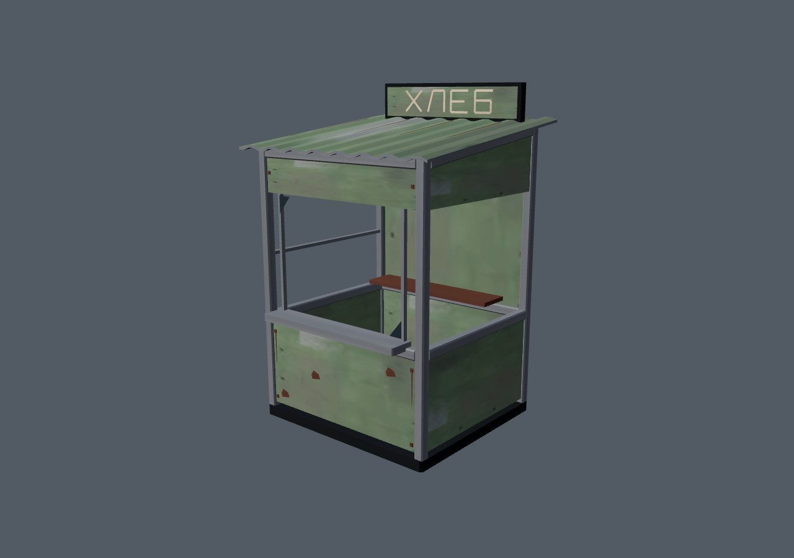
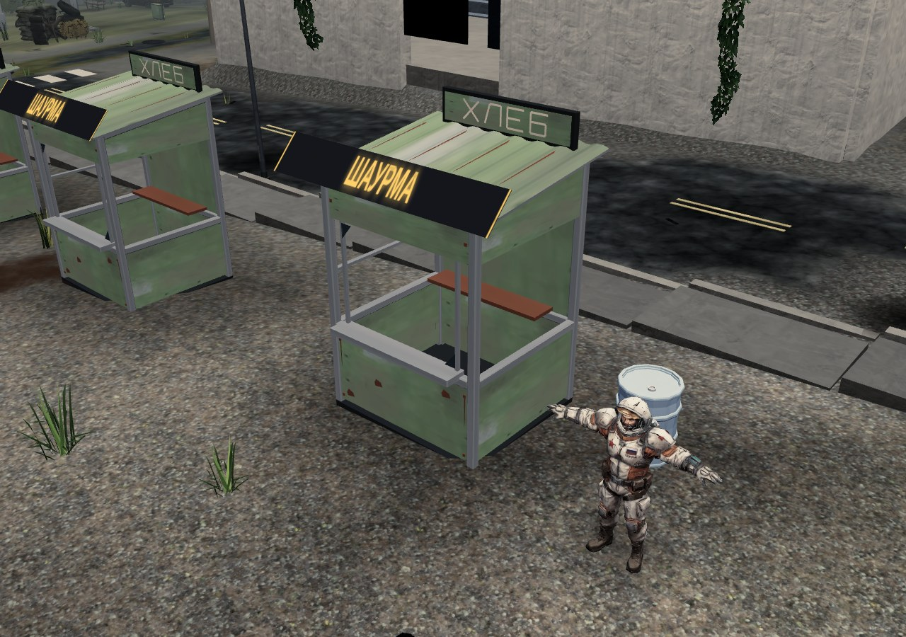

# Забытый киоск · 0.4.35

В опубликованной 0.4.34 металлические листы киоска складывались в крупные треугольники поперёк окон. Дефект сохранялся без текстур и normal map, то есть находился в геометрии. В исходных LOD обнаружено 71/93/128 треугольников с нормалью, направленной против грани; в среднем варианте были две нулевые нормали.

Заменена только модель `TERRA_KIT.decor.kiosk`. Новый каркас с фасками, утопленные панели, настоящие окна, прилавок, полка, дверь с петлями и ручкой, наклонная гофрированная кровля, остатки стекла, крепления и ржавчина. Старая вывеска «ХЛЕБ» остаётся частью павильона; штатные сменные таблички рынка, включая «ШАУРМА», сохранены.

| До · опубликованная 0.4.34 | После · упакованная модель |
| --- | --- |
|  |  |

[Прежний рынок](world-before.jpg) · [Сзади](rear.jpg) · [Средний LOD](mid.jpg) · [Дальний LOD](far.jpg) · [Сквозной дальний проём](far-window.jpg)

## Геометрия и стоимость

| LOD | Треугольники до → после | Вершины после | Замкнутые конструктивные части |
| --- | ---: | ---: | ---: |
| Ближний | 2599 → 1159 | 2009 | 41 |
| Средний | 1167 → 568 | 1076 | 35 |
| Дальний | 340 → 262 | 524 | 16 |

Упакованные грани не вырождены; направление нормали согласуется с гранью, минимальный скалярный коэффициент — 0,996. UV всех треугольников имеют ненулевую площадь после Uint16-сжатия, что необходимо normal map. Каждый закрытый конструктивный элемент проверен по рёбрам. Тонкие листы дальнего варианта имеют две стороны; краска и остатки стекла намеренно открыты.

Вдали сохраняются проёмы, пол, полка, дверь и вывеска. Основание всех LOD теперь `y=0` вместо прежнего подъёма среднего/дальнего варианта примерно на 9,7 см. Все три точных ограничивающих параллелепипеда совпадают с прежним ближним вариантом; общие метаданные `2,381 × 3,5 × 2,189 м` сохранены.

Каждая изолированная модель использует один штатный вызов отрисовки при каждом из трёх ракурсов. Материал, текстуры, загрузчик, группировка и поведение скрытия крыши прежние. Дальний вариант имеет больше вершин, чем прежний, но меньше треугольников; весь архив `TERRA_KIT.json.gz` уменьшился с 3 033 575 до **2 957 421 байта**. Новых карт и материалов нет.

## Проверка

`tests/kiosk-topology.py` независимо декодирует отгруженные массивы и сравнивает с **5f64bb12451c08830c63c1fee03a8b9e9858cd9f**. Проверяет нормали, площадь граней/UV, замкнутые детали, границы, бюджеты, воспроизведение генератором и повторную установку. Атрибуты и метаданные всех остальных моделей, карты всех групп и группы `bld/posts` сохранены точно. Повторный запуск установщика сохраняет байты архива, описи и HTML; в игровом HTML изменён только хеш описи.

`tests/kiosk-scene.py` загружает настоящий архив через штатную проверку SHA256. Базовый онлайн-вариант получает HTML, опись и KIT одного опубликованного коммита. Самостоятельный базовый HTML проверяется по SHA256 `0d6e3a6185459ea177f0b8f711422a6b509fba9fca4da20b0ab11244a332ef43`.

Проверены новая игра и пропуск вступления, 91 запись KIT, неизменность остальных 90 моделей по хешам декодированных атрибутов, девять районов с коллизиями, контейнерами, узлами добычи, разрушаемыми объектами, точками появления, картой, площадками и продолжением RNG. Три LOD отрисованы спереди, сзади и сбоку. Боковой луч проходит через настоящие окна каждого варианта; фронтальный проходит через окно и попадает в заднюю стенку. Контрольный кадр снят на настоящем рынке у `(137,13)`.

Веб-версия и самостоятельный HTML прошли сценарий без ошибок JavaScript/WebGL; полные числовые отчёты совпали точно: [до online](before-online.json), [после online](after-online.json), [до offline](before-offline.json), [после offline](after-offline.json), [упакованная геометрия](topology.json). На контрольном рынке — **74 вызова отрисовки** в обоих вариантах, **600 790 → 579 190 треугольников**. Самостоятельный файл — **38 231 169 байт**, SHA256 **6b5b608e363384d2d618cde4480905fc407fdb95d9d7a8f4be69a5aaa19bb5b5**.

Снимки — штатный Three.js/WebGL, Chromium + SwiftShader, 1280 × 900, среднее качество, DPR 1, без постобработки. Игровой цикл остановлен для воспроизводимых геометрических ракурсов; это не запись анимации или замер FPS. Осмотрены ближний/задний/дальний/боковой виды и рынок. Физические GPU, телефон, `file://` и автоматическое переключение на реальных дистанциях не измерялись. Формат profile v3 и функции сохранения не редактируются.

Исходники и воспроизведение — [tools/art/kiosk](../../../tools/art/kiosk/README.md). Новая геометрия собственная; существующий атлас не изменён.
