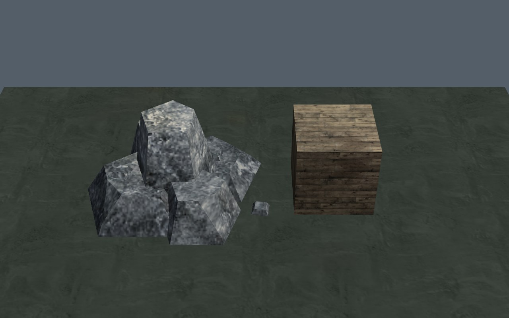

# Материалы окружения · 0.4.21

[Сцена до](buffer-before.jpg) · [После](buffer-after.jpg) · [Мир до](world-before.jpg) · [Мир после](world-after.jpg).

Крупный план — испытательная сцена игрового рендерера со штатным материалом: упакованный камень и справочный куб с деревянной фактурой. Она выявляет смещение индексов материалов. В продукт отдельная сцена не добавляется. Игровые кадры сняты у границы стартового участка, около (48,20), на среднем качестве.

## Причина

`ue.prop()` добавлял вершины, нормали, цвет и вспомогательные данные, оставляя массив `m` прежней длины. Следующая примитивная геометрия добавляла свои индексы материалов на место пропущенных: на части камня появлялась деревянная фактура, а следующие поверхности теряли своё покрытие.

| Пример | Вершины | Индексы до | После |
| --- | ---: | ---: | ---: |
| Участок 0,0 · детали | 2 952 | 1 488 | 2 952 |
| Участок 1,0 · основная геометрия | 20 466 | 8 256 | 20 466 |
| Участок 1,0 · детали | 14 607 | 1 458 | 14 607 |

На девяти участках число проблемных пакетов сократилось с **16 из 18 до 0**. При вставке упакованной модели заполняется один индекс на вершину: 0 для собственного вершинного цвета, 7 для существующего слоя камня Rock030. При замене старого кузова набором моделей массив материалов откатывается вместе с геометрией. Если будущий нативный загрузчик уже добавляет индексы, второй раз они не вставляются.

## Камни

У `rock_a`, `rock_b`, `stones` исходная пастельная палитра заменена приглушённым серым гранитом с мхом на верхних поверхностях. Каменные модели используют уже загруженную фактуру Rock030; остальные окрашенные модели сохраняют свои цвета. Количество треугольников, позиции, нормали и коллизии прежние.

## Проверка

`tests/prop-materials.py` — онлайн и самостоятельный HTML через HTTP: девять участков, сохранение геометрии/метаданных/ГСЧ, последовательность «примитив → модель → примитив», сохранение префикса материалов, отсутствующая модель, нетекстурируемая растительность, реальный откат KC-кузова и штатный GPU-рендер. Изменение цвета ограничено тремя названными моделями; окраска контрольной бочки совпала с исходной.

В контролируемой сцене осталось **1 вызов отрисовки и 180 треугольников**. JS/WebGL ошибок 0. Исходная версия на этой машине тоже не выдала WebGL-ошибку, хотя фактуры были смещены: одних сообщений консоли для такой проверки недостаточно. Регрессия `tests/salvage-props.py` с мебелью, лучами, разрушением и save/reload в standalone HTTP прошла.

Новых текстур, GLB, материалов и пакетов отрисовки нет. Добавлены недостающие индексы атрибута (на GPU — байт на вершину). Скрипт установки: `scripts/apply-prop-materials.py`; читаемый модуль: `play/art/prop-materials.js`. Profile v3 прежний. Физический телефон/file:// не проверены.
