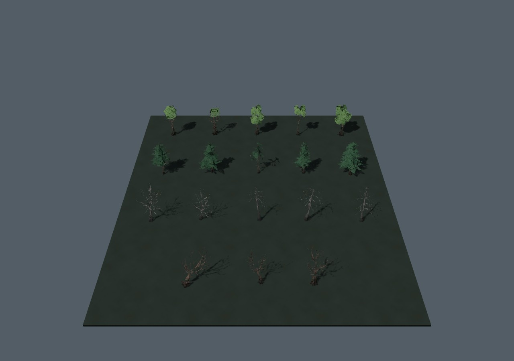
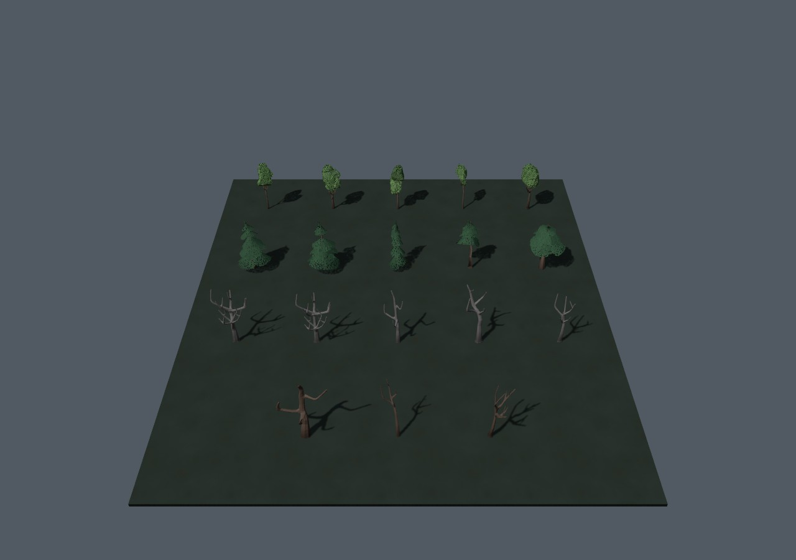
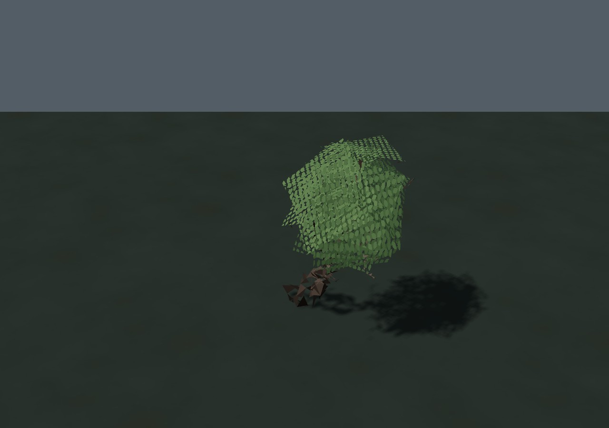
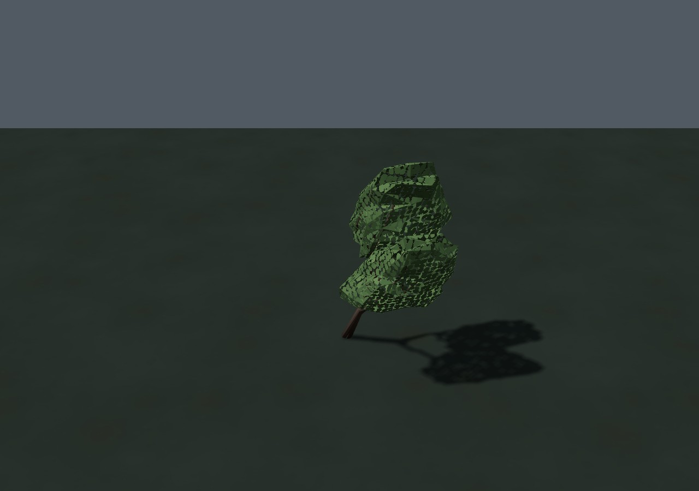

# Цельный лес · 0.4.23

Восемнадцать мешей с разорванными стволами и ветвями заменены цельными вариантами на основе Quaternius LowPoly Nature Pack (CC0). Это пять лиственных деревьев, пять сосен, пять сухих деревьев и три искривлённых варианта. Добавлены фаски древесины, доработаны основания сосен и нерегулярный рисунок листьев.

| До, 0.4.22 | После |
| --- | --- |
|  |  |
|  |  |

Верхняя пара показывает все 18 моделей в одной контрольной сцене с одинаковой камерой и освещением. Ряды сверху вниз: лиственные, сосны, сухостой, три искривлённых дерева. Нижняя пара использует нативную модель падающего дерева и одинаковую матрицу наклона.

## Проверенные свойства

| Показатель | 0.4.22 | 0.4.23 |
| --- | --- | --- |
| Треугольники 18 моделей | 19371 | 18555 |
| Контрольная сцена с тенями: вызовы отрисовки | 3 | 3 |
| Та же сцена: треугольники с теневым проходом и полом | 38754 | 37122 |
| Сжатый архив всех пропсов | 679092 байта | 548557 байт |
| Самостоятельный HTML | 38474625 байт | 38300817 байт |

Число треугольников каждой замены не превышает прежний бюджет. Положение основания проверено относительно центра нативной коллизии, габариты в индексе сохранены, кроны вписаны в радиус штатного скрытия при рубке. Проверка квантованных треугольников подтверждает замкнутость древесины всех 18 моделей и согласованность нормалей. Остальные 84 пропса сохранили исходные байты геометрии; обновились только их смещения в архиве.

`tests/nature-scene.py` сравнил самостоятельный HTML выпущенной 0.4.22 с изменённой сетевой версией: метаданные, коллизии, содержимое, узлы, переходы и последовательность ГСЧ девяти районов совпали. Нативная матрица наклона дерева прежняя; листва и тени подключены. Ошибок консоли/WebGL нет. [До](before.json) · [После](after.json) · [Топология упакованных моделей](topology.json) · [Отчёт сборщика](build-report.json).

Регрессия `tests/leaf-canopies.py` для самостоятельного HTML проверяет шесть растений, полный байтовый атрибут, отсутствие листового рисунка на голой иве, общие материалы теней, солнце/точечный свет, обычный предмет без маски и нативную падающую модель. Ошибок JS/WebGL нет. В этой отдельной сцене остаются 2 вызова / 3157 треугольников; с тенями и контрольными предметами — 7 / 6778.

Измерения сделаны в Chromium/SwiftShader. Более плотная крона и расчёт нескольких соседних листьев добавляют работу фрагментному шейдеру; таблица не означает измеренного ускорения FPS. Аппаратный GPU, физический телефон и `file://` не проверялись. Формат сохранений **profile v3** прежний.

## Подготовка

[Исходники, лицензия, закреплённые хеши и воспроизводимые команды](../../../tools/art/nature/README.md) находятся вместе со сборщиком Blender. Источники glTF и проверочные GLB отделены от компактного формата рантайма: дополнительных загрузчиков, текстур и пакетов отрисовки нет. Архив стал меньше на **130535 байт**, самостоятельный файл — на **173808 байт**.

Сборщик проверяет не только поверхность Blender, но и реальную точность `int16`: очень тонкие фаски могут схлопнуться при упаковке. Такие микрограни очищаются до окончательной проверки. Повторная сборка проверяет стабильность результата; манифест и его контрольная сумма обновляются вместе с архивом.

Работа над остальной растительностью, локальными стыками грунта, переходами LOD и временными резервными моделями продолжается в [общем аудите](../../GRAPHICS_AUDIT_RU.md).
