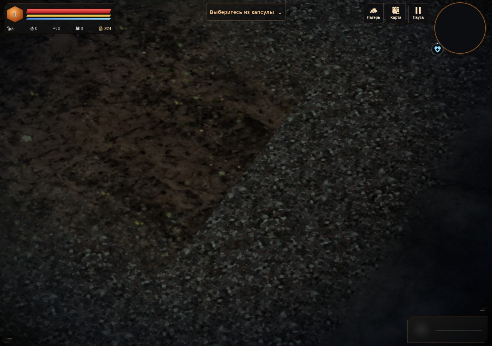
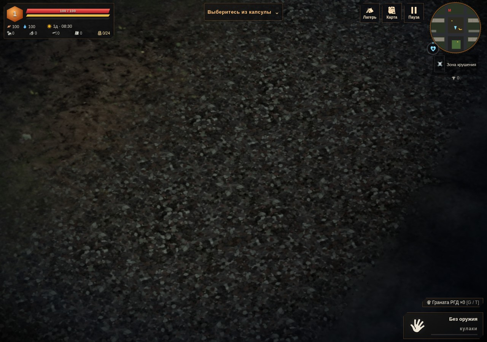

# След на обочине · 0.4.29

Местная тропа могла доходить до края своего района, а соседний район не знал об этом следе. В одной и той же точке дорожной обочины получались разные цвет, покрытие и влажность. На снимке виден прямой срез грязевого пятна по границе сетки.

| Резкий срез | Переход в обочину |
| --- | --- |
|  |  |

Контрольная сцена использует настоящую землю районов `(-1,-1)` и `(0,-1)`, штатный материал и загруженный PBR-атлас. Предметы скрыты, чтобы границу было видно. Это осмотр покрытия, не полный проход по миру.

## Изменение

На последних четырёх метрах у края района сила местной тропы плавно уменьшается до нуля. Цвет и веса грязевого покрытия получают один коэффициент. Добавленная тропой влажность затухает вместе со следом. Существующая влажность дороги или берега сохраняется.

Рисунок дальше четырёх метров прежний. Координаты троп, дороги, высоты, нормали, вода, расстановка и коллизии не менялись. Нет новых ассетов, текстур, материалов, атрибутов вершин или вызовов отрисовки. Вычисление выполняется только для точек, попавших в полосу тропы. Новых кэшей нет. Формат сохранений — profile v3.

`scripts/apply-path-ground-transition.py` проверяет точный участок нативного кода, воспроизводит правку из опубликованной 0.4.28 и допускает повторное применение. Исходники игрового бандла по модулям недоступны; изменён один блок окраски местных троп.

## Проверка

`tests/path-ground-transition.py` сравнивает опубликованную 0.4.28 с новым кодом:

- 16 контрольных случаев: четыре направления, две ширины тропы, положительные и отрицательные координаты. Новый результат сверяется с независимой интерполяцией между старым следом и землёй без тропы. Отдельно проверяется влажность. Максимальная ошибка независимого расчёта **4,47×10⁻⁸**; 55 296 выводимых внутренних вершин совпали точно.
- Девять настоящих заполненных районов. На границе вклад местных троп совпадает с контрольной генерацией без них. Внутренние участки, позиции, нормали, сетка высот и геометрия воды прежние; коллизии, контейнеры, узлы, площадки и следующие числа генератора совпали.
- В четырёх обнаруженных точках `(0,-6)`, `(46,0)`, `(-6,48)`, `(86,48)` скачки цвета **0,02734–0,03995**, весов **0,73525** и влажности **0,08** стали **нулевыми**. Другие участки сохраняют отдельные причины несовпадения.
- Контрольная сцена: **2 вызова / 3364 треугольника** в обоих режимах, **JS0 / GL0**. Готовность PBR ожидается перед снимком; кадры просмотрены.

[До](before.json) · [После](after.json). Сетевая и самостоятельная HTTP-версии прошли Chromium/SwiftShader; численные отчёты совпали. Строгий адаптер точно воспроизводит изменение из 0.4.28, повторное применение, JS/Python parse и diff check пройдены. Физический GPU, телефон и `file://` отдельно не проверялись; ускорение FPS не заявляется.

Остаются другие причины стыков: контактное затемнение зависит от местных объектов, а площадка здания в районе `(1,0)` меняет высоты соседних образцов нормали только в своей сетке. Это отдельная дальнейшая работа. Исправление троп не означает завершения всей графики мира.

Самостоятельный HTML: **38 310 112 байт**, SHA256 `d32757ff8f4d0827e0f86d48e34d11c686465ed20ef492b9dd534620c1582f9e`. Архивы ассетов прежние.
