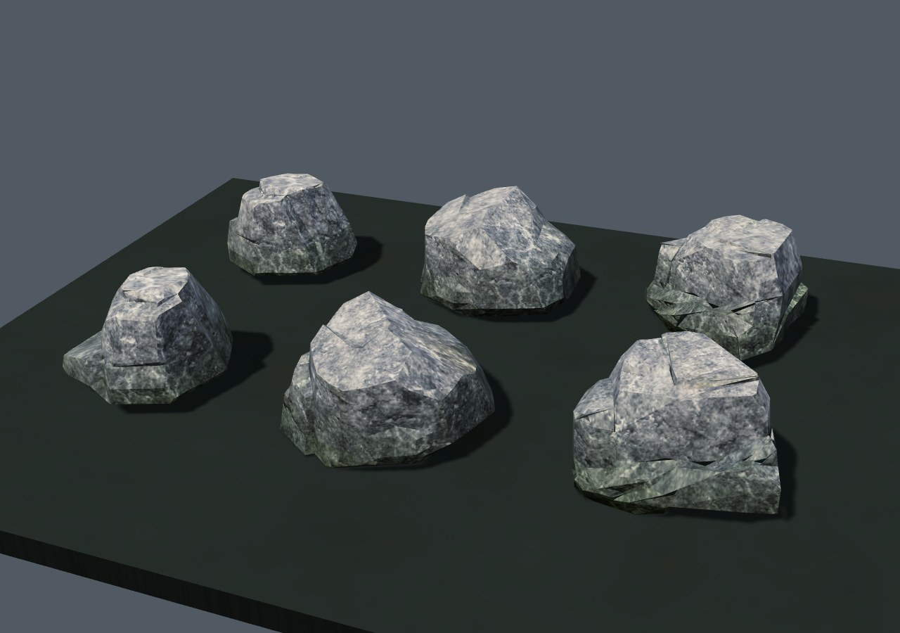
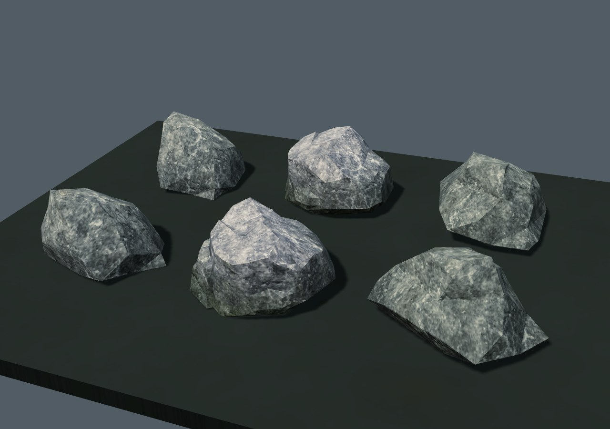
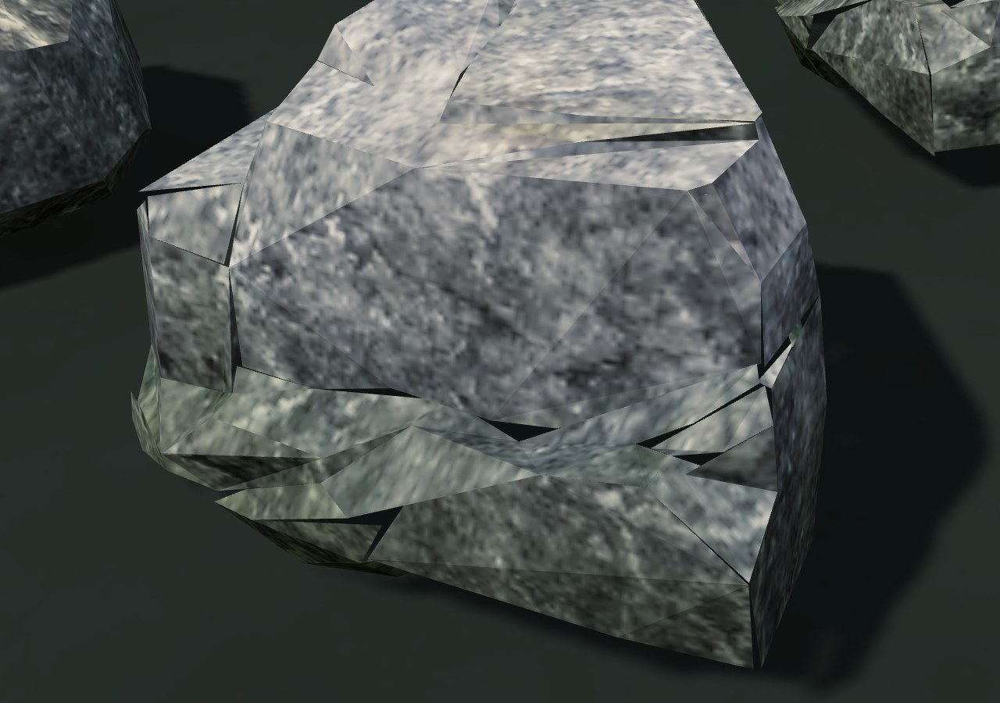
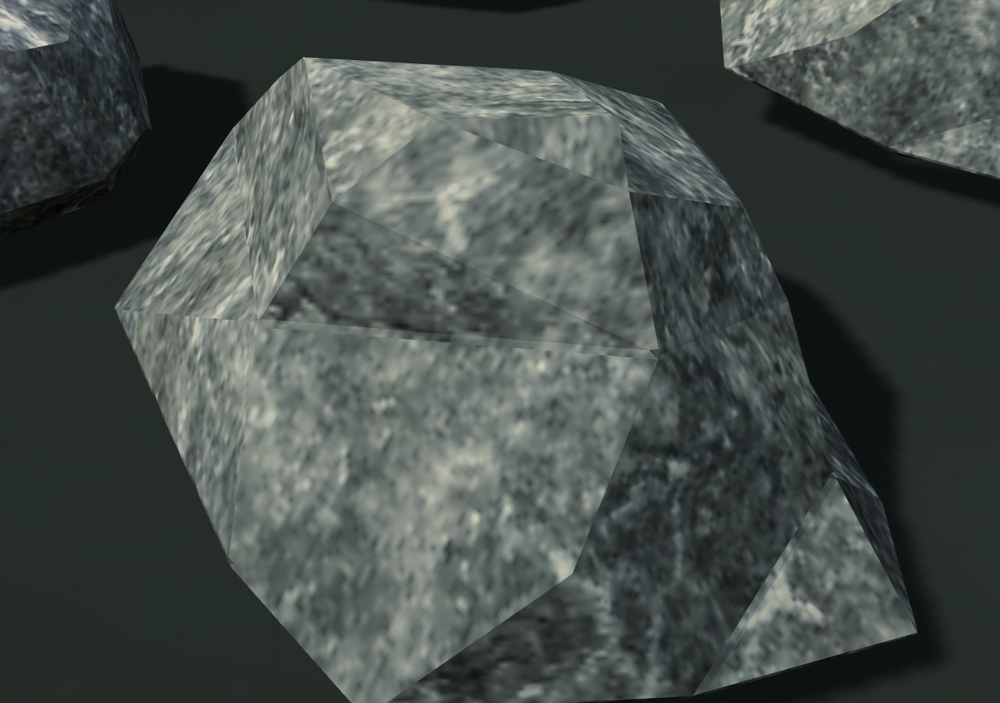

# Цельный камень · 0.4.26

У двух штатных валунов были треугольные щели на боковых поверхностях. В упакованной сетке обнаружены 94 и 234 незамкнутых ребра. Третий вариант замкнут и сохранён.

| Опубликованная 0.4.25 | Цельные валуны |
| --- | --- |
|  |  |
|  |  |

Использованы полные модели Quaternius LowPoly Nature Pack, CC0 1.0. Они подогнаны к прежним габаритам, ступенчатая форма смягчена двумя умеренными проходами сглаживания, длинные резкие рёбра получили небольшие фаски. Материал Rock030 и штатное загрязнение сохранены. [Исходники, лицензия, точные хеши и сборка Blender](../../../tools/art/rocks/README.md).

| Запись | Было треугольников | Стало | Незамкнутые рёбра до → после |
| --- | --- | --- | --- |
| `qn_rock_medium_1` | 260 | 186 | 94 → 0 |
| `qn_rock_medium_3` | 260 | 210 | 234 → 0 |

## Проверка

`tests/rocks-topology.py` независимо читает фактический формат `int16`. Оба меша замкнуты после квантования, порядок граней согласован с нормалями, основание лежит на нуле, габариты и точность упаковки прежние. Исходные Git blob/SHA256 проверены; 100 остальных пропсов, включая третий валун, совпадают побайтово. Манифест и его ссылка в загрузчике соответствуют новому архиву. Историческая проверка 18 деревьев также пройдена; два валуна теперь проверяются отдельно.

Повторная сборка Blender 4.3.2 и установка дают тот же архив. Нативный игровой JavaScript совпадает с 0.4.25; в игровом HTML меняется только контрольная сумма манифеста. Новых загрузчиков, материалов, текстур, GLB рантайма и полей сохранения нет.

`tests/rocks-scene.py` сравнивает опубликованный самостоятельный HTML 0.4.25 с новой сетевой и новой самостоятельной HTTP-версиями:

- Метаданные/коллизии/контейнеры/узлы и следующие числа генератора девяти районов совпали.
- 24 штатных вызова `rock` используют все три вида: выбор модели, положение, размер, поворот, коллизии и ГСЧ прежние.
- Проверены основание и высота, согласованные конечные атрибуты и слой Rock030. Из-за округления старых габаритов в метаданных сравнение высоты допускает разницу менее миллиметра.
- На всех трёх видах поверхность доступна лучам с восьми направлений на средней высоте. Это проверка формы, а не изменение правил попаданий или коллизии.
- Шесть валунов и основание в отдельной сцене с игровым материалом/освещением: **2 вызова / 3080 → 2584 треугольника**, включая тени солнца. Ошибок JavaScript и WebGL нет; кадры просмотрены.

[Исходный отчёт](before.json) · [Новый отчёт](after.json). Физический телефон, дальние ракурсы мира и запуск `file://` отдельно не проверялись. Уменьшение геометрии не заявляется как измерение FPS. Согласование фактуры на резких гранях и другие участки мира остаются в [общем аудите](../../GRAPHICS_AUDIT_RU.md).

Архив пропсов: **548557 → 545579 байт**, SHA256 `1572f32bb7d8a9b4f26c7620a02b2e500875f8b34c8d99cc2ed38d90e470de6d`. Самостоятельный HTML: **38303948 байт**, SHA256 `da29c05597c39658dd797246228a49465a08797a51a5e822b2a1e89ad10f99de`. Формат сохранений profile v3 прежний.
