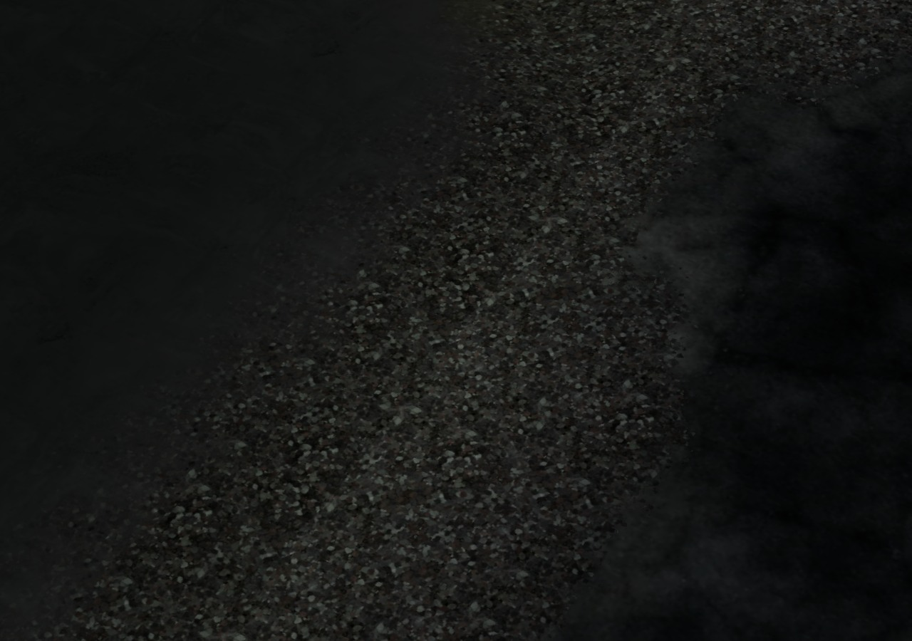
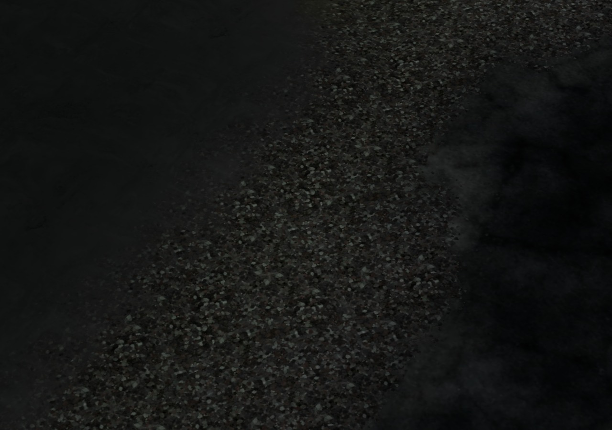

# Тень за границей · 0.4.31

Дом затемнял землю в своём районе, а соседний район не учитывал продолжение этой тени. После согласования нормалей и покрытий оставались 26 цветовых несовпадений на осмотренных границах. Худший случай — точка `(0,62)`: у дома коэффициент затемнения **0,8259765625**, у соседней сетки **1**.

| Локальная тень обрывается | Тень продолжается в соседний район |
| --- | --- |
|  |  |

В кадре — настоящая земля `(-1,1)` и `(0,1)`, штатный материал и готовый PBR. Дом скрыт для осмотра покрытия; направленные тени отключены. Проверяется именно запечённое контактное затемнение грунта.

## Изменение

Небольшой общий индекс хранит только объекты, чей штатный радиус 1,6 м пересекает край района. Внутренние объекты остаются в исходном локальном расчёте. При загрузке или выгрузке района затемнение согласуется у затронутых соседей. Исходные цвета сетки сохраняются, поэтому повторные обновления не накапливают затемнение.

Обновляется существующий цветовой буфер. Проём метро сохраняет исходную интерполяцию цвета по треугольникам, включая добавленные обрезкой вершины. Новых моделей, материалов, шейдеров, атрибутов вершин и вызовов отрисовки нет. Геометрия, высоты, вода, физические коллизии, расстановка и генератор мира прежние.

Данные принадлежат загруженным поверхностным районам; выгрузка удаляет запись и её источники. Подземелья не добавляются в этот индекс. Штатные функции сохранения не заменяются, служебные данные не попадают в profile v3. Это согласование существующей запечённой тени, без новой системы динамических теней от дверей и построек игрока.

Для девяти контрольных районов: **12 источников / 158 ячеек индекса**, **352 572 байта типизированных данных**. Последнее число не включает служебные объекты JavaScript и не является измерением всей памяти браузера. После циклов выгрузки/восстановления размер стабилен; после полного удаления районов все записи, источники и ячейки индекса удалены. Очередь обновления каждого цветового атрибута ограничена одним диапазоном, включая ещё не нарисованные участки.

Исходник — `play/art/terrain-contact.js`. `scripts/apply-shared-terrain-contact.py` проверяет четыре точных якоря загрузки скрипта, нативной окраски и жизненного цикла района; повторное применение безопасно, частичная правка отвергается. Модульные исходники игрового бандла недоступны. Для исторического сравнения `TERRA_ART.terrainContactEnabled=false` до запуска отключает только новое согласование.

## Проверка

`tests/shared-terrain-contact.py` сравнивает настоящую опубликованную 0.4.30, текущий отключённый режим и обычный текущий режим через нативный `World.build`:

- Девять районов в прямом и обратном порядке. Независимый эталон перебирает все допустимые объекты; для обрезанных вершин ищет исходный треугольник и вычисляет общие барицентрические веса.
- **45 450 выводимых вершин**, в том числе **78 добавленных обрезкой**. Ошибка относительно общего эталона **0,02284655 → 6,05×10⁻⁹**; перепад на границах **0,02284656 → 1,49×10⁻⁸**. В конечном кадре изменены **82 вершины**.
- Позиции, нормали, влажность, веса материалов, поля высот/воды, коллизии, контейнеры, узлы, расстановка и следующие числа генератора совпали. Исходные массивы строителя не меняются; обновляется только цвет готового меша.
- Запрет выгрузки штатным обработчиком сохраняет мир и индекс. Удаление дома убирает его продолжение тени; три цикла восстановления и обратный порядок загрузки дают тот же итоговый цвет и те же размеры данных.
- Отключённый режим точно воспроизводит опубликованную 0.4.30. Окончательная очистка оставляет ноль районов, мешей, источников и записей индекса.
- Контрольная сцена: **2 вызова / 3364 треугольника** во всех режимах, **JS0 / GL0**, без срабатывания резервного пути. Готовность PBR ожидается; кадры просмотрены.

[До](before.json) · [Отключённый режим](bypass.json) · [После](after.json). Сетевая и самостоятельная HTTP-версии прошли Chromium/SwiftShader; численные отчёты совпали точно.

`tests/shared-contact-transitions.py` отдельно проверяет настоящую игру: отмену подготовки возврата после загрузки новых поверхностных районов, отмену входа в метро, обычное метро из 16 комнат и возврат, сохранение штатных обработчиков/владельцев контейнеров. Проверены реальный сбор припасов с полки, сохранение и холодное «Продолжить»; добыча и состояние полки восстановлены, служебный индекс в сохранение не записан. Обе HTTP-версии пройдены, JS0/GL0. [Сетевая проверка](transitions.json) · [Самостоятельная проверка](transitions-offline.json).

Пройден и существующий `tests/sewers.py`: вход в семь секторов коллектора, свободные соединения, два насоса/осушение, карта в двух ориентациях, выход, сохранение/загрузка и повторный вход, пропуск/завершение записи и освобождение ввода. Ошибок JavaScript и переходов не обнаружено.

Строгое воспроизведение адаптера, повторное применение, JS/Python parse и diff check пройдены. Физические GPU, телефон и запуск `file://` отдельно не проверялись; ускорение FPS не заявляется. Другие районы, берега, резервные силуэты и оставшиеся модели остаются в [графическом аудите](../../GRAPHICS_AUDIT_RU.md); это не объявление о завершении всей графики.

Самостоятельный HTML: **38 321 512 байт**, SHA256 `9a5a7bf7ea447c98a2494ffa3f158382baa5360c27a92fcb1db1a79c54abe089`. Архивы ассетов прежние.
