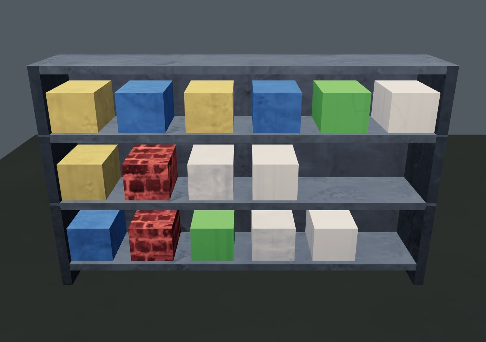
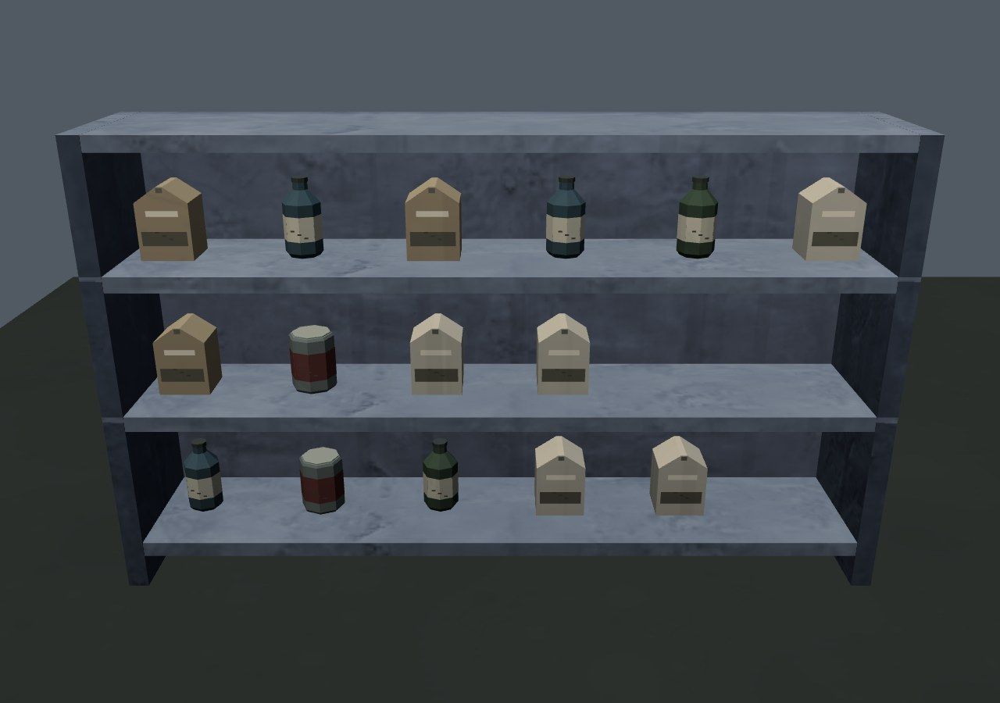
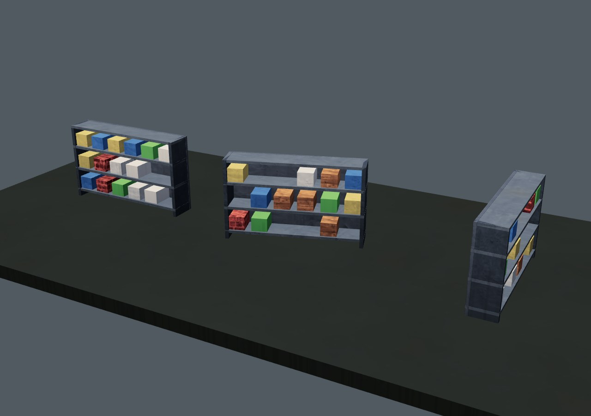
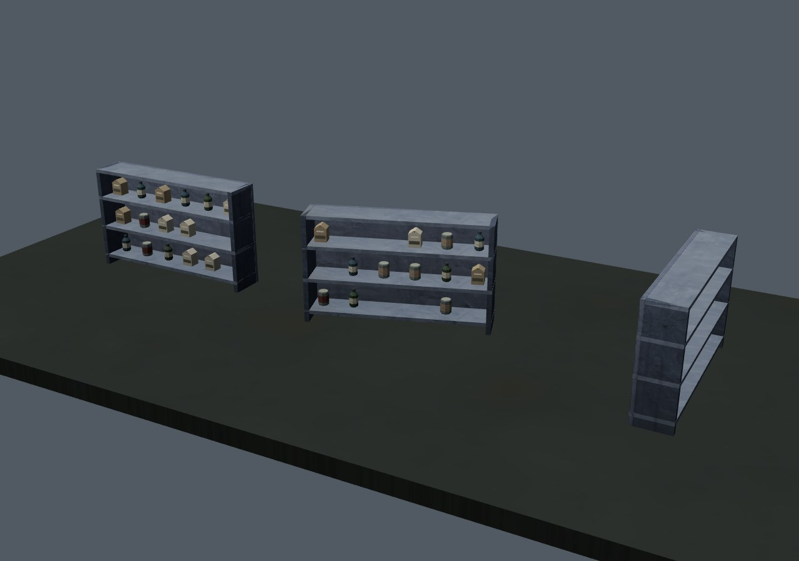

# Припасы на полках · 0.4.25

Содержимое штатных полок состояло из одинаковых цветных блоков. Автоматический выбор материала по цвету добавлял кирпичную или деревянную фактуру некоторым «продуктам». Теперь это банки с ободком и этикеткой, бутылки с плечиками и крышкой, картонные упаковки со складкой.

| Исходные блоки | Припасы |
| --- | --- |
|  |  |
|  |  |

## Устройство

Читаемый модуль `play/art/shelf-goods.js` оборачивает штатную генерацию полки. Исходный метод выполняется целиком: сохраняются последовательность случайных чисел, занятые ячейки, коллизия и контейнер добычи. Модуль распознаёт только точную сигнатуру исходных блоков содержимого, копирует остальную геометрию побайтово и заменяет эти блоки. Пустая полка остаётся прежней; нативный сборщик без геометрии не заполняется.

Новые примитивы создаются командой «Терры». Два ограниченных набора переиспользуются для низкого и обычного качества. Корпус бутылки/банки имеет 6 или 8 сегментов; на низком качестве убраны мелкие отметки на этикетках. Картон получил отдельный верхний сгиб. Упаковки непрозрачны, используют приглушённые цвета и общий материал со штатным загрязнением; строительный слой атласа отключён только для новых припасов. Новых текстур, моделей GLB, материалов и пакетов отрисовки нет.

В основном игровом бандле изменена только ссылка на дополнительный скрипт. Нативный игровой JavaScript совпадает с 0.4.24. Никаких новых полей сохранения не добавлено, формат profile v3 прежний.

## Проверка

`tests/shelf-goods.py` сравнивает исходный режим (`TERRA_ART.shelvesEnabled=false`) с новым. Остальной код и данные совпадают.

- 18 сочетаний: низкое/высокое качество, ширина 1/3/5 метров, поворот 0/π÷2/−0,4; полки стоят на общем основании высотой 3,25 метра.
- Первые 252 вершины каркаса, занятые места и цвета исходных ячеек, контейнеры, коллизии и следующие числа генератора совпадают. Пустая полка совпадает полностью. Метаданные трёх районов и рынка `(0, −3)` также совпадают.
- Все атрибуты согласованы, значения конечны, нормали единичные, порядок граней правильный. Вершины припасов остаются внутри прежних блоков; новые предметы не получают строительный материал. Бюджет — до 150 треугольников на занятую ячейку плюс штатный каркас.
- Настоящая полка рынка открыта через нативный обработчик, добыча перенесена в инвентарь. После сохранения и холодной перезагрузки сохраняются предметы и отметка обыска.
- Отдельная сцена с игровым материалом и освещением проверена без теней и с тенями солнца. Обновление теней задано явно: штатная игра ограничивает их частоту, и новая контрольная сцена не должна зависеть от флага предыдущего кадра.

| Три контрольные полки с основанием | Исходный режим | Новый режим |
| --- | --- | --- |
| Без теней | 1 вызов / 696 треугольников | 1 вызов / 3414 треугольников |
| С тенями солнца | 2 вызова / 1392 треугольника | 2 вызова / 6828 треугольников |

Детальные силуэты требуют больше треугольников, чем кубы. Для девяти одинаковых сочетаний полок с 126 предметами низкое качество использует **8748** треугольников, обычное — **11700**, включая каркасы. Это уменьшение геометрии низкого качества примерно на 25%; измерения FPS на физическом устройстве не проводились.

Сетевая и самостоятельная HTTP-версии проверяются в Chromium/SwiftShader. Кадры просмотрены. [Исходный отчёт](before.json) · [Новый отчёт](after.json). Физический телефон, дальние ракурсы мира и прямой запуск `file://` отдельно не проверялись.

Самостоятельный HTML: **38307920 байт**, SHA256 `0e7a24289ccb02c3a2f36ff588d9c70bb77b15e61026e0977737983b223cdeac`.
