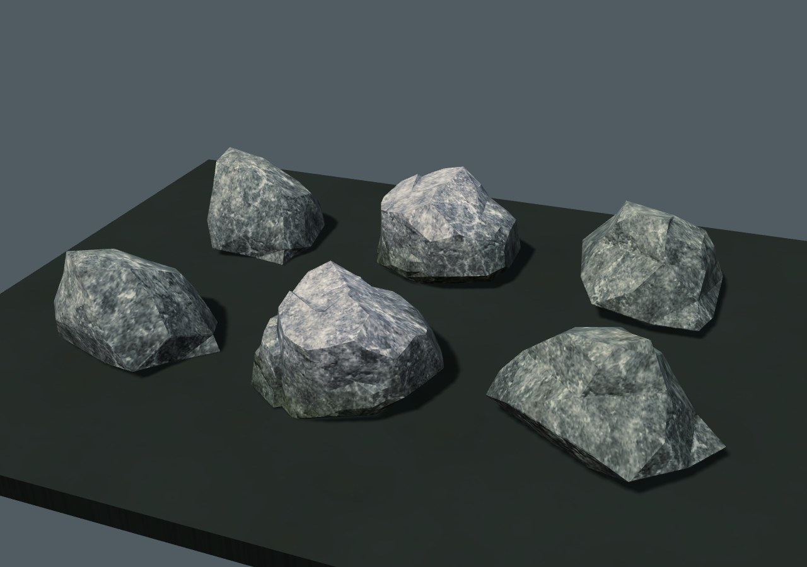
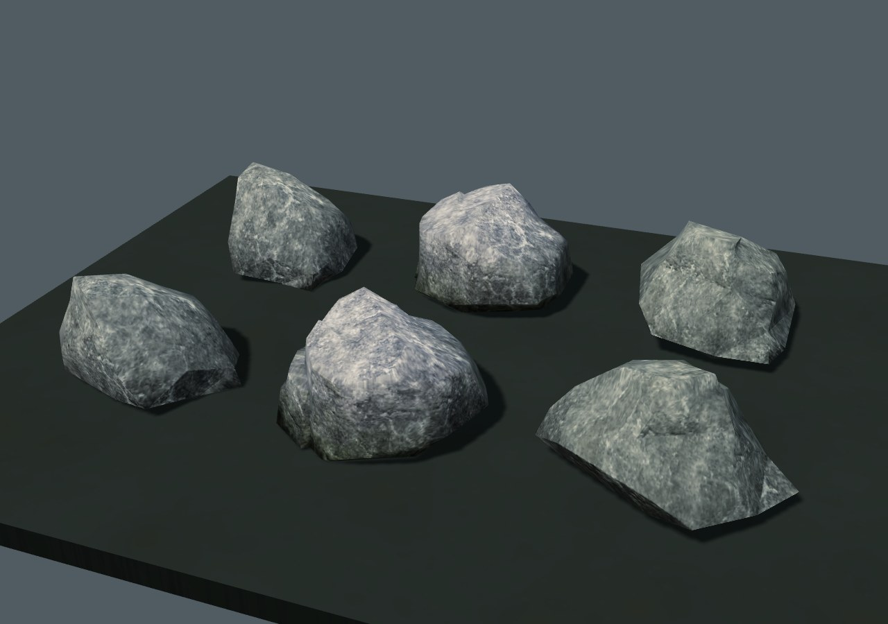
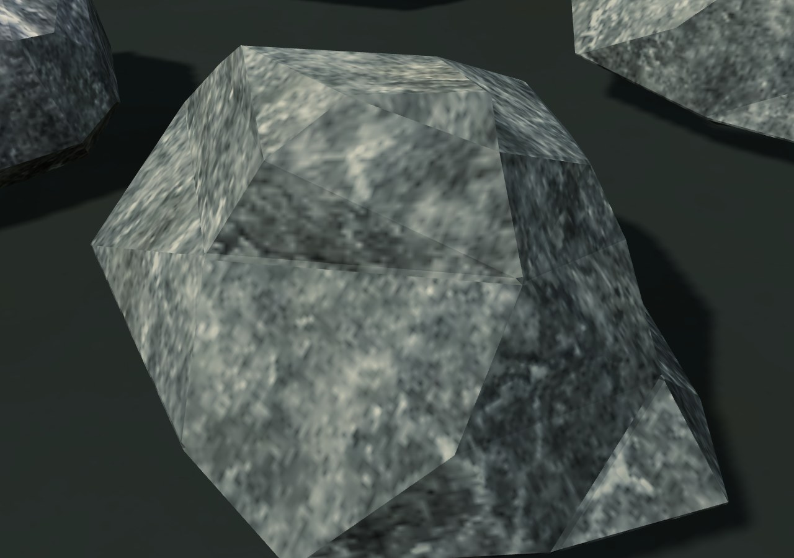
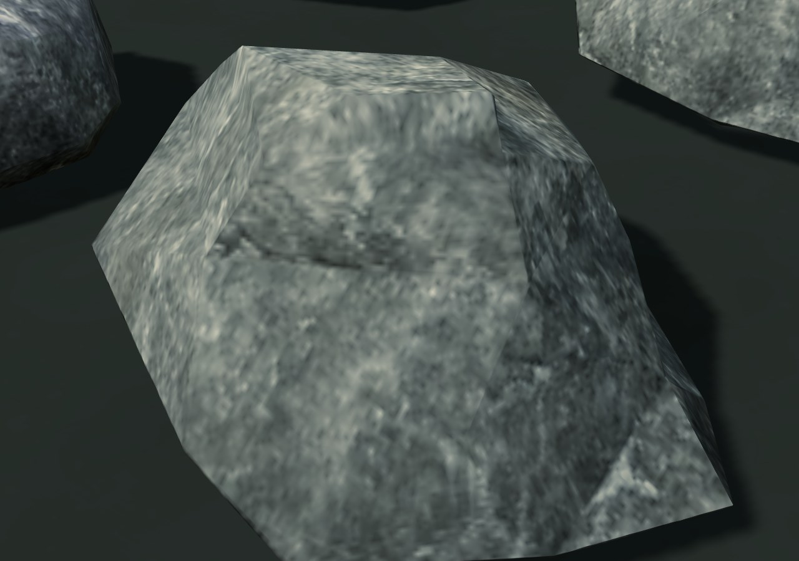
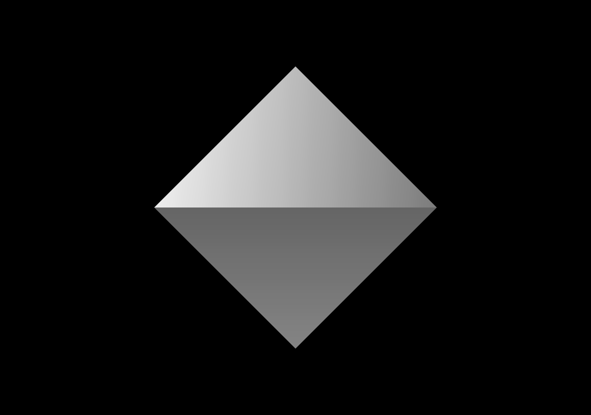
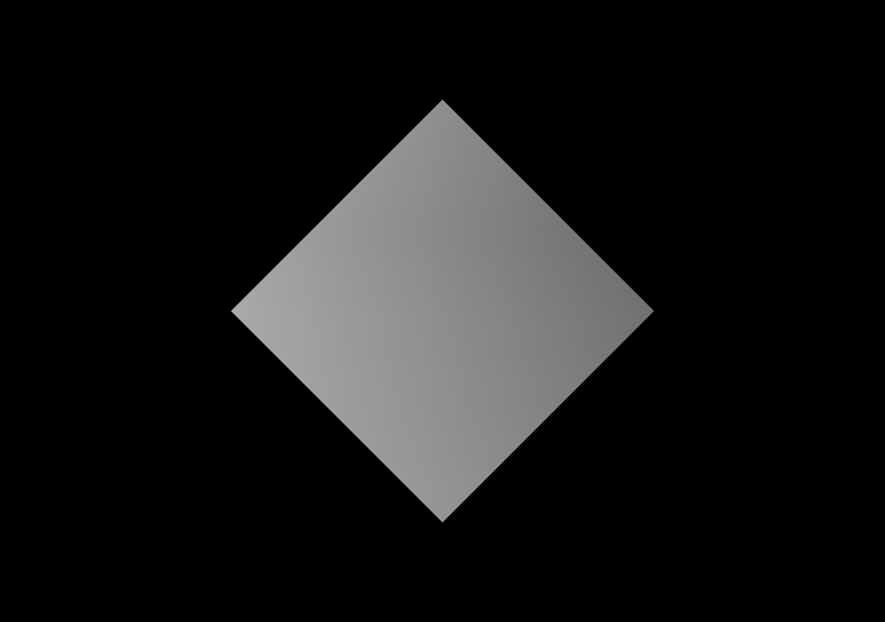

# Каменная поверхность · 0.4.27

После устранения отверстий в валунах на их гранях оставались заметные переходы рисунка. Нативный шейдер выбирал одно из трёх направлений проекции по максимальной компоненте нормали. Даже небольшой поворот грани мог резко переключить координаты текстуры. Плоские нормали усиливали границы освещения и мха.

| Исходная поверхность | Плавные переходы |
| --- | --- |
|  |  |
|  |  |

## Изменение

`play/art/rock-surfaces.js` собирает взвешенные по площади нормали совпадающих вершин восьми видов камней. Первый экземпляр переводится в исходную систему координат, дальнейшие используют ограниченный кэш. Учтены штатный поворот YXZ и положительный масштаб по высоте. Матрица считается один раз на экземпляр. Нормали записываются в прежний буфер; новых атрибутов вершин нет. Кэш восьми моделей занимает **46656 байт** и не хранит районы мира.

Необязательный вызов в `prop-materials.js` стоит перед окраской мха; штатная дополнительная окраска валуна также получает непрерывные нормали. Геометрия, контуры, габариты, расстановка, коллизии и случайные вызовы прежние.

В нативном `MeshPhongMaterial` слой Rock030 смешивает цвет и возмущение нормали из трёх мировых проекций. Веса меняются плавно вместе с нормалью поверхности. Остальные девять слоёв сохраняют исходную проекцию. Нативные освещение, загрязнение, намокание, отсечение и тени остаются в своих обработчиках. Новых текстур, материалов, ассетов или полей сохранения нет. Игровой бандл не менялся — только ссылки на читаемые скрипты.

## Проверка

`tests/rock-surfaces.py` сравнивает исходный режим (`TERRA_ART.rockSurfacesEnabled=false`) с новым:

- 24 сочетания: восемь моделей, три позы с разными поворотами всех осей и масштабом. Нормали совпадают с независимым расчётом по фактическим треугольникам, остаются единичными и непрерывными на общих вершинах. Проверены префикс сборщика, материал Rock030 и отсутствующая модель.
- Позиции, дополнительные атрибуты, материалы, UV, габариты и следующие числа генератора совпадают. Четыре посторонних пропса совпадают по всем буферам, включая нормали и цвет. Метаданные и рельеф девяти районов прежние.
- Шесть валунов с основанием и тенями солнца: в обоих режимах **2 вызова / 2584 треугольника**, без ошибок JavaScript и WebGL. Ожидалась реальная готовность PBR-атласа; кадры просмотрены.
- Кэш ограничен восемью записями, нормали занимают 46656 байт, отказов подключения нет. Проверка прежнего исправления индексов материалов `tests/prop-materials.py` проходит отдельно с отключённой новой поверхностью в обоих сравниваемых режимах.

Контрольный GPU-стенд использует два едва наклонённых треугольника с одинаковыми непрерывными нормалями и градиентный атлас. Влияние освещения исключено из выходного цвета; измеряются настоящие пиксели по обе стороны общей грани. Градиент за пределами своей области ограничен, чтобы повтор не создавал постороннюю границу.

| Переключение проекции | Плавное смешивание |
| --- | --- |
|  |  |

Перепад Rock030: **80 → 0 уровней RGB** в выбранной паре пикселей. Остальные девять слоёв сохраняют значения пикселей в пределах допуска 2/255. Это измерение конкретного стыка, а не заявление об отсутствии всех швов в мире. [Исходный отчёт](before.json) · [Новый отчёт](after.json).

Сетевая и самостоятельная HTTP-версии проверены в Chromium/SwiftShader. Каменный слой выполняет шесть выборок текстур вместо двух, поэтому неизменные треугольники и вызовы не означают ускорения FPS. Физические GPU/телефон и `file://` отдельно не проверялись; локальные стыки рельефа и другие материалы остаются в общем аудите.

Самостоятельный HTML: **38310024 байт**, SHA256 `a83d7d1e2c7111855803ac54561d81fa1c48b4f31380ed52b0a35c633407a87e`. Архивы ассетов и формат сохранений profile v3 прежние.
