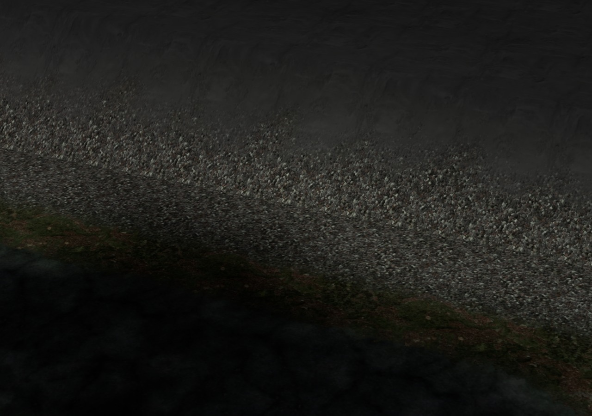
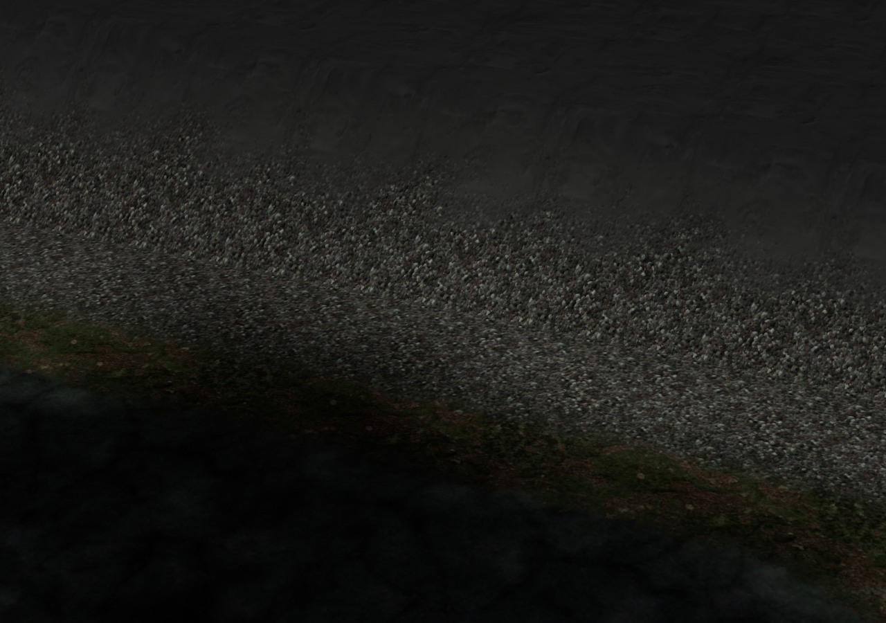

# Плавный свет · 0.4.30

Площадка здания выравнивала землю внутри своего района. Соседний район использовал исходную высоту того же образца при расчёте освещения. На стыке высоты совпадали, а нормали и маска склона — нет. Возникали перепад света и полоса другого покрытия.

| Разные нормали | Общее направление на стыке |
| --- | --- |
|  |  |

В кадре — настоящая земля районов `(1,0)` и `(1,1)`, штатный PBR и направленный свет. Предметы скрыты для осмотра грунта. На переднем склоне видна исчезнувшая полоса травы; форма площадки и земли прежняя.

## Изменение

Перед местным выравниванием площадок и углублением водоёмов сохраняется временная копия высот. В полосе 4 м вдоль края района направление освещения плавно переходит к общему исходному рельефу. На самой границе обе стороны используют одинаковый расчёт. Существующая маска камня/грунта на склонах получает то же направление.

Позиции вершин, физические высоты, сетка ходьбы, вода и коллизии не изменяются. Внутренние участки от 4 м сохраняют прежние значения. Новых моделей, текстур, материалов, GPU-атрибутов и вызовов отрисовки нет. Временная копия — **4096 байт** у обрабатываемого района; она создаётся только при наличии площадок или местных водоёмов и не сохраняется в мире. Формат сохранений — profile v3.

`scripts/apply-terrain-edge-normals.py` воспроизводит два точных изменения нативного бандла из 0.4.29, проверяет оба якоря и отвергает частичную правку. Повторное применение безопасно. Модульные исходники игрового бандла недоступны. Необязательный `TERRA_ART.terrainEdgeNormalsEnabled=false` отключает только эту коррекцию для сравнительной проверки; в обычной игре она включена.

## Проверка

`tests/terrain-edge-normals.py` сравнивает настоящую опубликованную 0.4.29, текущий код с отключённой коррекцией и обычный текущий режим.

- **16 контрольных случаев**: площадки у четырёх сторон, водоёмы вдоль двух осей, внутренняя площадка и пустая земля; положительные и отрицательные координаты. **9 настоящих заполненных районов**.
- Независимые разделённые разности по физическим координатам сетки и плавная интерполяция градиентов: **22 491 исходный образец**, максимальная ошибка нормали **2,98×10⁻⁸**. Исходные нормали конечны и единичны. Дополнительные вершины обрезки проёма метро интерполируются позднее; для них проверяются конечность нормалей и неизменность позиций.
- **360 общих точек**: максимальный перепад нормалей **0,510585 → 0**, весов покрытия **0,211032 → 0**. Высоты совпадают в обоих режимах.
- Позиции, полные поля высот/воды, сетка ходьбы, геометрия воды, коллизии, узлы, контейнеры, площадки, расстановка и следующие числа генератора совпали. Внутреннее покрытие от 4 м прежнее. Районы без местных изменений и внутренние контрольные площадки сохраняют весь рисунок и освещение.
- Отключённая коррекция точно воспроизводит численные данные опубликованной 0.4.29.
- Контрольная сцена: **2 вызова / 3376 треугольников** в трёх режимах; **JS0 / GL0**. Перед снимком ожидается готовность PBR; кадры просмотрены.

[Исходный отчёт](before.json) · [Проверка отключения](bypass.json) · [Новый отчёт](after.json).

Для исторического теста троп `tests/path-ground-transition.py` поздняя коррекция нормалей отключена в обоих режимах: он по-прежнему проверяет изменение троп относительно 0.4.28. Обычный режим нормалей проверяется отдельно текущим тестом. Историческая проверка троп также пройдена: 16 случаев и 9 районов, JS0/GL0; отчёты точно совпали с выпуском 0.4.29.

Сетевая и самостоятельная HTTP-версии прошли Chromium/SwiftShader; численные отчёты совпали точно. Физические GPU, телефон, запуск `file://` и ускорение FPS отдельно не проверялись.

Остаются цветовые стыки контактного затемнения от местных объектов: на этих же границах максимум **0,02285**. Это отдельная следующая работа; исправление нормалей не означает завершения всей графики.

Самостоятельный HTML: **38 310 607 байт**, SHA256 `0c725b9ca28dd6cddfb469392eeb0f82e16b444e462f3bd4d9cc1f78d6db1ba0`. Архивы ассетов прежние.
