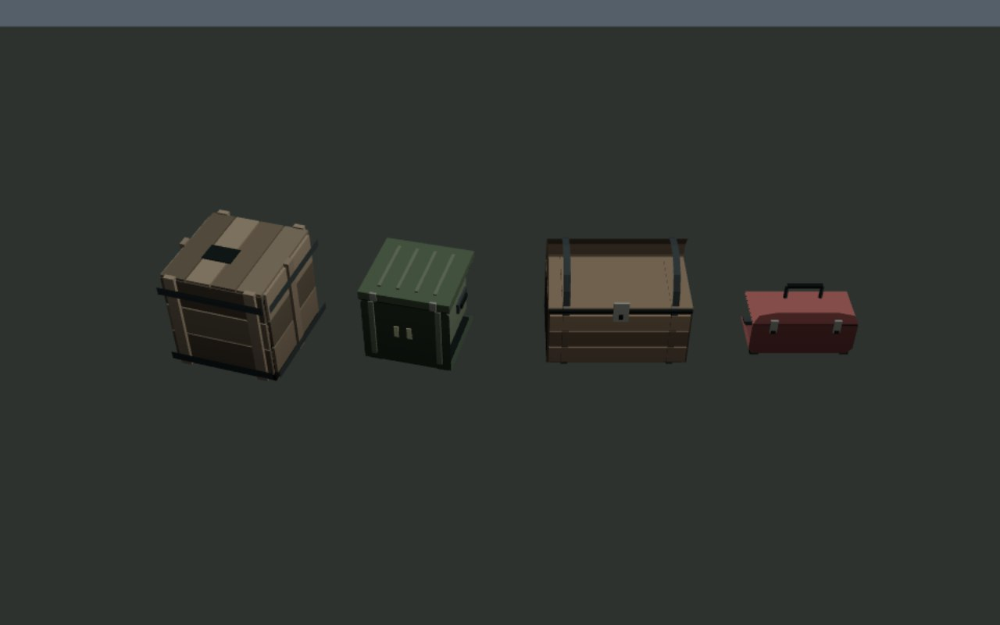

# Детали мира · 0.4.19

## Мелкие контейнеры

[До](props-before.jpg) · [После](props-after.jpg). Это крупный план в проверочной сцене игрового рендерера, с его материалом и освещением. Деревянный и армейский ящики показаны в резервном варианте: готовые статические модели `TERRA_KITS` продолжают использоваться. Новая геометрия также применяется к разрушаемому ящику в мире. Продукт не содержит проверочную сцену.

| Объект | Треугольники · низкое качество | Высокое качество |
| --- | ---: | ---: |
| Разрушаемый / резервный деревянный ящик | 304 (прежний разрушаемый: 168) | 372 |
| Резервный армейский ящик | 236 | 236 |
| Сундук | 240 | 240 |
| Инструментальная коробка | 244 | 268 |

Тонкие металлические ленты, накладки и обручи используют поверхности вместо скрытых граней. На этапе доработки это сократило ящик с 384 до 304 треугольников, сундук с 400 до 240. Новых материалов, текстур, файлов моделей или вызовов отрисовки нет. Геометрия подробнее исходных примитивов; улучшение кадровой частоты не заявляется.

`tests/salvage-props.py` сравнивает низкое/высокое качество и резервные формы, метаданные/ГСЧ трёх чанков, проверяет разрушение настоящего ящика, освобождение коллизии, сохранение/перезагрузку и повторное использование instanced-геометрии. Основание ящика находится на нативной отметке ноль. Проверки прошли онлайн и в самостоятельном HTML через HTTP; ошибок JS 0.

## Переход покрытий районов

[Игровой кадр до](terrain-before.jpg) · [Игровой кадр после](terrain-after.jpg).

Нативный генератор задавал базовый цвет и веса покрытий отдельно для каждого типа района. На общей границе участков значения расходились. В дополнение уклон для окраски вычислялся по другому градиенту, чем стыкуемые нормали.

В четырёхметровой полосе с каждой стороны границы смешивается основа соседних районов; в углу учитываются четыре района. Далее штатно накладываются дороги, вода, локальные тропы, основания и затемнение. Уклон для окраски использует стыкуемые нормали. Кэш классификации ограничен 256 короткими именами районов и не удерживает чанки.

`tests/terrain-blend.py`: шесть границ, включая отрицательные координаты и обе оси. Максимальный скачок линейного цвета **0,096276 → 0**, веса материала **0,934196 → 0**. Хеши позиций, нормалей, внутренних цветов/весов, коллизий и ГСЧ совпали с исходными. Онлайн и самостоятельный HTML через HTTP — PASS, ошибок JS 0. Это проверка базовых покрытий; все локальные стыки троп, объектов и берегов таким результатом не объявляются устранёнными.

Отдельный замер генерации участка (2,2), Chromium/SwiftShader на облачном CPU: медиана 9 выборок после прогрева — 7,7 мс без смешивания и 6,3 мс с ним. Разброс значительный (до 34 мс); этот замер не подтверждает ускорение FPS. [Исходные выборки](generation-timing.json).

Регрессия `tests/metro-ground.py` прошла: проём/ступени/ходьба, вход снизу и возврат, меню повторного захода, выгрузка кэша, плиты и прежние границы.

Исходники: `play/art/salvage-props.js`, `play/art/terrain-blend.js`. Воспроизводимые адаптеры: `scripts/apply-salvage-props.py`, `scripts/apply-terrain-blend.py`; повторное применение и восстановление итогового бандла из v0.4.18 проверены. Формат profile v3 прежний. Физический телефон и file:// не проверены.

Остаток художественной работы перечислен в [аудите графики](../../GRAPHICS_AUDIT_RU.md).
