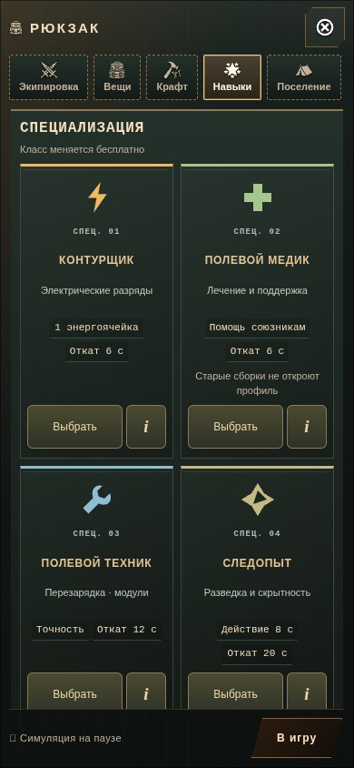
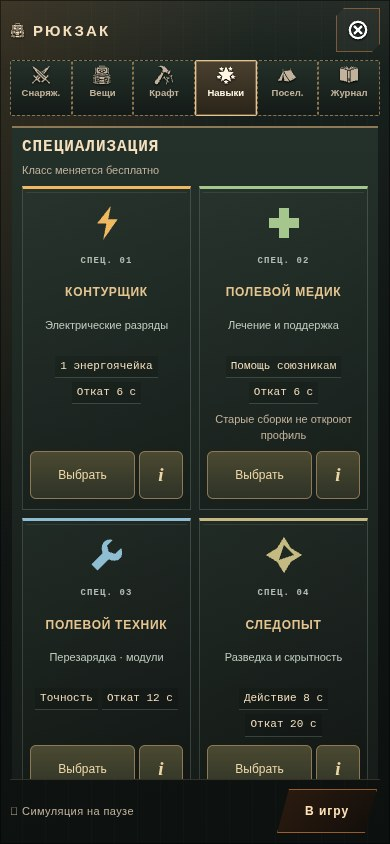
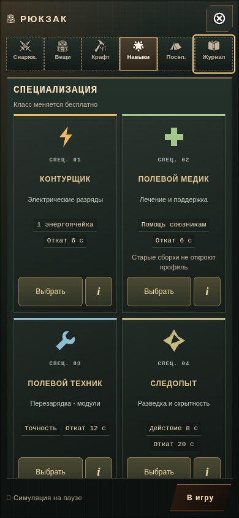

# Все разделы под рукой · 0.4.37

На узком экране за правой границей рюкзака скрывался «Журнал», а на ширине 320 пикселей — ещё и часть «Поселения». Теперь шесть значков с короткими подписями помещаются в один ряд. Полные названия сохранены в доступных именах кнопок.

| До · 390 × 844 | После · 390 × 844 |
| --- | --- |
|  |  |

На широком экране остаются полные подписи, в альбомной ориентации — боковая панель. Общий CSS-переход больше не анимирует размеры вкладок при повороте: плавной остаётся только подсветка. На низком альбомном экране панель прокручивается к выбранной или сфокусированной кнопке.

[320 × 568](narrow.jpg) · [844 × 390](landscape.jpg) · [812 × 320](short-landscape.jpg) · [1382 × 964](desktop.jpg)

## Клавиатура и фокус

- В горизонтальном ряду — стрелки влево/вправо; в боковой панели — вверх/вниз. Переход с последней кнопки ведёт к первой и наоборот.
- Home/End переводят фокус к первому/последнему разделу.
- Стрелки меняют только фокус. Enter или Пробел открывают выбранный раздел через прежний обработчик кнопки.
- У вкладок одна точка входа с Tab; текущая кнопка связана с панелью и отмечена `aria-selected`.

Если выбор класса ещё сохраняется, игрок может перевести фокус в навигацию. Завершение операции больше не возвращает его самовольно в карточку класса. Обычный возврат после выбора, приёма и отмены остаётся.

## Проверка

`tests/backpack-navigation.py` использует одноразовый профиль Chromium с эмуляцией касания. Реальные нажатия открывают все шесть вкладок при 320 × 568, 390 × 844, 844 × 390 и 1382 × 964. После прогрева штатных разделов полный игрок и исходная строка сохранения сравниваются побайтно после каждого перехода. Проверяются видимость кнопок, цель не меньше 44 пикселей, подписи, ARIA-связь, стрелки, перенос через край, Home/End и активация Enter/Пробелом. На 812 × 320 отдельно проверяются последняя вкладка и повторное открытие рюкзака.

Асинхронный выбор класса задержан обёрткой над настоящим `game.commitClass`: пока операция ожидает, фокус перемещается на «Поселение». После вызова исходного сохранения Контурщик действительно выбран и записан, фокус остаётся в навигации, Enter открывает «Поселение».

[Исходный узкий ряд](report-before.json) · [Проверка веб-версии](report-online.json) · [Проверка самостоятельного HTML](report-offline.json)

Сценарий прошёл в веб-версии и самостоятельном HTML; полные числовые отчёты совпали. Ошибок JavaScript нет. Самостоятельный файл — **38 273 003 байта**, SHA256 **36984c39be6d0d611fba617bd933a59dac31be01f083ef5a4b0c6c0c6be58370**.

`tests/class-dossier.py` повторно проверяет исходную справку, выбор и снятие Контурщика, подтверждение/отмену техника, сохранённый профиль v3, Следопыта, продолжение после перезагрузки и блокировку недопустимого профиля. Возврат фокуса после штатных действий сохранён; [отчёт регрессии](class-regression.json), ошибок JavaScript нет.

Изменения в `backpack.js` добавляют обработку навигации к тем же кнопкам. Прежние обработчики вещей, экипировки и предпросмотра не изменены. В `class-dossier.js` добавлена проверка текущего фокуса. Игровой бандл отличается от 0.4.36 только тремя версиями URL для кэша; модели, звук, правила и формат сохранений прежние. Покадрового опроса и новых зависимостей нет.

Кадры сняты из настоящего интерфейса с остановленным игровым циклом; мир отрисован отдельно для снимков после изменения. Это эмуляция размеров и касания, не проверка физического телефона или FPS. Самостоятельный HTML проверен через локальный HTTP: политика Chromium в этой среде блокирует переходы `file://`.
