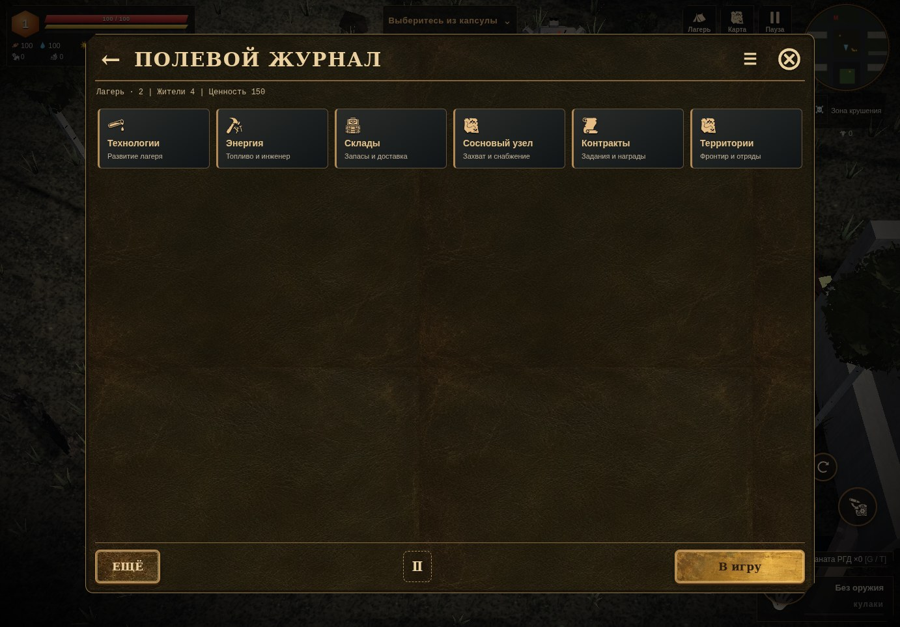
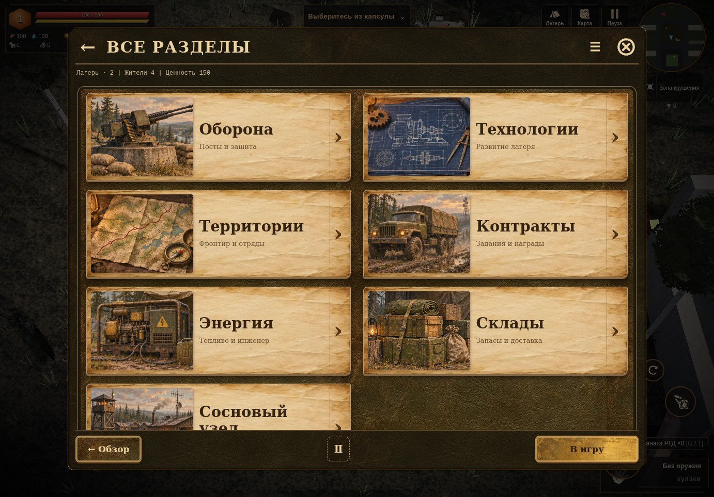
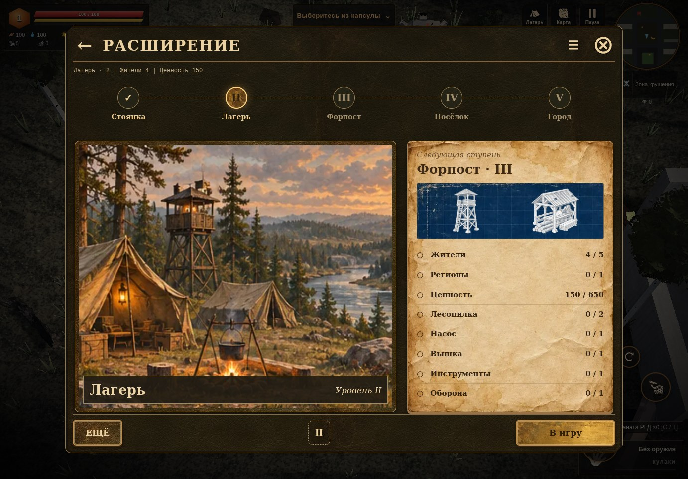
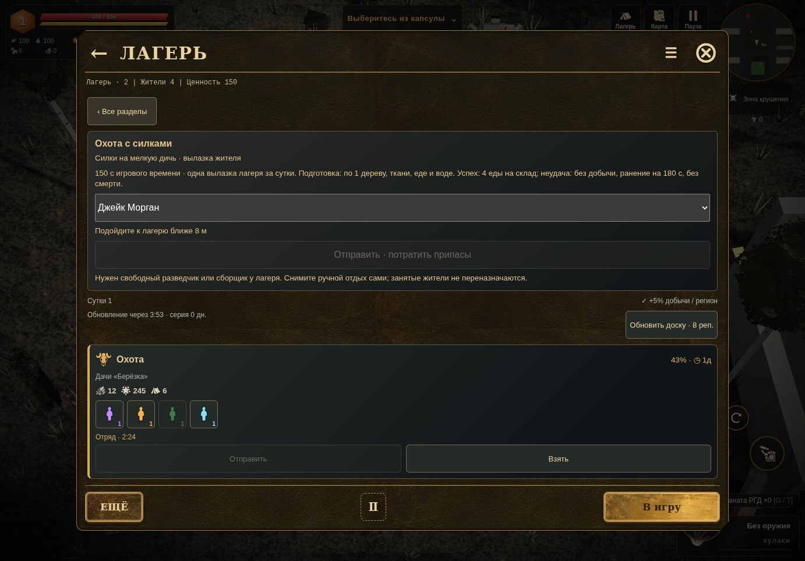
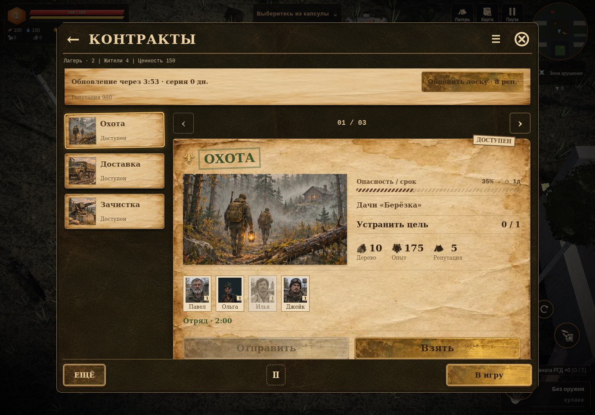

# Наряды и рубежи · 0.4.39

Продолжение оформления по новым референсам владельца: кожаный альбом, тёплая бумага, фотографии, штампы и латунь. Этот выпуск охватывает «Все разделы», расширение и контракты. Имена, уровни, условия, сроки, награды и команды берутся из настоящего состояния игры.

## Все разделы

| До | После |
| --- | --- |
|  |  |

Оборона, технологии, территории, контракты, энергия, склады и Сосновый узел доступны крупными закладками. Каждая сохраняет прежнюю кнопку и обработчик. Стрелка возвращает из раздела в альбом; «Обзор» — на главную лагеря. Добавляемые через штатный API разделы также получают закладку, даже если зарегистрированы после оформления альбома.

[Телефон](portrait-index.jpg) · [Узкий экран](narrow-index.jpg) · [Альбомная ориентация](landscape-index.jpg)

## Развитие поселения

На линии — пять уровней, которые действительно существуют в игре: Стоянка I, Лагерь II, Форпост III, Посёлок IV и Город V. Подсвечен текущий. Лист справа показывает ближайшую ступень и её настоящие требования: жители, ценность, регионы, постройки и технологии. Отметки проверяются штатным запросом `WL`, а текущий шаг расширения — `Z1`; формулы и условия не продублированы в новом интерфейсе.

Прежняя карточка текущего шага остаётся ниже: найти людей, открыть условия, выбрать отряд, перейти к району, построить аванпост, продолжить доставку или изучить технологию. Сохранены исходные причины недоступности, стоимость и подтверждения. Экран показывает рост, а не вводит новый способ обхода требований или покупки уровня.

[Расширение на телефоне](portrait-expansion.jpg) · [Условия следующей ступени](portrait-expansion-goals.jpg) · [320 пикселей](narrow-expansion.jpg) · [Текущий шаг](portrait-expansion-action.jpg)

## Контракты

| Прежняя доска | Бумажные наряды |
| --- | --- |
|  |  |

Один наряд виден полностью; остальные выбираются сбоку на ПК или в ленте на телефоне. Стрелки и счётчик помогают листать. У карточки есть состояние, регион, цель и настоящий прогресс, риск, срок, награда с подписями. Персональный портрет, если он есть в игре, совпадает с картотекой; для остальных используется тот же постоянный набор вымышленных лиц. Подсветка и галочка показывают выбранных участников; недоступные жители остаются недоступными по исходным правилам. Сам шанс успеха пересчитывает прежний обработчик игры.

При переключении скрываются карточки, а их элементы сохраняются: выбор отряда не сбрасывается. На обновлении доски сохраняется выбранный ID, если контракт ещё существует. Стрелки, Home/End и клавиши активации работают в списке нарядов; выбранная закладка видна при листании и повороте. Старые кнопки «Взять», «Отправить», обновление за репутацию и переходы операций остаются на месте вместе с исходными обработчиками.

Охота с силками находится в отдельном раскрывающемся разделе. Его цены, предупреждения о риске и отзыве, выбор жителя и сообщения записи сохранены. Активная охота открывает этот раздел автоматически.

[Верх доски](desktop-contracts.jpg) · [Контракты на телефоне](portrait-contracts.jpg) · [Выбор и отправка](portrait-contracts-actions.jpg) · [Узкий экран](narrow-contracts-actions.jpg) · [Действующая отрядная миссия](active-squad.jpg) · [Пустой лагерь](empty-contracts.jpg)

## Проверка

`tests/camp-dispatch.py` проходит в веб-версии и самостоятельном HTML через локальный HTTP:

- Четыре размера окна: 1382 × 964, 390 × 844, 320 × 568 и 844 × 390; пустой лагерь, затем четыре жителя, включая раненого. Все семь настоящих разделов, возврат и главная; без горизонтального выхода контролов, подвал ниже содержимого и закрытие внутри окна.
- Настоящие требования следующего уровня точно совпадают с запросом игры. Проверены все пять рангов, включая последний. Полный игрок и исходная строка сейва не меняются от чтения, навигации и предварительного выбора отряда.
- Изображения и портреты действительно декодируются; штатный персональный портрет совпадает в картотеке и отряде. На доске одна активная карточка; выбор доступного участника меняет штатный шанс, раненый недоступен. Переключение туда и обратно сохраняет выбор и шанс. Клавиатура, перенос через край списка, поворот, охотничья форма, новый зарегистрированный раздел и возврат работают.
- Прежняя кнопка обновления списывает настоящую репутацию и закрывается до следующего дня. «Взять» создаёт личное задание и закрывает меню; «Отправить» создаёт отрядную миссию с выбранным жителем. После сохранения и холодной загрузки миссия и состав доступны в новом интерфейсе. Ошибок JavaScript нет.

[Отчёт online](online.json) · [Отчёт standalone HTTP](offline.json)

Финальная адаптация всех трёх экранов, целых названий, счётчика и выхода отдельно проверена на тех же четырёх размерах: [layout online](layout-online.json) · [layout standalone](layout-offline.json). Числовые отчёты каждой пары совпадают.

Регрессии `tests/camp-fieldbook.py` и `tests/camp-info.py` проверяют прежние папки, жителей, дела, назначения, чертежи, мировые группы, справку, фокус и чтение без изменений игрока/сейва. Повторная проверка экономики сбора не требовалась: код сбора из 0.4.38 не изменён.

В ядро добавлен только экспорт двух уже существующих чистых запросов и прежней фабрики портрета, без изменения их кода. `scripts/apply-camp-album-data.py` применяет его строго и повторяемо. Обратное удаление экспорта, двух подключений и версий URL полевого альбома возвращает `play/index.html` 0.4.38 побайтно. Формат profile v3, игровые команды, экономика, вероятности, таймеры, модели, архивы и звук прежние.

Девять новых WebP — **411 872 байта**. Иллюстрации сделаны для навигации и нарядов, это не кадры нынешних 3D-моделей. [Происхождение и упаковка](../../../tools/art/camp-dispatch/README.md). В самостоятельном HTML каждая картинка встраивается один раз через CSS-переменную; внешних шрифтов, библиотек и новых циклов симуляции нет.

Снимки — настоящий интерфейс в Chromium/SwiftShader на контролируемых тестовых данных. Цикл мира остановлен, сцена отрисована отдельно. На телефоне показаны верх и низ одного прокручиваемого наряда. Это проверка размеров и эмуляция касания; физический телефон, FPS и `file://` не проверялись. Проверка остальной графики мира продолжается отдельно.

Самостоятельный файл — **39 680 352 байта**, SHA256 **e921a6862eef352d8447390c00d68c3ea3273dca4877c5d82016491d3dc8ef81**; 23 классических скрипта и 7 таблиц стилей.
