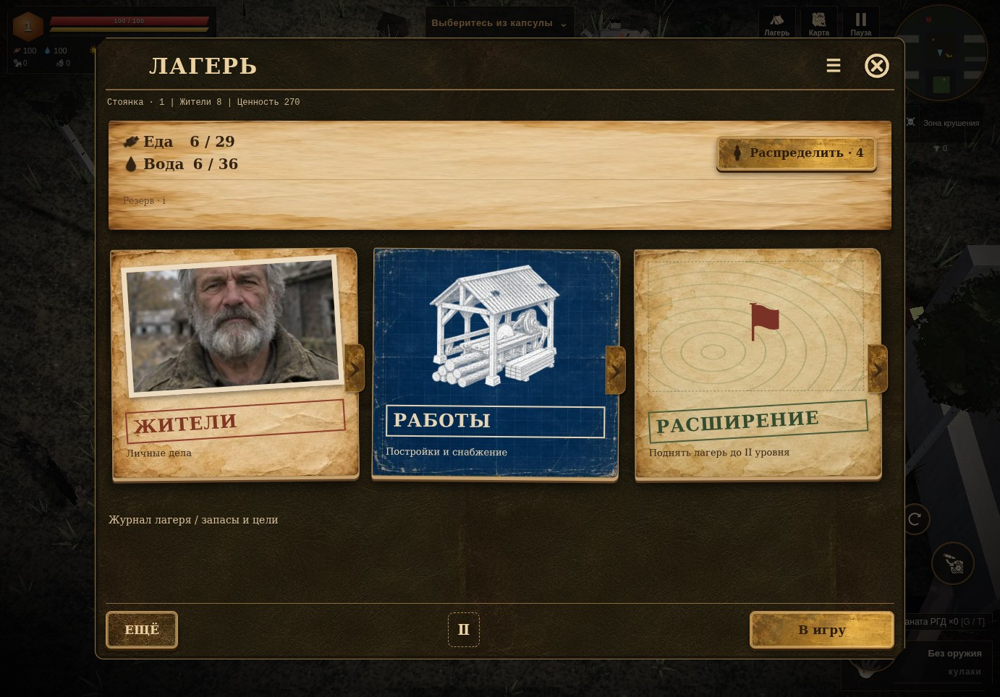
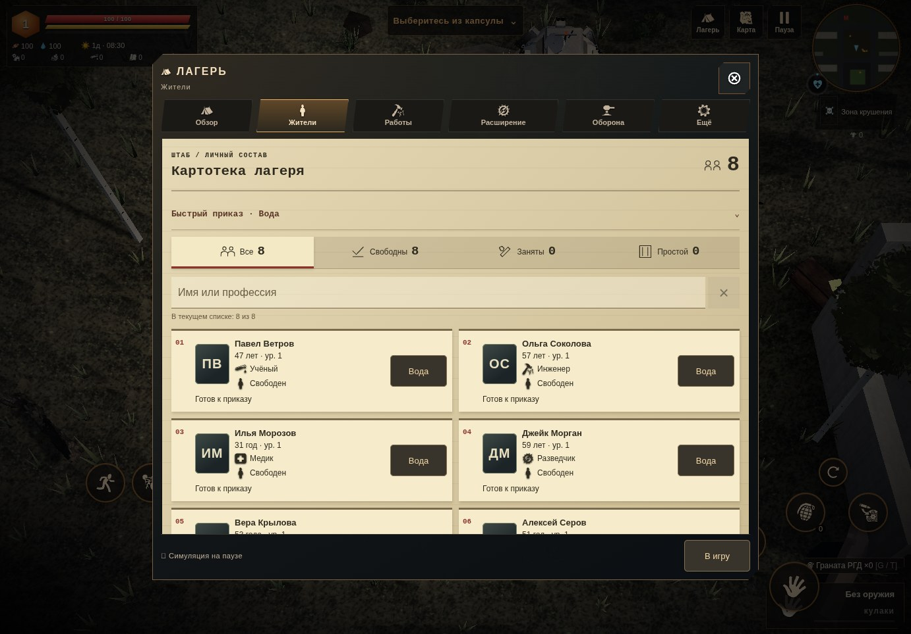
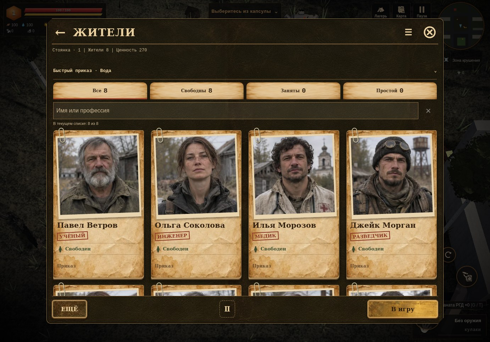
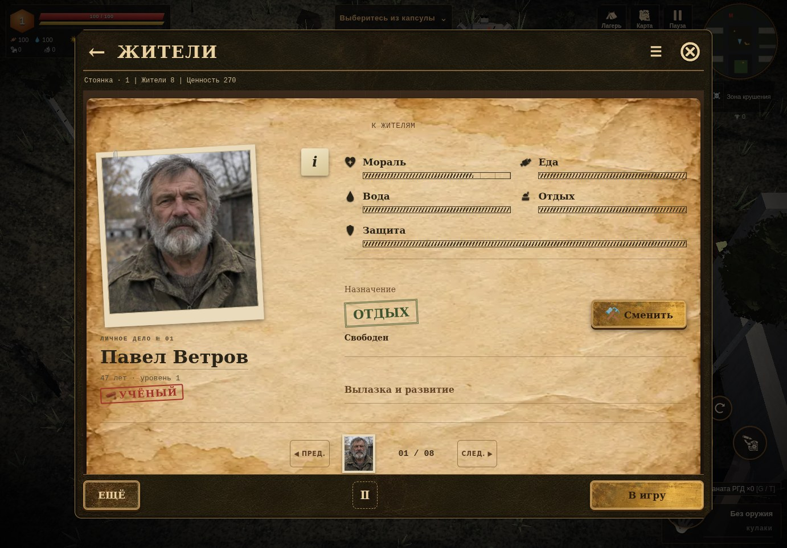
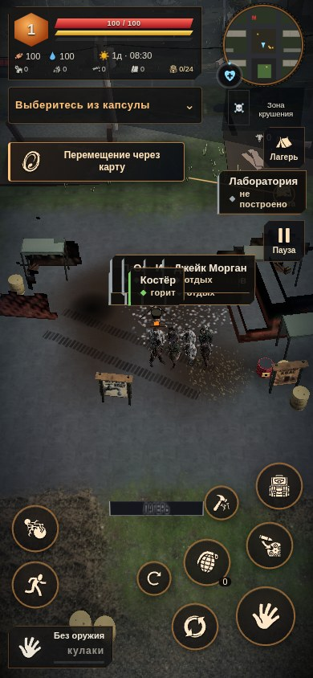
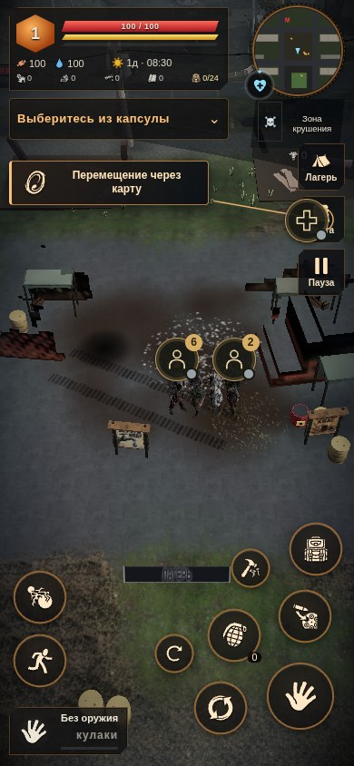
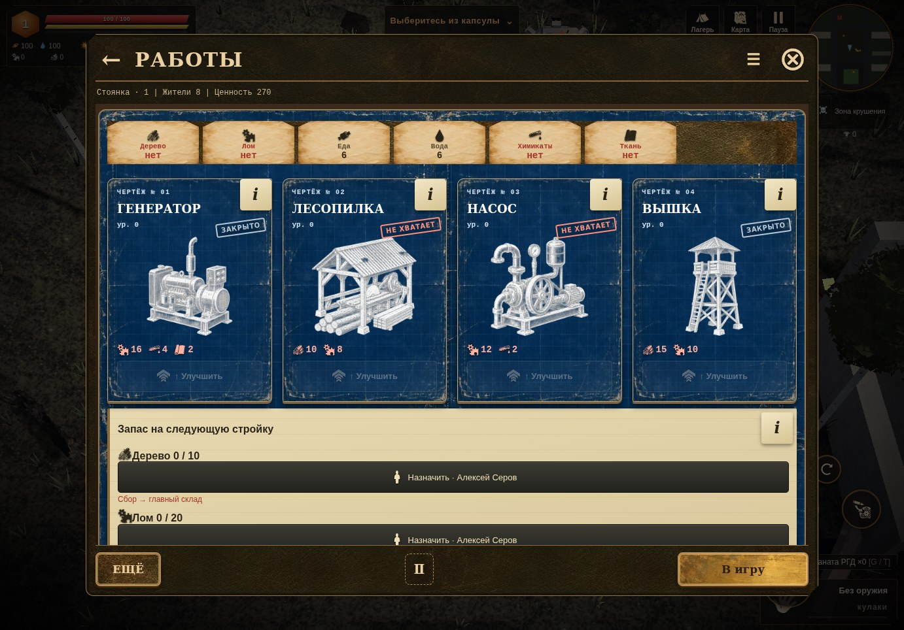

# Полевой альбом · 0.4.38

Оформление следует новым референсам владельца: тёмная кожа, потёртая бумага, фотографии со скрепками, штампы, латунь и синие рабочие чертежи. Имена, профессии, цифры, цены и состояния рисует игра из настоящих данных; готовые изображения экранов с фиктивными значениями не используются.

## Лагерь и жители

На главной — снабжение и три крупных входа: жители, работы, расширение. Запасы и цели раскрываются отдельным журналом; все прежние разделы доступны через кнопку меню и «Ещё». Кнопка распределения использует прежнее защищённое назначение. Значок `Ⅱ` объясняет, что открытый альбом приостанавливает мир и жители продолжат работу после «В игру».

| Картотека до | Фотокарточки после |
| --- | --- |
|  |  |

На ПК — четыре карточки в ряд, на телефоне — две. Сохранены поиск, фильтры, личные дела и быстрые приказы. Персональный портрет используется, если он есть; для остальных карточек выбран постоянный вариант из восьми вымышленных портретов. Новых данных жителя в сейве не создаётся.

Личное дело показывает потребности и назначение. «Сменить» раскрывает настоящие кнопки работ с их ограничениями. История, навыки и снаряжение доступны через `i`, развитие и вылазка — отдельным разделом. Листание сохраняет порядок текущего отфильтрованного списка; поэтому после поиска одного имени счётчик дела показывает `01 / 01`.

[Жители на телефоне](portrait-residents.jpg) · [Личное дело на 320 пикселях](narrow-dossier.jpg) · [Альбомная ориентация](landscape-dossier.jpg) · [Пустой лагерь](empty-residents.jpg)

## Компактные метки

| Прежние надписи | Компактные знаки |
| --- | --- |
|  |  |

Постоянные имена и строки состояния убраны. Над персонажем остаётся знак работы или группы; цвет показывает состояние. Близкие жители объединяются со счётчиком. По нажатию можно выбрать каждого участника и открыть его дело или прежние приказы. На ПК доступны подсказка при наведении и клавиатура.

Показ ограничен четырьмя знаками на узком экране и шестью на широком. Метки не накладываются друг на друга и учитывают расположение HUD; жители в вылазке, плену и погибшие не создают ложных меток в лагере. Повторные 3D-надписи скрыты; высота знака учитывает грунт так же, как штатная подпись персонажа.

Карточка остаётся внутри окна при повороте экрана, её заголовок с закрытием закреплён при прокрутке. Стрелки, Home/End и Tab перемещают фокус; Escape закрывает карточку. Клавиши не передаются управлению персонажем, пока открыты команды.

[Выбор человека в группе](context-card.jpg) · [Команды жителя](resident-context.jpg)

## Работы и доставка

У четырёх основных построек — инженерные иллюстрации; ещё шесть построек находятся в раскрывающемся разделе. Цены, доступность, улучшения и подробности используют исходные данные и обработчики. В режиме размещения сохранены синий призрак, выбор места жестом, поворот, фиксация клетки и штатная проверка; кнопка установки оформлена латунной печатью.

У сборщика уже существовал маршрут к ресурсу, но таймер работы шёл и в дороге. При длинном обходе старый порог расстояния мог телепортировать его к цели. Теперь порядок такой:

`путь → работа на месте → возврат с грузом → сдача на склад`

Работа и опыт не растут до прибытия. После трёх четвертей существующего периода житель возвращается с видимым грузом; ресурс зачисляется после сдачи. Сборщик не телепортируется через длинный обход. При неподвижном упоре в препятствие показан перекрытый проход; после освобождения маршрута причина сбрасывается. Эффективный темп добычи учитывает время пути.

Жителя, оставшегося у неработающей старой постройки, можно переназначить через «Сменить»: штатный обработчик снимает прежнюю привязку. Пользовательские приказы автоматически не заменяются. Производственные постройки, перевозки, строительство, цены и защищённые транзакции сохраняют прежние функции.

## Проверка и границы

- `tests/camp-fieldbook.py`: пустой лагерь, затем восемь настоящих нанятых жителей; четыре размера окна — 1382 × 964, 390 × 844, 320 × 568, 844 × 390. Папки, декодирование портретов, поиск, личное дело, раскрытие работ, справка с возвратом фокуса, чертежи, расширение и остальные разделы. Верхняя панель над содержимым, выход снизу, горизонтального выхода контролов нет. Полный игрок и исходная строка сейва не меняются от чтения.
- В мировой сцене проверены компактные цели 48 пикселей, отсутствие взаимного перекрытия и повторных 3D-имён, выбор участника группы → настоящее личное дело, поворот, прокрутка и клавиатурный фокус. Восемь близких жителей на контрольном кадре дали две группы `6 + 2`.
- `tests/camp-gather-arrival.py`: реальное назначение через кнопки, снятие старой привязки, закрытая тестовая комната без работы/опыта/добычи и восстановление после снятия препятствий; длинная тестовая стена без телепортации и начислений. Затем настоящие точки ресурсов и препятствия мира, работа, видимый груз, сохранение на обратном пути, продолжение, ровно одна сдача и повторная перезагрузка без дублирования.
- `tests/camp-info.py`: четыре размера, фокус и его ограничение внутри справки, прокрутка, закрытие, возврат, чертежи, штатное обновление и очистка неактивного фона.
- `tests/camp-live.py` в режиме `TERRA_LIVE_FOCUSED=1`: защищённые контекстные приказы и продолжение сейва; настоящий жест чертежа, сохранение выбранной клетки после отпускания и поворота, подтверждение этой клетки и отмена. Замер FPS в этом режиме не выполнялся.

Основные сценарии прошли в веб-версии и самостоятельном HTML через локальный HTTP; их полные числовые отчёты совпали: [интерфейс online](ui-online.json), [интерфейс offline](ui-offline.json), [сбор online](gather-online.json), [сбор offline](gather-offline.json). Ошибок JavaScript нет.

Ядро отличается от 0.4.37 четырьмя строгими изменениями сбора, двумя подключениями альбома и версией URL навигации. Обратное применение замен даёт исходный HTML побайтно; скрипт — `scripts/apply-camp-gather-arrival.py`. Новых полей сохранения нет: используются прежние положение, работа и причина остановки. Общие модели, звук и архивы ассетов не изменены.

Шестнадцать WebP занимают **487 060 байт**. Это собственные материалы проекта, вымышленные портреты и иллюстрации; [происхождение и упаковка](../../../tools/art/camp-fieldbook/README.md). Сборщик встраивает их в CSS самостоятельного HTML. Внешних шрифтов, библиотек и новых 3D-моделей нет.

Самостоятельный файл — **39 091 633 байта**, SHA256 **0d4f2a454813804a0303218d2f9de1a09efb497b9a38cbcd72e789092bc03ce2**; 22 классических скрипта и 6 таблиц стилей. Снимки — настоящий интерфейс и контролируемый тестовый лагерь в Chromium/SwiftShader. Для снимков цикл остановлен, сцена отрисована отдельно; сравнение меток использует одинаковые позиции жителей и камеру. Это эмуляция размеров и касания, физический телефон, FPS и `file://` не проверялись. Проверка всей графики мира продолжается отдельно.
