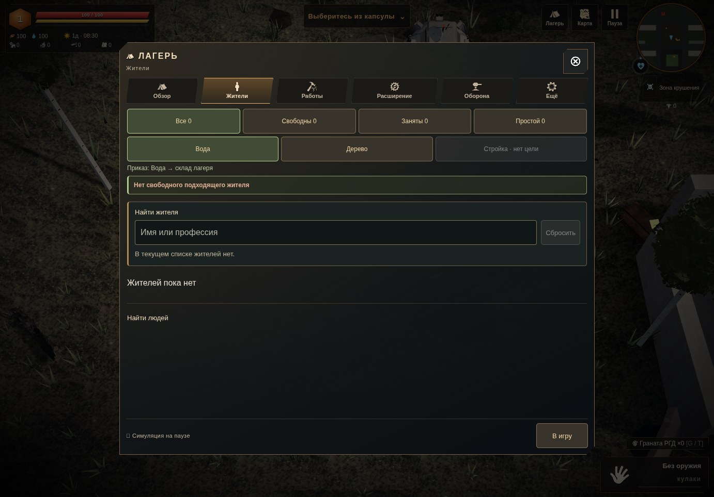
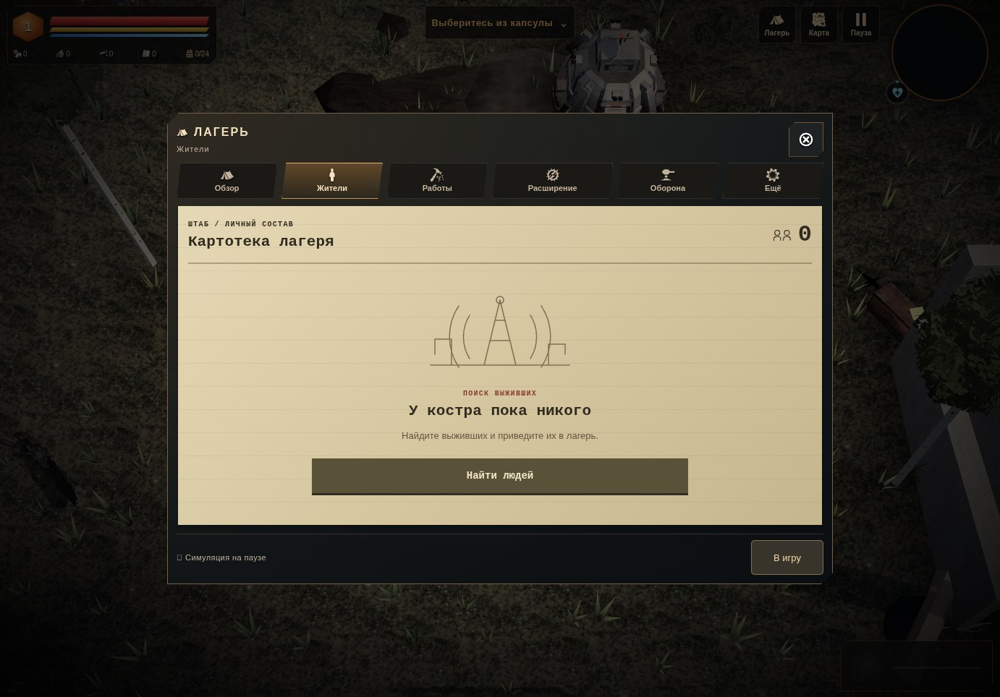
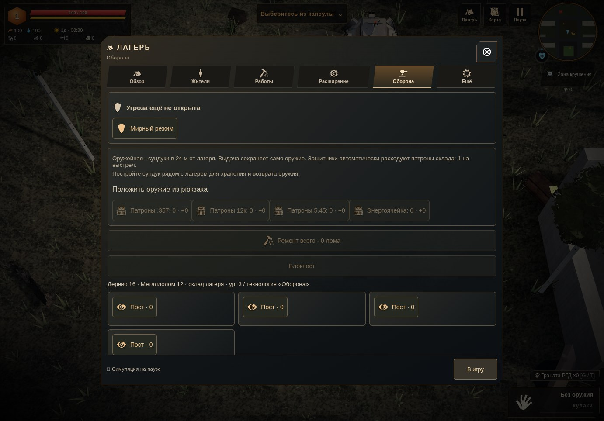
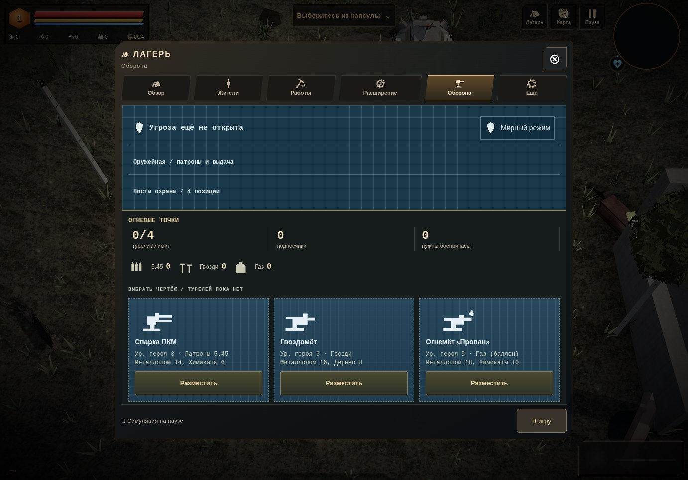
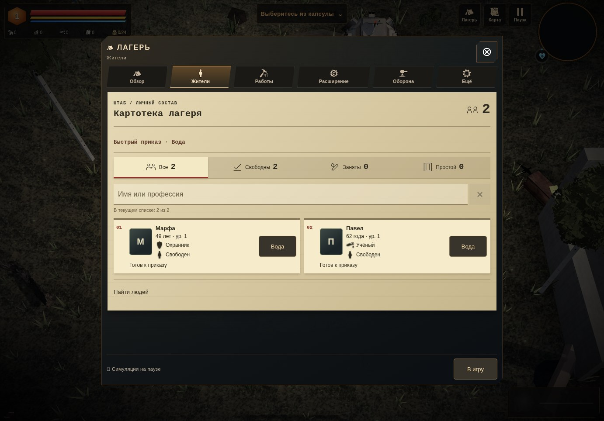
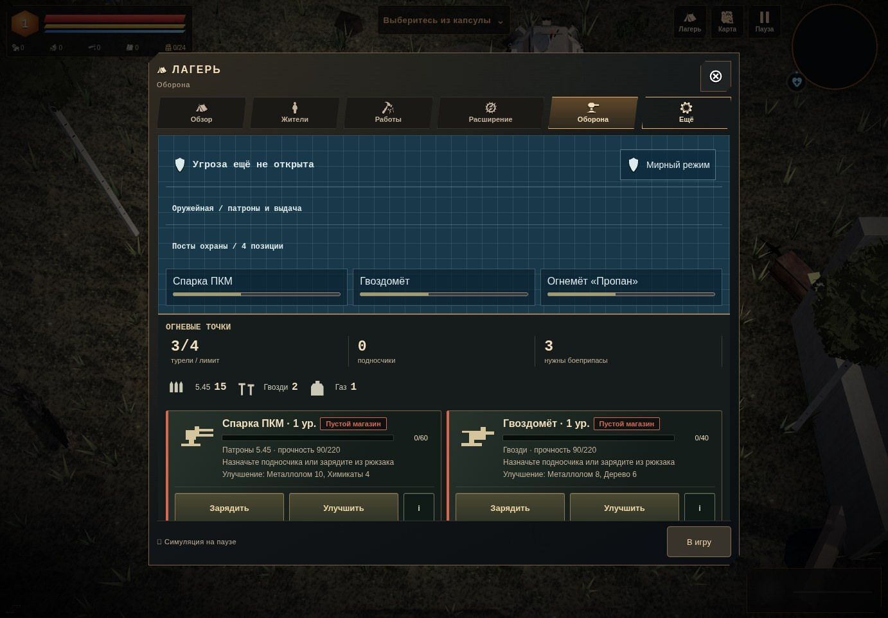
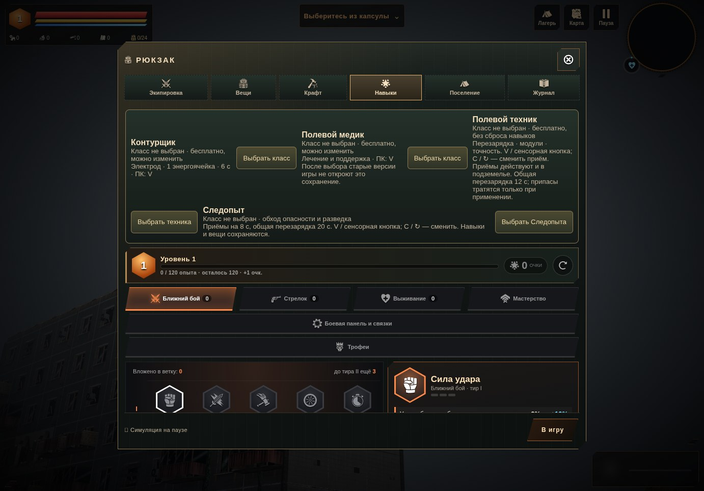
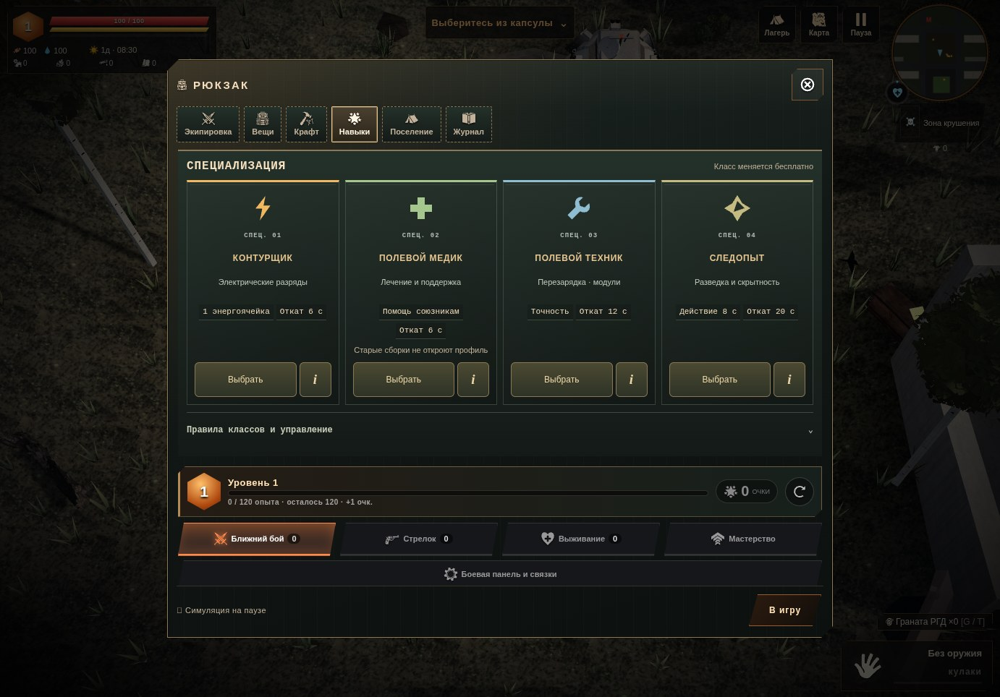

# Полевые досье · 0.4.36

«Жители» и «Оборона» приведены к языку уже существующих рабочих чертежей: бумажная картотека, номера дел, трафаретные подписи, схема позиций и силуэты снаряжения. Подписи остаются рядом с символами; цвет не заменяет название состояния.

Выбор класса в «Навыках» получил отдельные карточки специализаций, состояние выбранного класса и собственную область приёмов.

| Пустой лагерь до | Пустой лагерь после |
| --- | --- |
|  |  |

| Оборона до | Оборона после |
| --- | --- |
|  |  |

## Жители

Личный состав оформлен как картотека с номерами строк и контрастными карточками. Фильтры показывают символ, подпись и число; поиск сохраняет имя/профессию и прежний запрос после личного дела. Кнопка очистки имеет доступное имя и возвращает фокус в поиск.

Быстрые приказы открываются нарядом над списком. Выбранная работа видна в заголовке; раскрытый наряд переживает штатную перерисовку после смены задачи. Подробные правила назначения доступны внутри. Сами кнопки задач, рекомендация и обработчики назначения прежние.

Когда жителей нет вообще, отсутствуют пустой поиск, фильтры и сообщение «Нет свободного подходящего жителя». Вместо них — один лист с поиском выживших. Его кнопка раскрывает прежние условия найма, репутацию и сведения о караване; платный найм не заменён новым действием. На ПК окно уменьшается по содержимому, на телефоне сохраняется штатный полноэкранный каркас.

## Оборона

Угроза остаётся наверху. Оружейная и посты охраны раскрываются отдельно; штатные выдача оружия, ремонт, блокпосты и назначения доступны в них. Четыре пустых поста получили номера, а пустой выбор бойца сообщает, что доступных жителей нет.

Турели представлены чертежами с собственными SVG-силуэтами, названием, ценой, боеприпасом и требуемым уровнем героя. «Разместить» открывает штатный режим выбора места; нажатие само по себе не тратит ресурсы и не строит турель. Достигнутый лимит показан рядом с недоступной кнопкой.

Склад показывает 5.45, гвозди и газ раздельно. Снабжение читается как «Склад → Подносчик → Турель»; подробные правила открываются через `i`. Закрытие справки возвращает фокус к этой же кнопке. Передача припасов, зарядка, улучшения и назначение подносчиков используют прежние функции. Для пустого лагеря есть прямой переход к жителям.

[Жители на телефоне](portrait-residents.jpg) · [Оборона на телефоне](portrait-defense.jpg) · [Жители в альбомной ориентации](landscape-residents.jpg) · [Оборона в альбомной ориентации](landscape-defense.jpg)

## Специализации

| До | После |
| --- | --- |
|  |  |

У каждого класса — символ, роль, краткие базовые параметры и отдельная кнопка выбора. Выбранный класс отмечен штампом; его настоящие кнопки приёмов находятся ниже карточек. Справка открывает исходные правила конкретного класса, а возврат прокручивает к исходной кнопке `i` и восстанавливает фокус.

Предупреждение медика о совместимости остаётся на карточке. Штатное подтверждение техника или Следопыта показано широкой плашкой под всеми карточками вместе с исходным текстом, кнопками подтверждения и отмены. При этом классы сохраняют свои места. После перерисовки сохраняется фокус на выборе, отмене или приёме; ошибка и запрет изменения профиля остаются видимыми вне справки.

[Классы на телефоне](classes-portrait.jpg) · [Альбомная ориентация](classes-landscape.jpg) · [Подтверждение перехода](class-confirmation.jpg) · [Подтверждение на телефоне](class-confirmation-portrait.jpg) · [Выбранный техник](class-technician.jpg) · [Следопыт](class-scout.jpg)

`play/ui/class-dossier.js` переносит настоящие кнопки вместе с их `data-*`, поддерживает исходную разметку и уже оформленную старым `visual-fixes.js` плашку. Хеш состояния `data-circuit-view`, делегирование событий и функции выбора класса не изменены. Старое правило `.circuitClass div` растягивало эмблемы до 160 пикселей; в новом досье его влияние снято. На узких экранах проверяется отсутствие пересечения символов и названий.

## Проверка и устройство

`play/ui/camp-operations.js` дополняет существующий DOM: переносит настоящие кнопки вместе с обработчиками и оформляет состояние. Новые тексты, номера и векторные иллюстрации не меняют данные лагеря. Нативные фильтры иногда заменяют детей того же корня: заголовок и раскрытый наряд восстанавливаются и в этом случае. В `defense.js` изменён только слой представления после объявления публичного API; код симуляции, транзакций, сохранения и API побайтно совпадает с 0.4.35. Основной игровой бандл отличается только четырьмя подключениями и версией URL обороны. Модели, звук и опись архива прежние.

Самостоятельный сборщик теперь разбирает версию URL таблицы стилей так же, как версию скрипта. Новые JS и CSS входят в `terra.html`; отдельные файлы для интерфейса ему не нужны. Шрифты локальные, SVG собственные, новых внешних зависимостей, текстур и постоянных анимаций интерфейса нет. Используется наблюдение за изменениями DOM; новый покадровый опрос не добавлен.

`tests/camp-operations.py` использует одноразовый профиль: пустой лагерь, затем два жителя и три вида турелей. Проверяет реальные вкладки, найм, четыре поста, справку и возврат фокуса, быстрый приказ и его перерисовку, поиск/фильтр/личное дело/возврат, три размера экрана и отсутствие горизонтального переполнения управляющих элементов. Чтение разделов сравнивается с полным снимком лагеря, рюкзака, базы и сохранения.

Через настоящие кнопки проверены отказ записи при передаче гвоздей и полный откат, повторная передача на склад, зарядка ПКМ до 60, продолжение после перезагрузки и открытие чертежа без траты ресурсов. Состояние сохранений и правила экономики сохранены.

`tests/class-dossier.py` проверяет четыре карточки и исходную справку в трёх размерах, возврат фокуса и отсутствие изменений игрока/сохранения при чтении. Проверены настоящий выбор Контурщика, смена его приёма и снятие класса; открытие и отмена перехода техника без изменения профиля; реальный подтверждённый профиль v3, его приёмы; подтверждение Следопыта и продолжение после перезагрузки. Недопустимый профиль блокирует исходные кнопки и показывает причину вне справки. Размещение символов/названий и границы управляющих элементов проверяются также при подтверждении в трёх размерах. Медик проверен как карточка и справка; его реальный выбор отдельно не выполнялся.

Оба сценария прошли в веб-версии и самостоятельном HTML; их полные числовые отчёты совпали точно: [лагерь online](report-online.json), [лагерь offline](report-offline.json), [классы online](class-report-online.json), [классы offline](class-report-offline.json). Ошибок JavaScript нет. Прежний `tests/camp-list-return.py` также прошёл в трёх размерах: отфильтрованные личные дела, выбор цели, возврат, найм, фокус и неизменность лагеря при чтении.

Самостоятельный файл — **38 267 347 байт**, SHA256 **122b3651fa087d2869b5437b1e4ec8f3066d9f2e2f17bf83547e5b11a7029caf**. Он содержит 21 классический скрипт и 5 таблиц стилей; все новые слои включены в файл. Бюджет ассетов и форматы сохранений не меняются этой правкой; штатный выбор класса по-прежнему может выполнить существующий переход профиля с его предупреждением и копией.

Кадры сняты из реальной игры в Chromium/SwiftShader, 1382 × 964, 390 × 844 и 844 × 390. Для снимков игровой цикл остановлен и мир отрисован отдельно; это контроль интерфейса с тестовым лагерем, не запись анимации. Проверка размеров — эмуляция браузера, физический телефон и FPS не измерялись. Снимки и иллюстрации не являются новыми игровыми ассетами.
